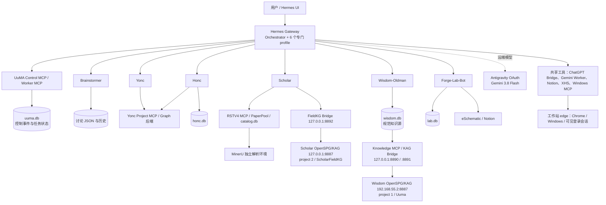

# UuMA Agent 架构与部分迁移评估

盘点日期：2026-10-21
范围：UuMA 仓库、当前 Hermes profile 配置，以及 Scholar 实际使用的 RSTV4 集成。只读检查；未更改服务、配置、数据库或任务状态。

后续用户确认迁移五个 Agent（Brainstormer、Yonc、Honc、Wisdom、Forge），Orchestrator 与 Scholar 留在工作站；目标为 `alandelone-server-001`。最新 SSH 实查、控制服务方案与风险见 [五个 Agent 服务器迁移讨论稿](five-agent-server-discussion-2026-10-21.zh-CN.md)。

## 结论

- **可以分开部署，但应按数据所有权和运行依赖拆服务，不宜只按 Agent 名称搬目录。** Agent 是 Hermes profile；调度、数据库、MCP 工具和领域引擎各有自己的运行边界。
- 当前七个 profile（Orchestrator 加六个 specialist）的主要聊天模型都配置为远端 `gemini-3.8-flash` / `antigravity-oauth`。把这些 profile 搬到 CPU 服务器不会释放本机 LLM GPU，因为主要推理本来就走远端 API。
- 当前能确认的本地模型路径以 CPU 为主：Wisdom 的 BGE-M3 默认选 ONNX/CPU；Scholar 的 MinerU 设备配置读到 `cpu`。Scholar FieldKG 的 BGE-M3 使用 CUDA-enabled KAG 环境，但项目配置没有固定设备，服务健康数据也不报告设备；应先将它列为“可能使用 GPU”，不能断言它当前正在使用 GPU。
- **建议把工作站留作 edge host**：Hermes/用户界面、Windows 控制、Chrome 可见浏览器和需要本机登录的连接留在桌面侧；在 CPU 服务器部署 UuMA 控制/API 与低 GPU 依赖的 profile；把是否启用 GPU 的 Scholar FieldKG/MinerU 作业作为独立 worker 决策。
- 当前 MCP 配置以本机 stdio 命令为主，路径和 `127.0.0.1` 地址写在 profile 配置中。直接把单个 profile 移到远端不会自动连上本机数据库或工具；需要把其依赖一起迁移，或提供有认证的网络 API/远端 MCP。

## 当前架构图

图中数据库是各自的权威源；投影、工具桥接和缓存不能取代其所有者。OpenSPG/KAG 是可重建投影，不是 Wisdom 或 Scholar 的规范知识库。

**当前端点要分开看：** Scholar FieldKG 的运行配置指向 `http://127.0.0.1:8887`（项目 2，`ScholarFieldKG`），其本机桥接为 `http://127.0.0.1:8892`。Wisdom 的 KAG 配置指向 `http://192.168.55.2:8887`（项目 1，`Uuma`），Wisdom/Orchestrator 的本机桥接分别为 `127.0.0.1:8890` 和 `:8891`。因此当前配置下它们虽然使用相同端口号 `8887`，实际目标主机和 OpenSPG 项目不同。Wisdom 的 `notion_kb` MCP `http://192.168.55.2:4000/sse` 是另一项服务，不是 KAG。

## Agent、共享工具和职责交界

| Agent | 主要职责 / 权威数据 | 当前 profile MCP | 与谁交叉 | GPU 状况 |
|---|---|---|---|---|
| Orchestrator（Hermes 默认 profile） | 建任务、分配、协调、审批和控制策略；`uuma.db` 是控制源 | `uuma-control`、ChatGPT Bridge、Gemini Worker、Knowledge MCP、Notion、Windows MCP、XHS | 与 Brainstormer/Yonc 都参与拆解，但 Orchestrator 拥有调度和审批；与 Wisdom 共用 Knowledge MCP | 主模型是远端 API；Windows/浏览器工具依赖本机 edge |
| Brainstormer | 问题澄清、挑战假设、方案收敛；独立讨论状态 JSON | `uuma-worker`、Gemini Worker、ChatGPT Bridge、`notion_kb` | 与 Orchestrator 在规划阶段重叠；结构变更仍交给 Orchestrator 审查 | 未发现本地 GPU 推理 |
| Honc | 记录真实执行事实、回合/习惯/完成判定；`honc.db`，并通过 Graph 回写 | `uuma-worker`、`honc-execution` | 与 Yonc 都触及任务进度，但 Honc 记录执行事实，Yonc 拥有项目结构和接受状态 | 未发现本地 GPU 推理 |
| Yonc | Graph 项目管理、拆解、角色能力查询和任务分配建议；外部 Graph 后端 | `uuma-worker`、`yonc-project` | 与 Orchestrator 在拆任务/指派上相邻；与 Honc 通过任务完成回写衔接 | 未发现本地 GPU 推理 |
| Scholar | 科研生命周期、论文集合、实验、引用和科学审查；RSTV4 `catalog.db` | `uuma-worker`、独立 `rstv4-worker` | 与 Wisdom 都研究资料，但 Scholar 管可复现科研资产，Wisdom 管跨领域长期知识；数据库分离 | 主模型远端；MinerU 当前设备为 CPU；FieldKG BGE-M3 设备未固定，GPU 使用待确认 |
| Wisdom-Oldman | 通用知识形成、证据、主张、冲突和知识问答；`wisdom.db` | `uuma-worker`、`wisdom-knowledge`、Gemini Worker、ChatGPT Bridge、`notion_kb`、XHS | 与 Scholar 的主题/论文来源有交叉，但知识所有权、审批和数据库边界明确 | BGE-M3 本地模型路径存在；当前 `auto` + ONNX 文件选择 CPU。CUDA 是显式可选路径 |
| Forge-Lab-Bot | 实验室库存、采购建议、Build/As-Built 和工程经验；`lab.db`，设计数据归 eSchematic | `uuma-worker`、Gemini Worker、ChatGPT Bridge；领域工具经 Worker 身份门控 | 与 eSchematic 通过设计清单/反馈桥接；设计 BOM 和实物库存不可混为一源 | 未发现本地 GPU 推理；eSchematic/硬件连接位置需按实际部署决定 |

Forge 还关联 Chrome 订单采集链路：Chrome 扩展在浏览器侧解析页面，UuMA 后端负责任务、归档和库存证据。因此可以把后端迁走，但需要保留一个在用户 Chrome 上运行的 edge connector。

### 交叉程度

- **共享运行底座：高。** 所有 profile 使用 Hermes；Worker MCP 是同一实现按 `UUMA_AGENT_ID` 区分身份。主模型提供方相同。任务路由基于 capability、工具、风险和负载；多个 Agent 同时匹配时回到 Orchestrator 消歧。
- **业务职责交叉：中等且有明确边界。** Honc/Yonc（执行事实 vs 项目管理）、Scholar/Wisdom（科研资产 vs 通用知识）、Brainstormer/Orchestrator（推理产物 vs 调度审批）都有交界，但设计上不是同一个责任源。
- **配置漂移需要审查。** 仓库权限文档写 `xhs` MCP 仅给 Orchestrator；当前本机 Wisdom profile 也配置了 `xhs` 命令，且该 profile 的 guard 配置列出了 `xhs`。本次没有调用该 MCP，也没有改权限。拆分前应确认这是不是用户有意授权，并同步配置和文档。
- **架构文档有版本差。** `README.md` 和 `docs/architecture/system-architecture.md` 仍描述四个 specialist；当前部署配置有六个（还包括 Honc、Yonc）。拆分实施前应更新这两份总览，避免按旧清单部署。

## 技术栈与 MCP 清单

**UuMA 核心：** Python 3.11–3.13、FastAPI、Pydantic、MCP SDK 1.26、SQLite；本地 HTTP 控制/API 默认只监听 `127.0.0.1:8766`。PowerShell 负责 Windows 部署/计划任务。Chrome 扩展为 Manifest V3 JavaScript。浏览器自动化、OpenSPG/KAG 使用隔离运行环境。

**领域引擎：** Scholar 使用独立 Python RSTV4/PaperPool、MinerU/Magic-PDF Conda 环境和 ScholarFieldKG；Wisdom 使用 `wisdom.db` 加 OpenSPG/KAG 0.8/Neo4j 投影；Yonc 接独立 Graph Project System；Forge 接 eSchematic、`lab.db` 和 Notion；ChatGPT Bridge 驱动本机 Chrome 的可见 ChatGPT 会话。

| MCP / 工具 | 谁使用 | 运行/数据边界 |
|---|---|---|
| `uuma-control` | Orchestrator | 控制平面 MCP；写入 `uuma.db` 事件/API |
| `uuma-worker` | 六个 specialist | 同一 Worker 实现按身份限制；各 profile 当前以本机 stdio 子进程启动 |
| `wisdom-knowledge` | Wisdom、Orchestrator | 语义 Knowledge API；只接触 `wisdom.db` 和 KAG 投影 |
| `honc-execution` | Honc | Honc 领域工具；回写 Yonc Graph 时保留来源和回执 |
| `rstv4-worker` | Scholar | 独立 RSTV4 MCP 和 `catalog.db`；不是普通 Worker 工具的替代品 |
| `yonc-project` | Yonc | 独立 Graph 项目 MCP |
| `chatgpt-bridge` | Orchestrator、Brainstormer、Forge、Wisdom | 本机服务与 Chrome 扩展/可见登录会话；不是另一个 Agent |
| `gemini-worker` | Orchestrator、Brainstormer、Forge、Wisdom | 模型/搜索工具适配器；不是 GPU 模型服务器 |
| `notion` / `notion_kb`、`xhs`、`windows-mcp` | 按 profile 配置 | 外部或本机连接器；服务账户和本机凭证是迁移依赖 |

Hermes plugins（例如 control guard、审计/Observability、Honc life 和 Telegram 命令插件）与 MCP 是两类接口：插件挂在 Hermes 生命周期/界面中，MCP 提供 Agent 调用的工具服务。

## GPU 盘点

| 路径 | 本次证据 | 判定 |
|---|---|---|
| Agent 主聊天模型 | 七份当前 profile 配置均为 `gemini-3.8-flash` + `antigravity-oauth` | 远端推理；不会占用本机 GPU 来运行主 LLM |
| Wisdom BGE-M3 | 本地模型/ONNX 文件存在；当前 profile 未设置 `UUMA_BGE_BACKEND` 或 `UUMA_BGE_DEVICE`；桥接代码默认 `auto`，有 ONNX 文件时选 CPU ONNX Runtime | 当前配置是 CPU。FlagEmbedding/CUDA 是显式可选项 |
| Scholar MinerU | 当前独立 `ragent-mineru122` 环境的 `magic_pdf.get_device()` 返回 `cpu` | 当前 CPU；解析是长任务 worker，迁移时需保留已排队作业及原有文件路径映射 |
| Scholar FieldKG BGE-M3 | ScholarFieldKG 使用本机 FieldKG bridge 和 BGE-M3 配置；它复用安装了 CUDA PyTorch/FlagEmbedding 的 KAG 环境，但没有固定设备字段 | GPU-capable / 状态未证实；迁移前应查实际运行健康/日志并固定 CPU 或 CUDA 选择 |

**因此，如果目标是释放本机 GPU，搬走 Brainstormer、Honc、Yonc 或 Forge 不会产生主要 GPU 收益。** 应先验证 FieldKG BGE-M3 是否真的用 CUDA；再决定把它放在 GPU worker、固定为 CPU，还是与 Scholar 的解析作业一并迁移。若目标是降低本机常驻进程、内存和维护负担，CPU profile 仍然适合迁移。

## 推荐的拆分和迁移顺序

1. **先确定目标服务器条件：** OS、CPU/RAM/磁盘、GPU/VRAM、能否连到用户工作站的私有网络、是否允许保存模型/账户凭证。当前配置含 Windows 绝对路径、登录态和 loopback 服务，不能原样复制到 Linux。
2. **先形成统一服务边界：** 将 `uuma.db` 的单一所有者/API 放在一个位置；profile 可同机运行其本地 stdio MCP，跨主机部分则需要认证 HTTP/远端 MCP。不要让两台机器直接同时打开同一 SQLite 文件。
3. **CPU 服务器第一批候选：** Brainstormer、Yonc、Honc，以及 UuMA 控制/API。它们没有发现本地 GPU 推理；但迁移时要一起安置其状态和 Graph/通知依赖。Orchestrator 的 Windows/Chrome/可见登录工具先保留在 edge，除非服务器能提供受控的远端桌面代理。
4. **第二批按数据所有者迁移：** 若要搬 Wisdom，连同 `wisdom.db`、Knowledge MCP、KAG Bridge 和 OpenSPG 项目一起规划；当前 BGE 默认 CPU。若搬 Forge，需同时规划 `lab.db`、eSchematic 和 Notion 接入，实体硬件/桌面工具可保留 edge。
5. **Scholar 最后拆：** 先保持 `catalog.db`、PaperPool 队列和原始 PDF 有一个所有者；再决定 MinerU CPU parser 与 FieldKG BGE 是放在 CPU 服务还是 GPU worker。不能因迁移而重置或重复执行当前保留的科研队列。
6. **逐个数据库迁移：** 先排空/冻结单个写入者，备份并比对表、行数和关键业务回执，再切换服务地址；保持原数据库只读一段时间，具备回滚路径。禁止跨库 JOIN 或把 Hermes `state.db` 当作共享数据库。

## 尚需用户提供的信息

真正开始迁移前，需要目标服务器 OS、CPU/RAM/磁盘、GPU/VRAM、与工作站的网络方式，以及哪些 Chrome/Windows/硬件操作必须留在本机。当前 `mission_status.json` 仍是 `verification / pending_review`；本盘点没有改变阶段或 gate。
