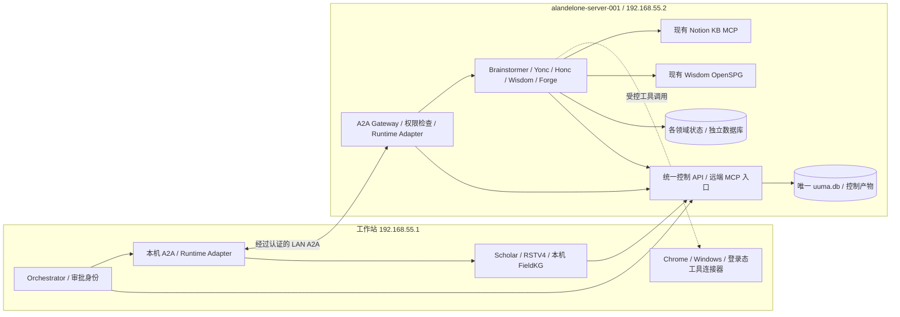

# 五个 Agent 迁移、A2A 与开发发布讨论稿

日期：2026-10-21（Asia/Kuala_Lumpur）。本次完成 SSH 只读检查与架构评估，尚未执行迁移、安装、服务重启或配置切换。Mission 保持 `verification / pending_review`。

## 已确认范围

- 迁移：Brainstormer、Yonc、Honc、Wisdom-Oldman、Forge-Lab-Bot，共五个。
- 留在工作站：Orchestrator、Scholar。Scholar 的 RSTV4、PaperPool、科研队列与 FieldKG 运行环境留在本机。
- 用户已确认浏览器、相关登录态与桌面连接器留在工作站。工作站离线时，依赖这些工具的步骤等待或明确阻塞；具体恢复策略列入下方决定项。
- 日常开发与 Agent 的角色、技能改进在工作站完成；服务器运行可追踪的发布副本。
- 用户最新澄清：手动更新，以最新已确认代码为目标；各主机与 Agent 按实际变更及共同依赖影响分别更新，没有变化的部分继续运行。此前“整套统一切换/所有运行版号一致”的解释已被这次澄清取代。其他架构建议按下文已确认表记录。
- 目标：`alandelone-server-001`，本机解析到 `192.168.55.2`。SSH 已通过现有 IP 配置、既有密钥和可信主机记录成功登录；未更改 SSH 信任记录或账户凭证。
- “Agent 留在工作站”与“控制数据库放在哪里”是两项独立决定。集中控制服务可以在服务器运行，Orchestrator 仍保留本机进程与审批身份。

## 服务器实查

以下是本次快照，不能代表业务高峰容量。

| 项目 | 实际读到的状态 | 对迁移的影响 |
|---|---|---|
| 系统 | Ubuntu 24.04.4 LTS / x86_64 | Windows 虚拟环境、盘符和计划任务需适配 Linux |
| CPU | Intel Core i5-7500，4 个逻辑核 | API 型 Agent 可作为候选；BGE 嵌入、浏览器任务需要控制并发 |
| RAM | 15.48 GiB 总量，约 11.60 GiB 可用 | 具备初步余量；不能把五个 Agent 与重模型任务视为无限并行 |
| 磁盘 | 根盘 226.82 GiB，约 168.03 GiB 可用 | 仍需统计 Wisdom 源文件、历史和备份大小；多个显示路径共用同一根盘 |
| GPU | 未找到 `nvidia-smi`，PCI 显示 Intel HD Graphics 630 | 当前无可依赖的 NVIDIA CUDA GPU；Wisdom 应按 CPU ONNX 路线规划 |
| 基础软件 | Python 3.12.3、Node 22.22.0、Git 2.43.0、Docker 29.1.3 | 具备部署基础，领域包仍需在 Linux 新建隔离环境 |
| 已有 OpenSPG | OpenSPG、Neo4j、MySQL、MinIO 容器运行中 | 已有知识基础设施需要复用和保留，避免重复 bootstrap 或覆盖项目 |
| OpenSPG 内存 | OpenSPG 约 1.88 GiB，Neo4j 约 0.96 GiB，其余数据库/存储另计 | 新增常驻 BGE 与浏览器会与现有服务竞争资源 |
| Notion KB | `notion-mcp.service` active，描述为 `Notion Local Knowledge Store MCP Server (Port 4000)` | 确认是独立的 Notion 本地知识存储 MCP 服务；不是 KAG 端点 |
| 其他服务 | NAS WebDAV、Cloudflare tunnel 等已运行 | 目标并非空机器；新部署需要独立目录、端口、服务单元和资源限制 |

### 网络观察

- 本次 SSH 的工作站来源地址为 `192.168.55.1`，服务器私网地址为 `192.168.55.2`。
- 从服务器向工作站 `8766`、`8787`、`8890`、`8891`、`8892` 进行短 TCP 连接检查，均超时。
- 工作站当时的 `8766`（UuMA API）与 `8787`（ChatGPT Bridge）只监听 `127.0.0.1`；当时未发现其余三个端口的监听。超时本身不用于判断具体是哪条防火墙规则。
- 跨机访问尚未成立。应选择经过认证的服务入口，或经 SSH 转发；不能让远端 Agent 继续使用自己的 `127.0.0.1` 来寻找工作站工具。

## 首要架构决定：唯一的控制状态放哪里

当前 `mcp_worker._control_plane()` 与 `mcp_control._control_plane()` 直接创建 `ControlPlane`。`ControlPlane` 再通过 `EventStore` 打开 `Settings.database_path`，默认是 `UUMA_DATA_DIR/uuma.db`。它们目前没有自动切换为远端 HTTP 客户端的行为。

这意味着复制五个 profile 到 Linux 后，如果继续沿用当前调用路径，就会各自在目标目录打开或创建控制库。两份控制历史会让分配、进度和结果无法形成同一个事实来源。禁止通过同步两份数据库或跨机器直接打开共享 SQLite 文件解决。

| 控制部署方式 | 好处 | 代价与风险 |
|---|---|---|
| **服务器统一拥有 UuMA API、`uuma.db` 与控制产物（建议方向）** | 五个服务器 Agent 的任务状态不依赖工作站持续开机；容易集中监督和备份 | 本机 Orchestrator、Scholar 的控制调用需要接入服务器；Orchestrator 的控制身份与审批权继续保留 |
| 控制/API 暂时留在工作站 | 本机控制链条调整较少 | 五个 Agent 的控制上报、领任务与协调受工作站开机和网络影响；远端 Worker 同样需要新的接入方式 |

现有 HTTP API 已有身份与 Bearer token 验证，以及 direct-run、assignment、heartbeat、block、result 等 Worker 入口，可作为跨机接入基础。也可以评估经 SSH 在数据所有者一侧运行 stdio MCP。两种方式都需要逐工具确认语义、权限和超时，不能把包含本机领域运行时的整个 MCP 无差别搬走。

按用户已经接受的方向，初始部署与通信边界如下；对应代码与部署仍待实现：

图中的 `Five` 是部署位置汇总，不表示所有 Agent 获得相同领域数据库、KAG 或 MCP 权限。

## 需要优先讨论的风险

### 1. 桌面工具已确定留本机，离线步骤需要等待

把五个 Agent 的进程搬走，可以让其远端模型与服务器数据任务常驻。Brainstormer、Wisdom、Forge 使用的 ChatGPT Bridge 仍依赖本机 Chrome；Forge 的采集、订单捕获、可见登录态与 Windows 任务也存在桌面依赖。服务器进程能运行，不代表这些工具在工作站离线后仍可用。

用户已确认保留桌面连接器和浏览器登录态。需要将依赖桌面的步骤保存为等待或明确阻塞，并规定超时、过期与恢复条件。当前 Forge `_wake_forge_journal_runner()` 在非 Windows 下直接返回 `UNSUPPORTED`；Agent 放在 Linux 后，此类动作需要路由到工作站上的受控连接器，不能继续假定服务器本机存在 Windows 任务。

### 2. Scholar 留本机，但共享依赖不能误删

Scholar FieldKG 的 `.rstv4-local/fieldkg/runtime.json` 引用本机 UuMA 的 KAG Python 环境。Wisdom 和 Scholar 共用过安装环境，不代表它们使用同一个 OpenSPG 端点：

- Wisdom：本机桥接 `8890`／Orchestrator 桥接 `8891`，KAG 项目配置指向 `192.168.55.2:8887`，项目 1 / `Uuma`。
- Scholar：本机桥接 `8892`，FieldKG 项目配置指向 `127.0.0.1:8887`，项目 2 / `ScholarFieldKG`。

迁移 Wisdom 时需要保留 Scholar 引用的本机 Python 环境、模型路径和本机项目。Wisdom 的服务器侧 OpenSPG 已经存在，不需要以“迁移 Agent”为由重新创建或替换它。

### 3. Wisdom 数据搬走后，Orchestrator 仍需要访问它

迁移范围要覆盖 `wisdom.db` 与其 `wisdom-content` 源文件，以及 Knowledge MCP/KAG Bridge 的部署位置。Orchestrator 目前也通过 Knowledge MCP 使用该知识源，所以需要接到服务器上的语义知识接口。

文件身份检查确认：工作站 `AppData/Local/UuMA/wisdom.db` 与 Codex 包缓存目录中的那条路径解析到**同一个实际文件**，并非两份知识库。当前文件约 453,709,824 字节，约 433 MiB。Forge 也有显式数据路径覆盖。迁移清单要记录实际文件、路径别名和源文件目录，避免漏拷贝或误以为存在两套权威库。

### 4. Orchestrator 的权限与服务器位置分开

控制服务放服务器不改变审批归属。现有 API 区分 `control`、`worker`、`ingest`；五个 Agent 应各有 Worker 身份，不能共享 Orchestrator 的控制 token。仅在进程环境里填写 `UUMA_AGENT_ID` 不能替代跨机身份认证。

Wisdom 当前 XHS 权限配置与文档边界不一致仍待核对。迁移时应以确认后的工具授权表为准，避免把同一主机上的所有服务都暴露给五个 Agent。

### 5. 断线重试不能变成重复操作

跨机后会出现“服务器做完了，工作站没收到回执”或“Agent 上报成功但响应超时”。需要保留现有任务/Run 身份、幂等键和事件历史，重连先查状态，不能盲目再次执行 Honc 完成回写、Yonc Graph 变更、Notion 写入或 Forge 订单任务。

每次切换只允许一个活动的旧/新执行者。Hermes 的会话、记忆、定时任务与接入渠道也需单独盘点；如果同一机器人入口在两台机器同时启动，会带来重复消费或冲突。Hermes `state.db` 保持自己的用途与边界。

### 6. 这台服务器的 CPU 与常驻服务需要预算

五个主聊天模型目前走远端 API，因此资源评估重点是本地 MCP、BGE、浏览器和已有数据库服务。i5-7500 的四核算力有限，应先控制嵌入和浏览器并发，避免 Wisdom BGE 批量工作拖慢 OpenSPG、Honc 或其他服务。需要核对两条 Wisdom 桥接是否能共享受控的嵌入执行服务，避免每个进程都重复加载模型。

账号授权应由迁移后的运行账户独立管理，并确认 OAuth 刷新和自动恢复能在 Linux 下运行；Windows `.venv`、凭证目录和计划任务不可直接当作可移植运行环境。仓库版本和配置需要固定，保持两端的请求与事件格式一致。

## 分享内容与 A2A 的整合

已完整阅读用户提供的 [A2A 架构建议分享对话](https://chatgpt.com/share/6ad83b99-5fe8-83ec-811b-d1596945903b)。对话早期讨论了多节点消息中间件，随后因用户明确目前只有 `192.168.55.1` 与 `.2` 两台局域网电脑，最终收敛为直接使用 A2A 接口、轻量适配层和现有任务存储。该结论与本次范围相符。

分享中的示意图把控制存储放在工作站，这是示例假设。用户已接受本讨论稿将它放服务器的建议，以便工作站关闭时仍保存任务、回执和等待状态。Orchestrator 的 LLM 进程若留在工作站，关机后也会离线。服务器的控制程序持续运行，并不表示会自动获得一个在线的 Orchestrator 来处理新的语义拆解或审批。

### 建议的通信边界

- A2A 用于 Agent 发现、任务请求、进度、结果与关联会话，复用正式协议和 SDK，兼容后续非 Hermes Runtime。
- UuMA 的 Task、Run、事件链、权限和验证仍定义业务事实；领域数据库继续由各自所有者负责。
- MCP 与桌面连接器继续负责工具访问。A2A 请求不会自动赋予数据库、桌面操作或知识应用权限。
- 近期保留两台 LAN 主机的简单部署。持久化派发、回执和重连核对放在控制服务中，暂不增加专用消息中间件。

[A2A 官方规范](https://a2a-protocol.org/latest/specification/)定义了 Agent Card、任务状态、关联会话以及取消请求；发送消息的幂等性可以由实现提供，不能把使用 SDK 当成业务去重保证。协议级任务完成也不等于 UuMA 的业务验收通过。

### 现有组件与增量工作

| 当前已有 | 建议补充的边界 |
|---|---|
| AgentDefinition、能力/权限路由 | 在现有注册体系上关联 Node、Runtime、A2A endpoint 和受信身份，不再新建一套竞争性的业务注册表 |
| TaskContract、Run、幂等键、execution epoch、验证记录 | 关联远端 Task ID、Runtime Run ID、会话标识、执行版本；保留原验收与旧执行者隔离规则 |
| HermesKanbanAdapter 与 HermesRunClient | 在适配层连接现有 Hermes 执行入口；给其他 Runtime 保留同一适配契约 |
| Append-only event store | 派发意图、接收回执和结果核对；失败后先查状态，再决定重发 |
| Worker/Control MCP 与身份 API | 跨机客户端与服务入口；领域本机工具继续由其本机执行 |
| 多 profile Hermes gateway | 按主机分配实际运行的 profile 和入口凭证，避免同一机器人由两台机器同时接收 |

本次检查未在当前 `src/uuma` 与依赖清单中找到已接入的 A2A SDK/协议引用。现有代码可作为适配基础；A2A 尚属待实现的设计。

跨机 A2A 建议由每台机器的轻量 Gateway/Adapter 接入。每个 Agent 仍有自己的身份、能力与 endpoint 路由。允许接口集中，不把五个 Agent 合成一个拥有全部权限的身份。

Agent 的多轮讨论需要关联会话、参与者、轮数/预算上限和结束条件。咨询回复作为建议；创建子任务、对外写入与知识应用继续经过 UuMA 的对应权限边界。A2A 取消请求也不能当作已执行操作的撤销。

## 工作站开发、服务器运行的 Git 流程

### 源码保持可在工作站完整编辑

当前主仓库已有 GitHub origin `alandelone/UuMA`。检查时分支为 `master`，HEAD 为 `c9c6f59`，工作区有大量未提交修改与新增文件。迁移前要先把准备发布的内容整理成可审查版本；仅部署当前 HEAD 可能缺少工作站上正在使用的修改。现有未提交内容不应被全量自动提交或清理。

建议继续保留一个 UuMA 主仓库，按模块和 Agent 目录组织共同控制逻辑、适配层与配置模板。已经独立的 RSTV4、Yonc Graph、eSchematic 等领域引擎保持原仓库边界，并在部署记录中固定其版本。暂时不需要把每个 Hermes profile 拆成独立 Git 仓库。

| 想改的内容 | 工作站上对应的版本化位置 | 变更与发布影响 |
|---|---|---|
| Agent 的角色、语气、主题处理方法 | 现有 `profiles/<agent>/SOUL.md` | 该 Agent 的 profile 更新 |
| 工作流程与专门技能 | 现有 `profiles/<agent>/skills/**/SKILL.md` 及必要资源 | 对应技能与依赖一起发布 |
| 工具行为与领域能力 | `src/uuma` 下相应模块，或领域引擎原仓库 | 该执行单元及其契约依赖 |
| 共同任务模型、路由、认证、A2A 映射 | UuMA 共同模块与契约 | 需要两侧兼容性检查，可能协调更新多个执行单元 |
| 当前讨论主题、执行事实、知识条目 | 通过所属服务/API 维护 | 属于运行数据，不通过 Git 发布来覆盖 |

生产配置中的机器路径、密钥与 OAuth 登录态留在各自主机；Git 保存模板、非敏感规则和部署描述。现有 `Sync-ProfileSoul` 已区分托管内容、自定义内容和待处理冲突，Linux 发布流程应保留这种语义。

### Agent 目录与 Git 版本的区别

同一 Git 仓库的 commit 记录整个仓库快照。按 Agent 分目录可以让修改范围清楚，但不会自动为每个 Agent 产生独立的 Git 版本历史。单独的功能分支也不等同于单独的产品版本。

建议 UuMA 保持一个共同 Git 历史，每个可部署组件另记录自己的实际运行版本、来源 commit、profile/技能摘要与依赖版本。发布时比较最新已确认提交与各组件实际运行内容：有变化或受依赖变更影响的组件才更新；没有变化的组件可以保留上次部署来源 commit，并显示“已符合当前目标版本”。不强求所有 Agent 的运行版号相同，也不需要因此为每个 profile 建立独立 Git 仓库。

例如一次只修改 Wisdom 的 `SOUL.md`，Git 仍产生一个整个仓库的新 commit，但部署影响可能只有 Wisdom。若修改的是共同 A2A 契约、认证、Worker MCP 或依赖锁文件，则需要把受影响的其他组件纳入发布。不能只根据 Agent 自己的目录有没有变化来判断。

已经独立的领域引擎继续保留自己的 Git 历史，通过部署清单固定其兼容版本。清单可以继续使用某个引擎原有版本；一次发布只更新实际选定的变化与受影响依赖。

### 建议的日常改进路径

日常修改在工作站 clone 完成，例如为一次 Wisdom 改进使用 `codex/refine-wisdom-*` 短期分支。需要 Linux 调试时，也可通过 SSH 操作服务器的独立 staging checkout；调试修复仍回到同一个 Git 提交链。

服务器的生产发布目录按确定 commit 建立，数据目录与其分开。通过 SSH 拉取已选版本、准备环境并切换目标服务。避免在运行中的 checkout 原地改变代码，以免长任务混用新旧模块。多个开发分支可使用 [Git worktree](https://git-scm.com/docs/git-worktree)隔离；不把工作站和服务器直接共享为同一个可写工作目录。

更新范围需要依据真实执行单元实现。现有默认 gateway 会 multiplex 多个 profile，两台主机需要明确各自负责的 profile 与机器人入口；如果某项更新需要重启共同 gateway，应把它实际影响的其他 Agent 列入发布预览。按 Agent 分目录本身不保证运行进程已经独立。

staging 使用独立数据、端口、会话和测试入口，避免重复接收生产机器人消息。每次 Run 建议记录代码 SHA、profile/技能摘要、依赖版本与协议版本。共同契约升级须检查新旧兼容性；切换须识别正在运行或保留为暂停的任务，不能把发布当作重新执行任务的指令。

Git 版本回退只能回退代码。若变更涉及数据库 schema、知识迁移或已完成的外部写入，需要单独的备份、兼容方案或补偿流程。历史数据库、账号、运行日志、Hermes 会话与知识源文件不应作为代码版本切换的覆盖对象。

## 已确认的架构与发布决定

用户确认其他架构建议，并进一步解释了发布意图：手动更新到最新已确认的代码；各处按实际变更分别更新，无变化的部分不需要更新。用户将发布技术细节交由本方案选择合理默认值。以下记录不改变当前 mission gate，也不表示已经执行部署。

| 决定 | 已确认方向 | 实际影响 |
|---|---|---|
| 唯一控制/API 与 `uuma.db` 的位置 | 放 `alandelone-server-001`；Orchestrator、Scholar 以本机客户端接入 | 工作站离线仍保存全局状态，但本机控制调用需要适配 |
| Orchestrator 离线时的授权边界 | 继续已授权任务与既有权限内的工作；需要新增审批/语义拆解的请求等待 | 保持现有决策归属；若希望低风险新委派自动处理，需另行确认明确的预授权策略 |
| A2A 第一版的协作范围 | 跨机派任务、进度/结果，以及有限、可审计的咨询会话 | 自动创建子任务、讨论轮数、预算和终止条件需在权限设计中明确 |
| 桌面离线时的恢复行为 | 保存等待状态；上线后先检查任务是否仍有效，再恢复安全步骤；过期请求交回确认 | 防止旧的浏览器或对外写入请求在很久以后自动执行 |
| 第一版的管理范围 | 任务、能力、状态与健康；发布和服务重启保持明确运维动作 | A2A 不直接扩张为任意远端命令执行入口 |
| 发布方式 | 工作站开发，隔离 staging，人工触发；按组件内容与共同依赖影响分别更新 | 版本目标来自最新已确认代码，无变化的组件继续运行；各 Agent 的实际运行来源 commit 可不同 |

### 发布技术细节采用的默认行为

1. **目标与实际版本分别显示：** 目标是最新已确认的 Git 提交；每个组件显示其实际来源、内容摘要，以及相对目标的“已符合/待更新/不兼容/等待上线”状态。主机位置、数据所有者和 Agent 身份保持已确认的分工。
2. **按影响范围等待任务：** 默认只暂停受影响执行单元接新任务，等待当前工作结束后切换；没有变化、没有依赖影响的 Agent 继续运行。长任务未结束时推迟该组件更新，不默认强制中止。
3. **暂停任务保持暂停：** 保留原运行版本与恢复标识，发布不触发任务恢复。若新版本与该任务状态不兼容，保留可恢复的旧代码/环境或另行设计迁移，不能重跑来代替恢复。
4. **先给出发布预览：** 列出变更的组件、牵连的共同服务、预计等待点与可用回滚版本；明确触发发布后才执行。工作站暂时离线时，保留它的待更新状态，通过兼容性检查限制不受支持的调用。

后续可在试点中细化咨询轮数、预算、桌面等待期限和执行并发。这些是受版本管理的可调配置；不会因 Agent 自行提出要求就无限扩大。

首个非 Hermes Runtime 如果已确定，可作为互操作验收对象；尚未确定时，先实现正式协议边界和 Hermes Adapter，不额外安装无使用对象的 Runtime。首个迁移试点建议选只读咨询任务，再覆盖持久化状态、知识源与 Forge 桌面依赖。

后续实际切换需要验证：远端身份权限、端到端任务回执、超时后的幂等恢复、单一数据库所有者、桌面离线时的预期行为，以及保留在本机的 Scholar 链条。此次没有启动推理、重放科研任务、进行业务写入或负载测试。

## 三条实施工作线：细节核对清单

本节将用户已确认的方向细化为待实施事项。所有未勾选项都是后续工作，不表示当前系统已经具备对应能力；阶段门继续以 `mission_status.json` 为准。

### 一、迁移与数据位置

- [ ] 建立主机分工清单：服务器运行 Brainstormer、Yonc、Honc、Wisdom、Forge；工作站运行 Orchestrator、Scholar 和桌面连接器。源码所在目录与实际启动的 profile 清单分开记录。
- [ ] 将唯一控制/API、`uuma.db` 与控制产物的所有者定位到服务器；本机 Orchestrator、Scholar 和服务器 Worker 都接入这一个控制源。移除对“每个 MCP 都打开自己本机控制库”的隐含依赖。
- [ ] 逐项列出实际数据位置和写入者：Brainstormer JSON、`honc.db`、`lab.db`、`wisdom.db`、`wisdom-content`、附件与产物，以及 Hermes 自己的会话、记忆和定时任务。控制库、知识库、领域库和 Hermes `state.db` 保持各自用途。
- [ ] 处理 Windows 路径别名：已确认两条 Wisdom 数据库路径指向同一实际文件，迁移按真实文件与源文件目录执行；不要把 junction/缓存路径误认为另一套数据。Forge 的路径覆盖也列入清单。
- [ ] 复用服务器现有 Wisdom OpenSPG 项目 1 / `Uuma`，记录其持久化位置和回滚依据；Scholar 本机 FieldKG 项目 2 / `ScholarFieldKG` 及其所引用的 UuMA KAG Python 环境继续保留。
- [ ] 本机 Orchestrator 的 Knowledge MCP 改为访问迁移后的语义知识服务；数据库文件不作为跨机共享文件打开。知识源文件引用与产物地址随所有者位置适配。
- [ ] 用主机配置模板生成 Linux/Windows 的路径、Python 入口与服务参数；Linux 新建环境，账号与凭证仍由各主机管理。Wisdom 按 CPU ONNX 路线配置，避免把 CUDA 作为服务器前置条件。
- [ ] 按节点划分 Hermes gateway、profile 和消息入口凭证。切换时确保同一个生产机器人入口只有一个活动接收方，避免复制全部 profile 后两端同时消费。
- [ ] 保留工作站的浏览器、登录态、Chrome 扩展与 Windows 执行动作。Forge 的 Windows 任务唤醒等动作经受控桌面连接器路由，避免在 Linux 上直接落入 `UNSUPPORTED`。
- [ ] 建立带认证的跨机服务/连接器入口。当前工作站 loopback 端点不能原样给服务器使用；只暴露需要的语义操作，处理桌面离线、等待期限、上线后的请求有效性与旧回执核对。
- [ ] 每个数据所有者分别准备备份、切换、写入者停靠和恢复方案；迁移保留任务、Run、队列与历史。当前暂停的科研工作保持暂停，发布或迁移不触发恢复或重放。

### 二、A2A 通信与协作

- [ ] 固定正式 A2A 协议/SDK 的实施版本与所用能力，先覆盖两台 LAN 主机；为未启用的流式/推送能力明确声明，不增加当前无需求的消息中间件。
- [ ] 在现有 Agent 注册与路由上关联 Node、Runtime、受信 endpoint 和身份。每个 Agent 独立授权；Agent Card 声明能力不能替代 UuMA 的权限判断。
- [ ] 为现有 HermesKanbanAdapter / HermesRunClient 增加统一适配边界，并保留非 Hermes Runtime 的接入契约；遇到具体外部 Agent 时再实现其对应适配器。
- [ ] 建立 UuMA Task/Run 与 A2A Task、Message、Context、远端 Run、Node、Agent、执行版本的关联。保留已有幂等键、execution epoch 和旧执行者隔离规则。
- [ ] 记录派发意图、接收回执、进度、阻塞与结果，补足持久化派发/核对路径。断线后先查询原任务与回执再重试，避免把超时当成未执行。
- [ ] 映射两侧生命周期：A2A 执行完成后仍走 UuMA 结果校验与验收；取消请求不保证撤销已完成的外部操作。知识修改保持候选与审批边界。
- [ ] 提供明确的受控咨询/协作工具，并同步 profile 工具白名单和 guard。现有 specialist 禁止的无限制 delegation/terminal 等能力不因增加 A2A 而自动打开。
- [ ] 为咨询会话记录参与者、父任务、目标、预算、轮数、期限与结束条件。咨询回答不自动成为创建子任务、修改项目结构或跨域写入的授权。
- [ ] Orchestrator 离线时继续既有权限内和已授权的工作；需要新增审批、语义拆解或超出父任务范围的请求等待其上线。
- [ ] Observatory 关联显示跨节点任务链、会话、阻塞原因、版本和回执。任务/健康管理与服务发布、进程重启保持独立入口。

### 三、Git、日常改进与手动发布

- [ ] 工作站维护完整 UuMA 开发 clone；服务器运行可复现的发布副本。准备发布基线时只纳入经过审查的改动，保留现有未提交及无关工作。
- [ ] 将角色与方法放在 `profiles/<agent>/SOUL.md`，技能放在对应 `skills` 目录，代码放在共同模块或领域引擎原仓库；运行中的主题、执行事实、知识和登录态通过所属服务维护。
- [ ] 继续使用共同 Git 历史；功能分支服务于一次修改。每个可部署组件记录自己的实际来源 commit、内容摘要、配置/技能摘要、协议与依赖版本，不强求各 Agent 运行版号一致。
- [ ] 编制组件依赖清单：不仅比较 Agent 自己的目录，也跟踪共同 Worker MCP、认证、A2A 契约、锁文件、gateway 和部署模板。公共依赖变更要扩大真实影响范围。
- [ ] 工作站修改后经同一 Git 远端进入服务器独立 staging；SSH 用于部署与隔离的 Linux 调试。staging 使用独立数据、端口、会话与测试入口。
- [ ] 手动选择最新已确认的目标代码后，生成发布预览：哪些组件有变化、哪些因依赖受影响、哪些不需要更新、哪些在等待任务结束或主机上线。
- [ ] 只让受影响执行单元暂停接新任务并等待当前工作结束；未受影响部分继续运行。若变更牵连共享 gateway，预览中列出实际影响，不能把按目录分组误当成进程已隔离。
- [ ] 在新的固定版本目录准备代码与依赖，数据目录独立；完成组件切换后记录版本和业务回执。工作站离线时保留待更新状态，并检查两侧版本兼容性。
- [ ] 没有内容或依赖变化的组件保留现状，并可标记为已符合最新目标；不因全仓库产生新 commit 就重启所有 Agent。
- [ ] 为每个组件保留可用的旧版本及依赖。代码回退与数据恢复分别处理；涉及 schema 或外部副作用时补充兼容迁移/补偿方案。

### 同时需要对齐的文字、定义与配置

- [ ] 更新 README、架构图与 Agent 目录说明，统一为 Orchestrator 加六个 specialist，并标明本次五个迁移、两个留在工作站的实际分工。
- [ ] 区分 Orchestrator Agent 的审批身份、服务器控制服务、A2A Gateway、MCP 工具与桌面连接器；说明各自职责与离线行为。
- [ ] 同步相关 SOUL、SKILL、任务契约说明、MCP 边界和配置模板；保留现有托管标记、自定义内容及冲突处理，避免文字仍指向旧的本机路径或权限。
- [ ] 对齐 XHS 等现有权限漂移：按已批准的权限矩阵配置，例外单独确认；不把当前配置出现某工具视为所有 Agent 都得到授权。
- [ ] 发布与监控文案区分“最新目标版本”和“实际运行版本”，明确无变化可保持原版本；将此前整套统一切换的解释标记为已被用户最新澄清取代。
- [ ] 每项实施完成后记录实际修改位置、相应检查证据和仍待处理的事项；文档里的设计状态与真实部署状态保持一致。

## 本次代码证据

- `src/uuma/mcp_worker.py`：`_control_plane()` 直接创建本机 ControlPlane；Worker 进度与结果调用该对象；Forge Windows 任务唤醒的非 Windows 分支。
- `src/uuma/mcp_control.py`：控制 MCP 直接创建 ControlPlane。
- `src/uuma/service.py`：ControlPlane 使用 Settings 路径创建 EventStore。
- `src/uuma/settings.py`：控制库、Wisdom、Honc 的数据目录与独立路径规则。
- `src/uuma/api.py` 与 `src/uuma/auth.py`：Bearer/身份/角色验证及 Worker HTTP 入口。
- 当前 Hermes profile 配置、Scholar FieldKG `runtime.json`、两侧 KAG 配置，以及目标服务器只读 SSH 快照。
