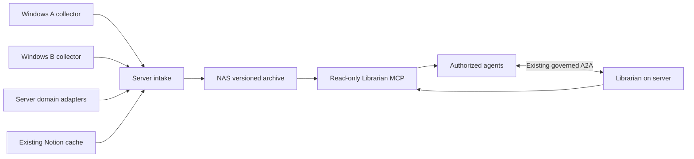

# Librarian architecture v1

> Production update, 2026-11-04: server intake, scoped worker/read MCP, guarded A2A
> retrieval and midnight collectors are active. Server capture now registers 42
> sources. NAS publication remains disabled at the user's direction. Second-PC
> enrollment, offline-key export, full project-file capture and broader semantic
> indexing remain unfinished. The dated design below is preserved; consult the
> [current deployment evidence](../operations/librarian-implementation-status.md)
> before interpreting its earlier pending-implementation statements.

Updated: 2026-10-28, Asia/Singapore (UTC+8).  
Product decisions accepted in the user's combined review; this document supplies concrete
technical choices for one complete implementation design. Read-only MCP component implemented;
collection, publishing and production activation remain pending.

## 1. Deployment and responsibilities



- Windows collectors capture accessible local tool records and project files for the approved
  device/source inventory. They maintain durable pending batches and transfer them to the server.
- Server domain adapters capture each domain owner's consistent records and related files.
- Intake validates device/source/batch identity, size/digests, expected source contract and
  delivery receipts. It publishes archive metadata only after actual received objects are present.
- NAS stores immutable object versions and retained manifests. The existing assistant-history
  tree remains preserved as a legacy input, not silently rewritten into a new format.
- Librarian is the server reasoning role for cataloging/project association and answering
  sourced questions. Ordinary copying, hashing, retries and scheduling require no LLM.
- Read-only MCP is the machine-readable archive interface. Existing A2A remains the collaboration
  and governed task/result channel. A2A completion does not imply business approval.

## 2. Exactly one daily logical capture

Accepted policy: one capture per device/source/date at **00:00, Asia/Singapore (UTC+8)**. The same
clock time currently applies to existing Asia/Kuala_Lumpur services. Existing unrelated timers
are not changed by this design.

Technical batch identity: `librarian:<device-or-owner>:<source-id>:<local-date>`. Capture receipt
and durable source checkpoint bind this identity to its immutable manifest. Overlapping launchers
must acquire the same source/date lease and reuse the existing batch rather than create another.

An offline or powered-off computer captures only when it becomes available. Its actual capture
time and missed scheduled date remain visible; it cannot fabricate a midnight state. Reconnect
transfer, interrupted-upload continuation and bounded delivery retries reuse the same batch.
They are not new scheduled daily captures. Old pending batches retain identity across dates;
pending backlog and any missed dates must be visible.

One daily capture cannot reconstruct a version that a source created and permanently removed
between captures without retaining its own history. The all-record requirement applies to all
accessible original records and source history, with that coverage limitation reported explicitly.
No unrequested continuous collector is introduced behind the once-daily policy.

Normal agent work does not wait for NAS, indexing, or an LLM. Start with one collection/transfer
worker per device and owner, background priority, bounded copy chunks and configurable bandwidth.
Measure resource impact before setting a performance acceptance claim. Lock/busy/I/O failures
produce PARTIAL or UNAVAILABLE coverage; they do not stop the agent or become false success.

## 3. Source integration contracts

There is no unresolved product-scope question blocking the design. Actual source completeness
still requires technical adapter verification; do not ask the user to enumerate internal tables.

| Source | Collection boundary | Required retained material |
| --- | --- | --- |
| Windows Codex/ChatGPT Desktop | Verified local application stores and available supported export surfaces | Original session/message/tool records, indexes, plans, logs, available attachments, current and archived records; do not infer all cloud ChatGPT content from a `.codex` folder name. |
| Windows Antigravity | Verified `.gemini` stores and complete relevant source artifacts | Conversation data, original execution/transcript/task records, artifacts and associated assets; not only selected Markdown summaries. |
| Project files | Registered roots on each computer and shared NAS sources | Working files, untracked relevant material, Git/version references and linked outputs, with clear source identity. Generated-file/large-file handling must preserve declared coverage. |
| Brainstormer | Domain-owner state plus native profile history | All graph entities/links/history, proposals/reviews, navigation receipts, original messages/tool records, memories and related files. Preserve undecided status. |
| Yonc | Active owner of `project_graph.sqlite3` | Nodes/edges, proposals/versions, operation/status history, allocations/deliveries/reviews/receipts and referenced resources. |
| Forge/eSchematic | Separate Lab and design owners | Physical inventory/order/build/event records, canonical component/design data, engineering evidence, commerce outputs, journal/relay receipts and NAS project files. |
| Honc | Active execution/life ledger owner | Execution facts, rounds, habits, life observations/revisions/sources, reminders, delivery/operation history and native profile records. |
| Wisdom | Knowledge owner and source content tree | Knowledge/evidence/conditions/review/reversal history, source files, topic versions, research/Orbit history and linked artifacts. |
| Scholar | Workstation RSTV4 and registered resources; server graph dependencies | Catalog/provenance, PDFs, artifacts, experiments, manuscript/workspace versions, review history and recorded scientific/model receipts. Capturing must not run scientific work. |
| UuMA/shared runtime | Existing control and individual runtime owners | Task/run/event/verification receipts, artifact references and files; separately identified native/shared delivery/recovery state. |
| General Notion sync | Existing `/home/alandelone/services/notion-sync` cache | Source page identities, current Markdown/cache state, recorded source edit/sync time, sync-run evidence and separately versioned archive objects. |

Use the [verified source inventory](library-source-coverage-2026-10-28.md) as the initial source
registry. Some remaining technical mapping includes workstation native profile roots, exact
referenced PDF/attachment roots, and supported graph export/rebuild contracts. Source adapters
must fail closed for missing/unmapped inputs instead of creating replacement production stores.

SQLite collection uses the owner's consistent snapshot/export facility or SQLite backup API
under that owner's authority. Never copy an active DB and its WAL/SHM independently and label
the result consistent. Record schema version and source cutoff with related files. Independent
owners have independent consistency boundaries; one manifest is not a cross-database transaction.

### Existing Notion schedule

The existing Notion full sync runs at 03:00 MYT. Midnight Librarian capture therefore archives
the cache available at midnight, often the prior day's successful sync, and discloses actual
`source_as_of`/sync timestamps. It does not imply fresh midnight Notion content or change the
03:00 job. Its rolling seven DB files remain separate from Librarian's retained version history.

## 4. Storage and version identity

Proposed server/NAS root (not created by this implementation):

```text
/mnt/nas/backups/librarian/v1/
  archive/
    catalog.json                 atomic current published read index
    objects/<sha-prefix>/<sha>   immutable original object bytes
  captures/<source>/<date>/      source/device manifests and verified delivery receipts
  catalogs/<snapshot-id>.json    retained historical publication indexes
```

Each record version carries stable namespaced record/source/device identity, version identity,
project associations, source locator, source status, capture time, content digest/size/type,
summary-versus-original distinction, lineage references and explicit reader grants. Duplicate
content can share object bytes while retaining distinct record occurrences and provenance.
Replacing the published index never removes older manifests, versions, or referenced objects.

Source deletions are retained as observed events and do not erase historical backups. A changed
file creates a new retained version. Cross-device conflicting versions remain separate. Source
clock time and capture time are different observations; no global causal order is invented.

Keep authoritative originals distinct from derived catalogs, summaries, searchable indexes and
embeddings. Project associations can evolve with history; original source text/status stays
unchanged. Uncertain associations remain in a retrievable inbox. Do not create or alter Yonc
project structures merely to classify a record.

## 5. Read-only MCP contract and delivered component

Launch entry: `uuma-librarian-mcp` or `python -m uuma.mcp_librarian`.
The current implementation supports **stdio only**. A trusted host launcher sets
`UUMA_AGENT_ID` and `UUMA_LIBRARIAN_ARCHIVE_ROOT` for that caller. These are not tool arguments.
Source and record reader grants both apply; the current implementation has no implicit
Orchestrator override or wildcard grant. Missing root/identity fails without creating an archive.

Reuse existing SSH/remote-MCP patterns for later cross-host exposure, preserving their trusted
caller binding. No unconfigured network MCP endpoint is started by this component. It does not
modify the shared token registry or claim that Librarian is already registered as a live agent.

| Implemented tool | Read behavior |
| --- | --- |
| `librarian_list_sources` | List permitted sources and their recorded capture/verification evidence. |
| `librarian_search_records` | Paginate authorized archived metadata, including older versions; filter by source/project/kind. |
| `librarian_get_record` | Get one exact record/version's provenance, original status and content metadata. |
| `librarian_read_record` | Read UTF-8 original-text chunks after verifying the retained size and SHA256. |
| `librarian_get_project_context` | Return latest authorized record versions belonging to an explicit project; source-record index, not an LLM summary. |
| `librarian_get_backup_status` | Read recorded source coverage and the accepted schedule policy; trigger no capture or live probe. |

All six tools declare read-only, nondestructive annotations. There are no SQL, caller-selected
filesystem path, source-write, approval, restore, retry, or schedule-install tools. Results expose
snapshot identity and provenance. Clients can pin `expected_snapshot_id` across pages and reject
a changed publication. Original OPEN/DRAFT/FAILED and other statuses remain unchanged.

The delivered reader expects `catalog.json` conforming to the generated
[catalog schema](../contracts/librarian-archive-catalog-v1.schema.json). Objects are addressed
only as `objects/<first-two-sha-characters>/<sha256>`, never by a caller-selected path. Duplicate
identities, unknown sources, reader-scope escalation, untraced summaries, false restore claims
without evidence references, invalid digests, oversized catalogs and object symlinks are rejected.

Version-one limits: 16 MiB catalog input; metadata search rather than full-text content search;
UTF-8 inline text up to 8 MiB/object and 20,000 characters per read call. Binary/larger objects
remain visible as authorized metadata. A complete binary/large-artifact reader and scalable
search index are separate implementation tasks; do not present this component as all-source
backup or complete archive publication. Catalog publishing/ACL assignment is a trusted service
responsibility; the read component neither creates grants nor certifies semantic truth.

## 6. A2A and restoration

Use the [existing A2A contract](uuma-a2a-contract-v1.md), administrator-bound agent endpoints,
Task/Run identity, idempotency and result-review semantics. No new agent protocol is defined.
Librarian may answer scoped archive questions and prepare sourced context or a recovery preview.
Production registration/capability advertisement for the new agent remains unactivated.

The user/Orchestrator reviews a concrete recovery preview containing owner, exact source versions,
destination, conflicts, expected writes, current-state preconditions and verification evidence.
An authorized owner executor performs restoration and preserves later writes; read-only MCP never
applies it. No database replacement, task replay, knowledge approval, or scientific continuation
is implied by a request to retrieve history.

## 7. Coverage, failure and recovery evidence

Track separately: discovered, locally captured, pending delivery, received, content-hash verified,
published/indexed, and restore verified. Source statuses COMPLETE/PARTIAL/UNAVAILABLE describe
declared coverage, not a claim of global completeness. Show source age, missed dates, failures
and recorded evidence. Reading a catalog does not freshly inspect sources or install a timer.

Capacity or integrity failure retains pending work and existing history, produces a visible
failure/partial receipt, and pauses that publication. No automatic deletion policy is introduced
to conceal insufficient space. Future storage tiers/compression preserve record/version identity.
The initial imported legacy backups retain their original path and uncertain consistency status;
they are not relabeled as verified captures merely because files exist.

Before activation demonstrate two-device capture, interrupted/offline delivery, one dated batch
without duplicate publication, source-consistent DB/file versions, preservation of older/deleted
records, caller-scoped retrieval, actual selected recovery, and measured impact during normal work.

## 8. Current implementation evidence and remaining activation work

Windows: 18 tests passed, one symlink-privilege case skipped. Linux/server isolated fixture:
19 passed, including the actual symlink case and MCP initialization/list/read/denied-read round
trip. Source bytes in that fixture match the tested local source. One Linux dependency warning
was retained. Final lint passed. No assertion was weakened and no production archive was opened.

Local evidence is under `.uuma-local/librarian-implementation-20261028`; server fixture receipt:
`/home/alandelone/.local/share/uuma/operations/librarian-read-verification-97fdd34a2915466fbdb3bca7ca74bf2f/receipt.json`.

Delivered now: complete design, local agent identity definition, read-catalog schema, fake example,
MCP/read component, packaging entry and meaningful isolated tests. Remaining implementation:
collector/adapters, durable batch publisher/catalog writer, nightly launcher integration, exact
remaining source/resource mappings, large/binary retrieval and scalable content indexing.

No server Librarian receiver, production A2A/MCP binding, NAS archive, Windows collector, or
midnight task was installed. Those activations need the existing scoped release procedure and
actual source/recovery acceptance. A tested read component is not a deployment receipt.
