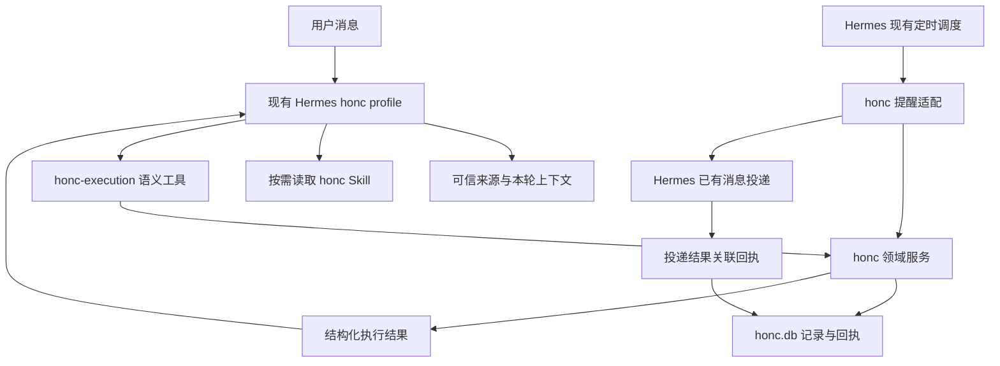

# honc｜基于现有 Hermes 的软件架构设计 v1

日期：2026-10-13，Asia/Kuala_Lumpur。  
状态：设计草案；R1–R4 产品规则已接受，技术实现与验收未完成；没有部署或改变全仓库门禁。

## 1. 阅读入口与范围

用户已完成 [四项行为审阅](../reviews/honc-architecture-2026-10-13/user-review.md)，无需再次确认。
本文、[工具合同](honc-life-tool-contracts-v1.zh-CN.md)、
[运行手册草案](honc-life-runtime-manual-v1.zh-CN.md)和
[功能验收清单](honc-life-feature-contract-v1.json)由开发时使用。
已确认的产品要求以 [原讨论记录](honc-habits-body-tracker-discussion-2026-10-13.zh-CN.md)为准。
用户「all follow your 建议」明确接受四项行为，依据见
[接受记录](../reviews/honc-architecture-2026-10-13/policy-acceptance.json)。
该接受范围不扩大到整个软件已经实现、验证或上线。

本轮范围是现有 honc 的生活能力扩展设计。保留工作执行、Graph 完成核对、Yonc／UuMA
所有权与原有资料；没有前端、模型切换、定时任务创建、Notion 写入或数据迁移。
已读用户 Agent CodeBook 的方法用于上下文、工具、状态、证据与恢复设计，
其中通用框架例子不代表本项目需要迁移框架。

## 2. 当前基线与具体差距

以下是本轮读取本地代码／文档得到的事实，未运行功能测试，也未检查生产 profile 是否与仓库一致。

| 当前可核实的结构 | 扩展时需要解决的具体问题 |
| --- | --- |
| honc 已有 Hermes profile、SOUL、四项 Skill、`honc-execution` 和 Worker 工具 | 扩展当前边界；通过固定工具与手册接入，不另造 Agent Loop |
| `HabitDefinition` 有名字、boolean／number、单位和每日目标 | 补记录类型、配置历史、启用状态、频率与提醒规则 |
| `check_habit` 对未知标识自动登记，quantity 默认 1 | 拟采用显式习惯管理；打卡工具不能把拼写错误或未知名称变成新习惯 |
| 该打卡路径创建一个默认本地 TrustedInput，然后追加事件 | 输入来源与操作身份需要贯穿真实 Hermes／Telegram 入口；不能只靠模型提供 user_id |
| `record_execution_event` 是按 event_id 插入 | 可信消息去重不自动等于业务效果去重，需要持久操作回执与唯一约束 |
| `register_habit` 使用 UPSERT 更新当前字段 | 修改定义要保留旧版，过往记录关联旧版，不让今日目标改写过去 |
| 日报按事件条数累计习惯，所有带 outcome 的事件进入 done_items | 数量型／时长型要按值汇总；身体观察不能因存在文字而变成工作成果 |
| 日报事件读取未按用户过滤；round 部分另有 user_id 过滤 | 新查询必须从可信输入所有者过滤；旧回查亦需明确兼容修正范围 |
| `conversation.py` 有关键词意图路由 | 作为当前兼容辅助，不能替代 Hermes 模型的多意图工具选择，也不能绕开服务验证 |
| 当前 checkin Skill 主要写打卡和日报原则 | 补逐步流程、真实字段、返回状态、缺信息和失败例子 |

以上是设计差距，不表示本轮已经修复，也不是对整个旧系统的完整安全审计。

## 3. Hermes 基础与 honc 扩展边界

保留 Hermes 的消息入口、模型调用、会话、Skills、MCP 和投递基础设施。
扩展点集中在现有 honc profile、现有 guard 集成、语义工具、领域服务、存储和提醒适配。
不修改 Hermes 通用 Agent Loop，不新增通用 SQL、HTTP、终端或任意收件人发送工具。

现有 honc Direct Run 登记、领域健康检查及结果汇报继续执行。
可信输入从真正用户入口捕获，不把后台提示、工具输出、引用或其他 Agent 结果当成用户报告。
`pre_llm_call` 只附带已经核实的引用和短上下文；不能把任意模型正文转成可信来源。

本地 Hermes 的 AGENTS.md 明确要求能力通过边缘扩展，保持会话缓存前缀稳定。
配置、手册和工具发布在新的会话边界生效；日常状态作为工具结果／当前消息附加上下文读取，
不能在每个回合重写 SOUL 或中途改变工具名单。

## 4. 模块与依赖方向

保留现有 `src/uuma/honc/`；下表是拟建模块职责，具体文件数量可由实现者调整。

| 模块 | 输入与输出 | 不能承担的事 |
| --- | --- | --- |
| 来源适配 | 真实 sender／profile／session／message → 不可伪造的 source_ref | 自己宣称用户授权或将提醒文本当用户输入 |
| 生命周期上下文 | 身份化查询 → 习惯、版本、当前实例、用户规则、来源引用 | 加载整个历史或泄露其他用户身体资料 |
| 习惯服务 | 管理配置、打卡、汇总、修正 | 自动新建未知习惯或改项目树 |
| 身体服务 | 原话与可选观察字段 → 用户自报记录 | 推断诊断、自动追问变化 |
| 日记服务 | 原始正文、日期、关联 → 日记版本 | 覆盖旧正文或自动把全文生成症状事实 |
| 锚点／提醒策略 | 起床／开始当天计划／睡前及固定时段 → 合资格实例 | 从普通聊天猜起床，或依据重要度追加次数 |
| 记录与操作存储 | 事务、唯一操作身份、配置版本、原话、修正、投递状态 | 与 uuma／wisdom／Hermes 数据库合并 |
| 历史查询 | 类型、日期、对象、游标 → 有来源的分页结果 | 把没有记录解释成没有做 |
| Hermes 提醒适配 | 受管 tick、到期实例、目标绑定 → 投递及结果 | 新建任意后台 Agent 或允许模型改变收件人 |

MCP／消息适配依赖领域服务；领域服务依赖模型和存储／适配接口。
领域规则不依赖 Telegram SDK、Hermes UI 或模型供应商；适配实现连接实际框架。
配置和记录的所有写入通过领域服务，禁用其它入口绕开同一份规则。

## 5. Session、业务 State 与历史

| 数据 | 权威来源与寿命 | 恢复方式 |
| --- | --- | --- |
| Hermes 对话历史 | Hermes 当前会话；可裁剪、摘要 | Hermes 原有恢复机制 |
| 当前工作回合 | honc 既有回合记录 | 读取 active round，不从聊天猜测 |
| 习惯／提醒设置 | honc 配置及版本，跨会话 | 查询当前版本；记录关联发生时版本 |
| 实际事实 | honc 类型化历史，跨会话 | 按 source_ref、日期、对象查回 |
| 今天是否已提醒 | honc 实例与 reminder receipt，跨进程 | 原子领取与回执恢复 |
| 用户偏好 | 用户明确设置与来源；不从总结反推 | 查询有效配置与生效时间 |

数据库拟扩展现有 honc.db。保留 `trusted_inputs`／rounds／execution_events 等历史，
新增结构通过迁移增加，不清库、改写原历史或重用 Hermes state.db。
拟增加配置版本、习惯执行实例、身体观察、日记版本、操作回执、提醒回执及迁移映射。
新事实即使通过独立类型表保存，仍有稳定事件引用和共同来源，不通过文案冒充其它类型。

发生时间与记录时间分开：`occurred_at` 可以为空，`occurred_date` 和 `time_text` 可保留
「昨晚／大概下午」；不能用中午或当前时刻冒充用户没有提供的精确发生时间。
后端设置 recorded_at；查询标明精确／日期级／近似／未知，不同类型保持区别。

## 6. 操作一致性与更正

每项写操作都有入口持久生成的 request_id、可信 source_ref、有效 profile／owner、
规范化内容摘要和最终回执。模型只能引用，不自行生成授权或重试身份。

- 同 request_id、同内容：返回原结果，不再产生业务效果。
- 同 request_id、改内容：返回冲突，不能用新 id 掩盖重试。
- 同 source_ref 的不同事实：允许分域操作；每个事实有稳定 slot 与独立回执。
- 新事实 slot 由服务基于已登记来源分配；同一段事实另换工具／序号不应再记一次。
- 两条内容相同但真实不同消息：不只按文字去重；有疑似同一发生时返回候选供纠正。
- 配置更新和更正检查 expected_revision；并发版本改变时返回冲突。
- 多项事实按各自事务保存并返回结果；部分成功只补失败部分，不回放已完成部分。

自然语言的“是不是同一发生”不能靠内容 hash 证明，具体 slot 分配与冲突判据必须有独立
契约测试；实现前冻结这部分接口。更正以新记录 supersede 原记录，历史与来源不删除。
过去未关联用户的记录通过 trusted_input 归属核实，无法核实的保留为待映射，不猜所有者。

## 7. 提醒接入与恢复

本轮已读取本地 Hermes：`cron/scheduler.py` 提供 no_agent 脚本路径、已有投递、
delivery outcome 分类及队列；本地 cron 文档描述已有时段身份、领取和恢复机制。
这些是源代码能力，尚未证明 honc profile 的有效配置、Windows 路径和实际通知已接通。

首选设计为一个受管的 honc no-agent tick，调用受限生活提醒服务，
复用 Hermes scheduler 与固定绑定目标的投递基础设施。精确 tick 频率是工程配置，
对外承诺“在设定窗口内提醒”，不把调度精度声称为毫秒级。
实际入口由 Orchestrator／部署流程配置；日常 honc 不获取 cron／脚本编辑权限。

提醒处理顺序：解析当前用户与配置版本 → 取当天实例 → 检查窗口／启用／额度 →
原子领取带 fencing 的 reminder_id → 生成固定模板 → Hermes 投递 → 关联实际结果。
起床提前触发与 08:00 tick 共用同一实例，在任何一条路径已消费时另一条不能再发送。

必须区分 `QUEUED / SENDING / DELIVERED / DELIVERY_UNKNOWN / FAILED / EXPIRED / SUPPRESSED`。
外部消息已发送但回执丢失时，无法同时保证绝不重复与必定送达；设计选择保留 UNKNOWN，
查询原投递记录，不盲目重发。只有证明尚未发生外部发送时才允许同一逻辑操作恢复。
发送成功不证明用户看到、起床或完成习惯。

no_agent 的 stdout 被投递并不等于 honc 已取得可关联投递回执。
实现必须验证 business reminder_id 与 Hermes job／execution／delivery 的稳定映射。
如已有接口不能拿到最终结果，只在 profile 插件／受限适配增加结果桥接；
不能靠 script 退出码标记 DELIVERED。该集成作为独立工作包验收后才启用通知。
失败提示也要防重复，不让通用 cron 失败重试变成额外习惯催问。

重要度只影响同次提醒的排序和表达。增加提醒次数只能来自用户明确设置；
多个时间点的旧运动规则不能自动解释成用户批准更多次提醒。
已确认：对应实例达标则取消未发送提醒；窗口外不补发，单点默认允许 30 分钟；
同一时刻到期的习惯合并并按重要度排序；明确提前睡前触发共用当晚额度，21:30 不重复。
准确边界及样例见 [提醒政策合同](honc-reminder-policy-contract-v1.zh-CN.md)。
实现这些路径仍须通过技术验收，不把产品确认等同于运行设置已变更。

## 8. 运行手册和模型负担

SOUL 保留简短的角色与不可违背规则。Skill 入口列场景，正文按需加载具体操作步骤。
本轮手册是设计草案，不放入生产 skills 白名单，不假设提议工具已经存在。
工具返回明确对象 ID、单位、版本、状态和下一步，避免普通模型自行做单位换算、
跨日归属、提醒计数或猜测错误处理。初版不需要 RAG／向量库保存可直接查询的个人账本。

模型输出不作为保存回执；后端成功后才反馈成功。详情中保留原话和缺失信息，
前台身体记录的执行分支以简短确认结束，不推荐后续关怀对话或自动调研。

## 9. 开发顺序与证据

| 工作包 | 自主完成的工程工作 | 完成证据 |
| --- | --- | --- |
| A 来源与操作合同 | 入口绑定、作用域、稳定 request/slot、统一结果 | 真实入口／两 profile／重启／重复与冲突契约 |
| B 配置和类型化历史 | 版本、实际记录、补记、更正、过滤、分页 | 原资料保持、版本冲突、未知时间、汇总与用户隔离 |
| C 工具与手册 | 准确 schema、工具结果、场景手册、固定发布边界 | 参数验证、手册例子与实际 schema 一致 |
| D 提醒适配 | Hermes tick、业务实例、发送回执与恢复 | 早起／08:00 竞态、重启、未知回执、窗口策略 |
| E 普通模型对话验收 | 版本化消息集，使用实际生产模型配置 | 用户话→实际工具→数据库→回复的完整轨迹 |
| F 旧资料迁移与部署 | 映射预演、保留旧 ID、发布与回滚 | 原资料数量／hash、逐项映射、单次通知软件验证 |

四项提醒产品政策已确认；旧资料逐项映射与通知渠道仍在实施相应副作用前核对。
不把自主整理授权视为上线授权；本轮保持设计阶段的范围，不推进 mission 门禁。
后续编码契约应使用现有仓库测试／生命周期规范；独立审查与真实模型验收尚未发生。

验收清单中的 passes 均为 false，表示新合同未验收，不表示旧系统所有功能失败。
功能完成要有回执、数据库和实际对话证据，不能只凭 unit PASS 或“Agent 说已完成”。

## 10. 本地来源

- `profiles/honc/SOUL.md` 和四项现有 Skill。
- `src/uuma/honc/models.py`、`mcp.py`、`service.py`、`store.py`、`conversation.py`。
- `integrations/hermes/uuma_control_guard/__init__.py` 的 Direct Run、领域检查与工具边界。
- 本机 Hermes `AGENTS.md`、`cron/scheduler.py`、`website/docs/guides/cron-script-only.md`、
  `website/docs/developer-guide/cron-internals.md`。
- 用户 [Agent CodeBook](https://app.notion.com/p/Agent-CodeBook-3dde1eb5ce57802489cae4082ff4b342)，
  作为架构方法参考，已在前一轮读取页面。

具体读取文件的 SHA、证据性质和未验证项见
[基线记录](../reviews/honc-architecture-2026-10-13/baseline.json)。
