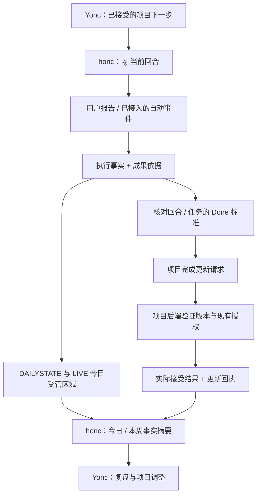

# honc｜日常执行与追踪 Agent 建设计划

日期：2026-10-05（Asia/Kuala_Lumpur）  
状态：规划稿；本次交付为职责、流程、迁移顺序与验收计划。本文中的 honc profile、工具、记录模型和同步机制均为拟建能力。

## 1. 要解决的问题

Yonc 帮你决定项目怎样推进、怎样拆解；honc 接住执行现场：今天实际做了什么、留下什么成果、算不算完成、下一步在哪里，以及这些事实有没有更新回系统。

honc 的定位是 **「日常执行与追踪管家」**。习惯、作息、专注和提醒都围绕这条执行记录链服务：

> 已接受的项目下一步 → 当下执行 → 留下事实与证据 → 核对完成 → 更新记录 → 将真实进度交回 Yonc。

首要成果是可信的 tracing 闭环。第一版先让你能通过一句话补记、查询和纠正；自动采集随后接入。

## 2. 按方矩 v4 划分职责

| 层面 | Yonc | honc |
| --- | --- | --- |
| 进击的巨人 / 31 | 管理阶段方向、Main / Support / Parked 取舍与建议 | 提供实际成果和阻塞摘要 |
| 筑梦具现 / 线们 | 管理项目、里程碑、依赖、任务树和验收标准 | 把每次执行关联到原任务，反馈进展和完成依据 |
| LIVE 今目 | 提供已接受的候选下一步 | 按当前状态选择一个回合，写清果象、小笨事、Mode、Timer、Done 标准 |
| Focus / 做 | 接收执行结果 | 记录开始、结束、中断、实际产出和恢复入口 |
| DAILYSTATE / 日记 | 用真实记录判断项目进展 | 维护成 Done / 明今目 Next / 坑 Blocker / Actual / State |
| 习惯与作息 | 接收影响项目的现实约束 | 管打卡、休息、地点、可用时间和用户报告的能量 |
| 周复盘 | 决定项目或方向怎样调整 | 汇总本周事实、重复坑、投入及未同步项 |

用户拥有优先级和最终项目决策；项目后端拥有项目状态；Hermes Orchestrator / UuMA 拥有 Agent 调度与运行控制。

honc 可以把已接受的动作细化为「这一回合先做哪一步」，但项目任务树、里程碑和方向调整交给 Yonc。日常记录足够明确时直接记；只有缺少关键对象、成果或时间归属时才补问。

遵守已核实的系统约定：Main x1、Support 至多 x1；Parked 不进入今日承诺；今日一个主要成果；新灵感先进入千丝万绪；卡住超过 10 分钟记录坑并切换求解或备用动作；每周只提出一个系统修正重点。不引入 `⁉️` 分级。

如果你实际做了 Parked 项目的事情，honc 仍照实记录为计划外发生，并反馈给 Yonc；记录事实不会自动把该项目重新启用。

## 3. 完成判定：分开三件事

| 判断 | 示例 | 记录方式 |
| --- | --- | --- |
| 做过什么 | 写了 30 分钟，完成两段 | 执行事实、Actual、成果、Next |
| 是否达到完成标准 | 约定的三段已写好并保存 | 使用当时的 Done 标准逐项核对，保留依据 |
| 是否已更新成功 | 日记已写入；项目状态仍待提交 | 各目标分别保存更新结果和回执 |

计时结束只证明一个回合结束。文件出现只证明文件存在。测试通过只证明该次测试通过。Agent 返回成功只证明运行结果。这些事实需要对应到具体 Done 标准，才能支持任务完成。

完成分三个粒度：本回合小成果、原任务、项目里程碑。本回合 Done 不自动完成整项任务；任务 Done 不自动完成父节点或整个项目。

**用户明确报告也属于有效依据。** 你说「任务 A 完成了，报告已保存」，honc 保存为用户报告，并核对 A 的标准；普通日常记录不用强制上传截图。若你只说「弄好了」且对象不明，保留原话并补问对应任务。若任务另有必须复核的验收条件，显示还差哪项。

Done 标准从已接受的任务或本回合约定取得，并保存版本。缺少标准时可以拟一个简短标准供当前回合使用，但不追溯假装它早已属于项目验收条件。标准后来变更，原记录仍保留当时的标准。

显示可采用：进行中、已结束、待核对、未达标、达到标准；另列项目状态「待更新 / 已接受」及同步结果。工作已达标但 Notion 暂时失败时，保留完成事实并显示待同步。

## 4. 日常使用流程

### 🛸 定 + 准

honc 读取当前 Main、已接受的 Next 与现有果象卡，结合你报告的体力、精神、地点、可用时间，确定这一回合：

> 果象：文献卡保存，包含 3 条理论定义。  
> 小笨事：打开 PDF，摘第一条定义。  
> Mode / Timer：Focus，25 分钟。  
> Done：3 条定义已保存并留下 Next。

没有新状态报告时，沿用可用的最后观察并注明时间；DayStyle 的预计状态只能作为建议，不能充当当前真实状态。

### 🍅 做 + 查

开始回合 → 记录中断或状态变化 → 结束回合 → 接收实际成果 → 核对 Done → 保存 Done / Next / Blocker / Actual / State → 更新适用目标 → 返回简短结果。

第一版支持手动开始、结束和补记；真正的倒计时、暂停和恢复在 Focus 接入阶段补齐。中断后保留现场和 Next；没有可靠起止时间时，Actual 留空或明确标为用户估计。

### 你可以直接这样说

| 你的话 | honc 应怎样处理 |
| --- | --- |
| 「刚才写了半小时，但没写完。」 | 保存进展与 Actual；任务保持未完成；留下 Next |
| 「报告已保存，那个任务完成了。」 | 关联原任务，核对标准，保存完成依据并执行允许的更新 |
| 「昨天晚上其实有锻体，帮我补记。」 | 记到实际发生日期，同时保存今天的补记时间 |
| 「刚才不是完成，只是初稿。」 | 追加修正记录，纠正当前状态和适用投影，保留原历史 |
| 「今天到底做了什么？」 | 按事实列成果、投入、坑及 Next；指出缺少记录的时段 |
| 「现在累了，在 Grab 上。」 | 采用 Gap / 场景小 Mode，接一个适合的小动作或休息；维持主战方向 |

手动报告和自动事件进入同一条记录链。只有对接了明确的数据源，honc 才能自动观察对应事件；没有记录时显示「未记录」，不能推断为「没有做」。

日终用一张短卡收功：今天成了什么、还有什么坑、明今目接哪里、有哪些待核对或待同步项。每周把事实摘要交给 Yonc，由 Yonc 处理项目调整。

## 5. 数据与更新的安排

拟采用独立的 Hermes `honc` profile，并建立 honc 执行记录服务。对话负责理解与解释，记录和更新由服务执行，保证换聊天或重启后可恢复。

拟建业务记录最少包含四类：

| 记录 | 必要内容 |
| --- | --- |
| 回合 | 回合 ID、原任务引用、成果、Mode、Done 标准及版本、起止和中断 |
| 执行事件 | 发生时间、记录时间、时区、用户原话或来源回执、Actual、State、成果、Next、Blocker |
| 完成核对 | 核对粒度、具体标准、已满足 / 缺失项、依据、判定来源、原任务版本 |
| 更新回执 | 目标及稳定 ID、原版本、拟改内容、请求标识、成功 / 待处理 / 冲突 / 失败及实际结果 |

习惯记录按具体习惯和发生次数关联；一天多次吃饭或多次运动要能区分。重复提交同一次消息、计时事件或更新请求不得重复产生事实或完成转换。

建议执行领域记录使用独立 `honc.db`；这属于拟定方案，实施前确认现有存储适配。项目状态留在其项目后端；UuMA 控制状态留在 `uuma.db`；知识留在 `wisdom.db`；Hermes `state.db` 继续承担自身会话职责。系统间使用稳定引用和服务接口连接。

**每个字段只指定一个权威来源。** honc 负责执行事实和观察；项目后端负责已接受的项目状态；Notion 显示日记和今日投影。旧 Notion 任务与新 Graph Project System 任务的对应关系要先核实：没有稳定映射的任务保留原系统归属，不用名称相似性猜测合并。

日常执行记账与项目提交分开：用户要求记录的事实可先保存；项目变更沿用其后端的现行写入合同。当前 Yonc 的 Graph 提交要求可信本地 UI 的单次、精确版本授权，Telegram 接受路径尚未实现。honc 不能通过调用旧勾选脚本绕开该合同；达到标准但暂时不能提交时，显示事实已记录、项目更新待处理。

因此，第一版要把这条更新路径做具体：展示「原任务 → 拟完成状态、依据、版本」的更新项，在现有可信界面接收适用授权，再提交并查回。日常日志不因此反复请求批准。若以后希望一句 Telegram 对话同时完成正式项目提交，应另行实现并验收可信授权适配。

同步采用待更新队列和可核对回执：先保存事实，再逐个更新目标。失败不抹掉事实；重试前核对原请求是否已生效；发生人工编辑冲突时保留两边内容并列出差异。已经完成的目标和失败的目标分别显示。

纠正用追加的修正或反向更新保留历史。新回合开始后，旧回合迟到的更新只能影响旧记录，不能覆盖当前 LIVE 今目。时间保存实际发生时间及记录时间；日报按 Asia/Kuala_Lumpur 的发生日期归日；跨午夜的 Focus 时长按实际区间拆分统计，并保留同一个回合 ID。

## 6. 现有 Yonc 四类能力怎样抽出

只读审计确认旧实现位于 `C:/Users/Alandelone/CodeSpace_Local/yonc_agent`。环境中给出的 `yonc_agent/unlimited_llmapi` 路径不存在。本节是源码观察，不能视为 honc 部署或旧系统实跑验收。

| 用户提到的能力 | 本次核实与迁移方向 |
| --- | --- |
| 日常打卡 / Daily State / Cron | CLI 和状态、定时例程有现成入口；先复用读取与格式映射，再把记录和触发边界移到 honc。旧计划状态与用户实际报告要区分 |
| DayStyle / today_status | `data/daystyle_config.json` 有作息模板；`today_status.json` 实际位于旧 Yonc 根目录的父目录。目前落盘内容含日型与预计轨迹，不能据此宣称完整打卡状态机已运行。统一显式数据目录，解除对当前工作目录的依赖 |
| Focus 检测 / 耗时 | 有 emoji 检测、任务切换、历史时段与时长同步；CLI 也有结束路径。它们不足以构成完整倒计时、暂停 / 恢复和成果核对。先规范 start / stop / interrupt，再接自动采集 |
| 任务完成 / Block Lifecycle | 有从视图勾选回写原任务的机制；迁移成带原任务引用、完成依据、版本检查和更新回执的适配层。完成事实、原任务状态和多个视图刷新分别处理 |

迁移前必须处理的已核实问题：

1. **整页删除。** `dashboard.py` 的 `clear_dashboard_page` 删除页面全部顶层子区块，`write_dashboard` 会调用它；现有 Focus / track 路径会重写 dashboard。这会覆盖 LIVE 今目的「现在｜果象卡」。先改为只更新明确受管的任务容器，并保留用户内容，再启用回写。
2. **停止语义不同。** `focus_tracker.track_focus` 在未发现 emoji 时仍可能返回旧 current_focus；CLI `cmd_track` 和 `focus --done` 则有停止处理。抽取时统一入口，不能把所有路径都当作同一计时合同。
3. **关闭时段与完成混在一起。** CLI `focus --done` 会结束时段、同步耗时、勾选任务并重写 dashboard。新设计中「结束回合」与「确认任务完成」应分别执行。
4. **重复视图依赖显示标签。** LIVE 今目会按 Mode、Task Type 等重复展示同一任务；旧同步使用标题里的 Tn / [n] 和映射表。honc 要使用原任务稳定身份，多份展示只能算一次。
5. **取消完成不是完整反向链。** 旧视图取消勾选时的处理不等于原任务自动恢复未完成；新设计必须有明确的修正事件和适用的反向更新。
6. **输出 Done 不一定代表写入成功。** 旧 CLI 的完成路径在勾选写入失败后仍可能继续刷新并输出 Done；新接口必须返回各目标的真实结果。
7. **建议选用与执行完成需要保留区别。** 旧生命周期对「选用 AI 建议」的勾选有单独守卫；honc 只接已经选用的可执行任务。旧 completion 中的父节点结构转换也不能转移成日常执行权限。

现代 Graph 实现还已有 FocusSession 的 start / stop 接口，可在第 0 阶段评估复用；其活动状态仍不等于项目完成。旧 CLI 的 poll 仅调用同步，不能当作现成的 honc 行为采集或提醒调度器。

推荐抽取顺序：来源与 ID 映射 → 只读状态 / 作息适配 → 新执行记录链 → 完成核对与受管回写 → 统一 Focus 生命周期 → 定时提醒。旧模块的写入和批量重建入口不得直接作为 honc 的工具暴露。

## 7. 分阶段建设与每阶段验收

### 第 0 阶段：对齐来源和边界

交付：honc 职责说明、来源映射、原任务稳定 ID 规则、当前 Main / Support 来源、Done 标准归属、Notion 受管区域与保留区约定、旧触发器清单。

验收：选一个真实 Main 任务，能说明它在哪里、谁拥有状态、哪些页面只是投影、完成要满足什么、怎样更新才符合当前合同。果象卡和用户手写区域明确保留。

### 第 1 阶段：手动 tracing 最小版

交付：独立 honc profile、操作说明、持久化记录服务；通过对话记录开工、进展、补记、习惯、成果、Next、Blocker，并能查询和纠正。接入当前回合及项目来源的只读信息。

验收：你说一句话即可记下真实执行；重启后记录仍在；昨天补记不会混成今天；「做了半小时」不会被打成完成；缺失时间和状态不会被补造。

这是第一批编码的中心。先选一个 Main 项目和少量日常习惯试用，避免一次搬入全量旧数据。

### 第 2 阶段：完成核对和更新闭环

交付：标准快照、成果核对、完成更新项、现有授权适配、Notion 受管区域写入、逐目标回执、失败恢复和修正。

验收：从用户报告到 DAILYSTATE、LIVE 和允许的原任务更新，结果都能查回；重复请求不重复写；完成但同步失败能恢复；不同视图不会双算；果象卡始终保留；并发人工编辑能检测。

**第 1、2 阶段构成可日常使用的 MVP。** 不等全部自动化做好才开始使用；但尚未接通的目标必须显示待更新。

### 第 3 阶段：接入 Focus 与自动事件

交付：明确的开始、暂停、恢复、结束、中断接口，旧 emoji 检测适配，可靠时长汇总，必要成果或勾选事件的来源接入。

验收：关闭和移除 emoji 都遵循同一生命周期；未关闭时段可见；跨日和多次中断不会双计；回合到点不自动完成任务；自动事件与手动补记可合并而保留来源。

### 第 4 阶段：作息、提醒和稳定迁移

交付：DayStyle 建议、实际 State 与计划的对照、休息和场景 Mode、用户约定时段内的少量提醒、日终卡和每周事实摘要；旧入口转交 honc。

验收：预计能量不写成实际观察；休息时不持续催工作；没有新情况不重复提醒；一项触发只有一个写入负责人；旧流程有可恢复备份，迁移后的历史仍可查询。

后台提醒在实施这一阶段时按约定配置；本次规划不创建定时任务。

## 8. 必须通过的核心场景

| 场景 | 预期结果 |
| --- | --- |
| 写了半小时但未达标 | 有进展、Actual、Next；任务未完成 |
| 用户明确报告成果满足标准 | 保存用户依据、核对结果，更新允许目标并返回实际回执 |
| 🍅 到点但成果不足 | 结束回合，保留缺失项，原任务不自动勾选 |
| 同一完成请求重复投递 | 原记录与回执可重用，不重复完成或累计耗时 |
| 今天补记昨天锻体 | 发生日期与补记日期分别保存 |
| 达标但 Notion 更新失败 | 完成事实仍在；失败目标待同步；恢复后不重复追加 |
| 用户纠正「其实只是初稿」 | 保留原历史，追加修正，更新当前核对与适用投影 |
| 同一任务出现在两个分类下 | 关联同一原任务，只计一次，所有受管投影一致 |
| 回写 LIVE 今目 | 果象卡和其他用户内容完整保留 |
| 外部人工修改或旧回合迟到 | 检出冲突；不覆盖新编辑或新回合 |
| 完成一个小成果 | 原任务和父里程碑仍按各自标准判断 |
| 没有采集到执行 | 显示未记录，不生成「今天没做事」结论 |
| 项目后端尚无适用授权 | 日常事实仍可记；正式项目更新清楚显示待处理 |
| 一个 Agent 返回成功 | 只记录实际运行结果，再核对任务验收标准 |

上述场景是实施时的验收要求；本次没有运行 honc 测试或修改旧运行链。

## 9. 拟建产物和先后依赖

| 拟建产物 | 作用 | 阶段 |
| --- | --- | --- |
| honc 角色与操作说明 | 明确身份、范围、重新进入与回复方式 | 0–1 |
| 独立 Hermes profile | 提供持续使用的 honc 对话入口 | 1 |
| 执行记录服务与语义工具 | 保存、查询、修正回合与事实；拟用独立 honc.db | 1 |
| 项目读取 / 完成更新适配 | 取标准，准备更新项，走既有后端合同 | 1–2 |
| Notion 日记与 LIVE 适配 | 只写受管区域，保留用户内容 | 2 |
| 更新队列、回执与冲突处理 | 支持断网恢复和跨系统部分成功 | 2 |
| Focus / 打卡来源适配 | 将自动事件接入同一记录链 | 3 |
| DayStyle 与提醒触发器 | 根据真实状态提供恢复和执行支持 | 4 |
| Yonc 事实摘要接口 | 回流 Done / Next / Blocker / 投入 / 待核对事项 | 2–4 |

工具名称和表结构在实施设计时确定；记录服务先以少量语义操作覆盖「读当前、记事实、核对、修正、更新、查回」，避免把旧脚本或原始数据库操作直接暴露给 Agent。

迁移采用先包装、后替换：以一个 Main 项目试用，比较新旧读取结果，确认写入由单一负责人承担，再迁移其余来源。保存旧配置、ID 映射和历史，按来源分批接入；切换依据是验收结果，不是日历日期。

## 10. 本次依据与下一步

已读取的系统来源：

- [每天の修行](https://app.notion.com/p/9d5a40ae6c9842b08991f089cb05cf62)：每日循环、🛸 / 🍅、Mode、恢复与 Done / Next / Blocker。
- [方矩 v4｜系统 Guideline](https://app.notion.com/p/32fe1eb5ce5780bb8b53f63e2e44a073)：Main / Support / Parked、四流与各页面职责。
- [LIVE 今目](https://app.notion.com/p/33ae1eb5ce578083bffad43328863da6)：现有果象卡及多种分类投影。
- [YoncTask_config](https://app.notion.com/p/318e1eb5ce5780c7be3def64930aafbb)：旧标签、Mode 与 DayStyle 配置。新方矩 v4 及本次用户要求优先于旧约定。

本地依据：

- [Yonc 当前角色](../agents/yonc.md)和[现有运行说明](../../profiles/yonc/SOUL.md)：项目后端、Orchestrator 边界及尚未实现的 Telegram 提交路径。
- [CLI_GUIDE.md](C:/Users/Alandelone/CodeSpace_Local/yonc_agent/docs/CLI_GUIDE.md)。
- [DayStyle 配置](C:/Users/Alandelone/CodeSpace_Local/yonc_agent/data/daystyle_config.json)及[today_status.json](C:/Users/Alandelone/CodeSpace_Local/today_status.json)。
- [Focus tracker 原计划](C:/Users/Alandelone/CodeSpace_Local/yonc_agent/docs/plans/2026-04-06-focus-tracker-dashboard.md)。
- [Block 生命周期](C:/Users/Alandelone/CodeSpace_Local/yonc_agent/docs/BLOCK_LIFECYCLE.md)。
- [Daily State 文档](C:/Users/Alandelone/CodeSpace_Local/yonc_agent/docs/CLI_GUIDE.md:612)与[字段写入适配](C:/Users/Alandelone/CodeSpace_Local/yonc_agent/cron_manager.py:582)。
- [底层 Focus 检测](C:/Users/Alandelone/CodeSpace_Local/yonc_agent/focus_tracker.py:259)、[CLI 完成路径](C:/Users/Alandelone/CodeSpace_Local/yonc_agent/main.py:643)和[CLI track 路径](C:/Users/Alandelone/CodeSpace_Local/yonc_agent/main.py:816)。
- [工时同步](C:/Users/Alandelone/CodeSpace_Local/yonc_agent/focus_time_sync.py:45)、[完成格式写入](C:/Users/Alandelone/CodeSpace_Local/yonc_agent/completion.py:116)和[多视图勾选同步](C:/Users/Alandelone/CodeSpace_Local/yonc_agent/livetoday_sync.py:94)。
- [整页删除入口](C:/Users/Alandelone/CodeSpace_Local/yonc_agent/dashboard.py:545)及[调用该入口的写入路径](C:/Users/Alandelone/CodeSpace_Local/yonc_agent/dashboard.py:577)。
- [今日状态相对路径](C:/Users/Alandelone/CodeSpace_Local/yonc_agent/daystyle_manager.py:12)、[日型写入](C:/Users/Alandelone/CodeSpace_Local/yonc_agent/daystyle_manager.py:45)与[午夜例程路径](C:/Users/Alandelone/CodeSpace_Local/yonc_agent/midnight_routine.py:16)。
- [建议选用守卫](C:/Users/Alandelone/CodeSpace_Local/yonc_agent/state_evaluator.py:118)和[现代 Graph Focus 接口](C:/Users/Alandelone/CodeSpace_Local/yonc_agent/graph_app/api.py:221)。

源码观察与计划文档分别使用，未把文档中的完成标签当作实跑验收。

进入实施时，先完成第 0 阶段的一页来源映射，再做第 1 阶段的手动追踪；接着以第 2 阶段打通「已做 → 核对 → 更新 → 查回」。这条链稳定之后，再将另外三类自动化逐步交给 honc。
