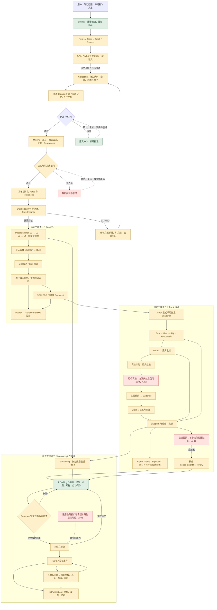

# Scholar / RSTV4 全流程与用户界面验收

日期：2026-09-30 · Asia/Kuala_Lumpur  
范围：UuMA 的 Scholar 契约、RSTV4 当前公开 MCP 与原生文献流程、Paper Catalog、Writing Studio。用户口述的 IST 在本仓库对应 RSTV4。

**总体结论：部分能力可验收，完整科研流程与用户界面尚未完全对齐，不能整体通过。**

本报告交叉检查已接受需求、开发说明、工作流图、当前代码、自动测试及浏览器实际页面。它记录验收结果，不变更产品代码、不批准 mission gate。当前 mission 仍为 `verification / pending_review`。

## 1. 如何理解结果

- **局部通过**：本报告列出的具体行为已经有测试或实际页面证据，不代表整个阶段或真实科研质量通过。
- **部分完成**：存在实现，但入口、闭环、数据或质量验证不完整。
- **不通过**：本次隔离测试已重现与要求相冲突的行为。
- **待验收**：没有足够真实运行证据；不能用“接口存在”代替验收。

采用较新的已接受设计：研究结构为 Field → Topic → Track → Project；Manuscript 直接属于 Track，可绑定其 Projects。界面中的 RQ 是展示分组，不改变稿件归属。FieldKG Build、Track 科研里程碑、Manuscript 六阶段分别运行，不能合并成一个进度条。

## 2. 逐阶段验收矩阵

| 阶段 | 需求与实施约定 | 当前代码与证据 | 用户界面 | 结果 |
|---|---|---|---|---|
| Scholar 工作前检查 | 自有图谱必须健康；直接工作登记 Run；科学决定由用户／Orchestrator 审阅 | Worker 有 preflight、Direct Run、完成前图谱检查；相关 25 项测试通过。本次未做新 Telegram 对话验收 | Catalog 未展示 Scholar Run 与图谱健康 | 局部通过；真实对话与界面整合待验收 |
| 研究范围与结构 | Field / Topic / Track / Project；Track 独立持续；Paper 归 Track | TrackFirst 数据模型、跨 Track 绑定限制与隔离库创建行为已有证据 | 首页层级基本对齐；生产研究结构为空时显示明确标注的示例；＋Field 禁用；完整结构编辑未接通 | 部分完成 |
| 种子输入与 Collection | DOI、BibTeX、关键词；范围固定；查重并复用已有论文／PDF | 后端有持久化关键词检索、去重和已登记 PDF 复用测试 | 三列输入与本地检查可用；“开始采集”禁用；预览的已有论文／PDF 仍“待服务检查”；已有目录论文选入 Collection 未接通 | 部分完成；用户端启动不通过 |
| 全文获取与身份验证 | 先复用已登记文件，再获取；文件版本、身份、来源、人工交接可追踪 | 原生 Network worker、外部全文与人工交接入口已存在；待身份审核的旧文件不会直接重下载 | 真实 PDF 队列与原文页面可读；能标注 DOI／标题、记录修正与撤回 | 部分完成；提供商／授权浏览器的完整实跑待验收 |
| PDF 身份审核闭环 | 修正、确认身份、复检、恢复解析 | 原文批注与目录修正已有测试；当前 UI 分支不会自动批准 `VERIFIED` 或调度解析 | 案件修正后仍可能留在队列；缺少完成审核并继续的入口 | 未完成 |
| 正文、图表公式、References | 版本化解析、位置保留、正文完整、引文质量门 | MinerU 与质量门已实现；同日质量记录引用的十篇审计仍有一篇漏七条编号参考文献并被拦截；生产 parse_runs 为 0 | 可查看状态与原文；解析人工意见不能完成参考文献修正→复检→新版本→恢复任务 | 部分完成；准确性与恢复闭环待验收 |
| 递归引文与科学分流 | 只有 EXPAND 才扩展；循环去重；无固定深度截止；持久暂停／恢复 | 队列、参考文献解析、无 DOI 查询、分流与资源控制有实现和测试；新设计取代旧文档的默认三层深度 | 缺少完整 Citation View、前沿与逐条失败／人工项的工作面板 | 部分完成；真实持续运行待验收 |
| QuickRead / Core Insights | 分类与研究价值判断、来源、版本，候选不自动成为科学结论 | Worker 和持久产物路径存在；测试验证保存与处理契约 | 目录显示状态和部分摘要；生产未形成真实完成链 | 部分完成；模型判断质量待验收 |
| PaperSkeleton L1–L4 | 原子内容→语篇关系→微观意图→宏观角色；全文上下文、来源、条件与模型版本保留 | 四层处理与存储存在。最新真实小样本诊断发现上下文不足、输出结构漂移、嵌套三元组未进入规范读取路径、宏观／微观角色混淆、调用回执保存和中途恢复缺口 | 目录仅状态／版本摘要；没有完整骨架内容与来源浏览；写作左栏已有样本位置，但当前真实库无产物 | **尚未质量验收** |
| FieldKG Build → 审阅 → SEALED | 显式选择完成 Skeleton；证据候选审阅；Gap 保持候选；不可变 Snapshot | TrackFirst FieldKG 垂直切片测试通过；后端有构建、审阅、快照、采用与 projection outbox。测试不能证明真实图谱内容科学正确 | 总览接口未返回 Build、Snapshots、Gap 队列；缺少完整 Field View | 部分完成 |
| Track 采用与科研 Blueprint | 显式采用 Snapshot；Gap → Idea → RQ → Hypothesis → Method → Claim；依赖与版本可追踪 | 决策提案、一次性授权、Blueprint 与依赖边存在；替换节点后没有完整传播失效，见 A-01 | 总览只显示采集状态，未提供完整科研里程碑、Projects、阻塞与复核入口 | **不通过** |
| 实验计划→执行→证据→Claim | 用户批准计划；运行时方法仍有效；固定脚本；结果先成为证据／候选 | 计划审批与脚本校验已实现；方法被替换后旧计划仍可执行，见 A-02 | 缺少对应执行审批、方法失效与结果证据的完整 Track 界面 | **不通过** |
| Figure / Table / Equation | 科研结论对应可追踪素材；作者选择内容，稿件保存素材与位置 | Writing Studio 有图表文件、公式与版本产物；没有足够证据批准“Claim 自动生成科研图”的整条链 | 有素材／公式入口；缺少从科研节点到图表结论的完整可视回查 | 部分完成；整条链待验收 |
| 写作 Stage 1 Planning | 模板／Skeleton 来源、作者采用；不擅自填入作者思想 | 样本与模板采用入口、Track 归属存在 | 六阶段与左样本／中结构／右证据布局对齐；真实库缺少完成 Skeleton 样本 | 局部界面通过；真实样本链待验收 |
| Stage 2 Drafting | Section→Paragraph→Intent→Thought；不完整也可保存；作者引用决定；撤销、冲突与离线保护 | 实际服务验证作者思想保存与重新打开保留；Generate 不完整结构被阻止；模拟接口前端测试覆盖拖动、离线、冲突、Undo 与大文档 | 嵌套结构、侧标签、六点拖动、引用与讨论入口已呈现 | 局部通过；复杂协同的真实服务验收仍待补 |
| Stage 3 全文检查 | 只有完整成功生成的不可变版本才能结束 Drafting，审阅固定该版本 | Generate 主路径有完整性与版本检查；通用阶段接口可在零版本时进入 Stage 3，见 A-03 | 有成文／结构切换；没有成功版本时显示空态；正常生成链本次未调用真实模型 | **阶段门不通过**；生成语义质量待验收 |
| Stage 4 定稿／投稿 | 包装、生成 LaTeX／PDF、提交事件，不把多个投稿细节扩成新阶段 | 后端有产物与事件路径、接口测试；阶段接口可跳过成功版本一路前进 | 六阶段条对齐；完整真实产物与提交周期本次未重跑 | 部分完成；不能整体通过 |
| Stage 5 Revision | 轮次固定基线，原始意见保留，意见与实际修改关联，响应与 diff 可回查 | 后端有评论、轮次、软归档／恢复、修改与响应产物及测试 | Revision 入口存在；本次未完成真实意见→修订生成→response package 的浏览器验收 | 待端到端验收 |
| Stage 6 Publication | 接收后终稿、校样、发表与归档，以事件完成 | 状态与事件存在；无成功稿件也能切到 Publication，见 A-03 | 阶段名称对齐；完整真实发表事件与归档未验收 | **阶段门不通过** |

## 3. 已重现的三个代码问题

### A-01 · P1 · 替换已批准科研节点，没有使完整下游失效

要求：上游被替代时，受其影响的科研节点应进入待复核／STALE，依赖这些节点的稿件应标记 `needs_scientific_review`。

隔离重现：批准原 Method → 批准依赖原 Method 的节点 → 创建只绑定该下游节点的稿件 → 批准替换 Method。

实得：原 `research_nodes` 行成为 `SUPERSEDED`；下游仍是 `APPROVED`；稿件 `needs_scientific_review=0`。代码只更新直接绑定原节点的稿件，没有沿 `research_edges` 更新全部下游。`impact_analysis` 能读出受影响节点，却没有在这条审批路径执行传播。

位置：[track_first.py:527](C:/Users/Alandelone/CodeSpace_Local/RSTV4/src/rstv4/track_first.py:527)。旧 `service.py` 的传播逻辑不能证明当前公开 TrackFirst MCP 已正确执行。

修复验收：测试至少包含两级依赖、只绑定间接下游的稿件、无关节点不受影响、历史保持、重新批准／复核后恢复。

### A-02 · P1 · 方法失效后，旧实验计划仍可运行

要求：执行计划时重新检查所依据方法仍处于有效批准状态，失效后需重新审阅。

隔离重现：原 Method 批准 → 实验计划批准 → Method 被替换 → 运行旧计划。命令仅打印 `ISOLATED_ACCEPTANCE_ONLY`，不执行研究实验。

实得：执行没有被阻止，退出码 0。计划审批时检查 Method；`run_experiment` 只检查计划批准与脚本摘要，没有重新检查 Method 状态。

位置：[track_first.py:659](C:/Users/Alandelone/CodeSpace_Local/RSTV4/src/rstv4/track_first.py:659)、[track_first.py:673](C:/Users/Alandelone/CodeSpace_Local/RSTV4/src/rstv4/track_first.py:673)。

修复验收：方法 SUPERSEDED／STALE／撤销后都拒绝执行，拒绝不产生实验运行；合法新计划可通过重新审批运行；继续保留脚本变更校验。

### A-03 · P1 · 通用阶段接口允许跳过成功生成版本

要求：Generate 成功产出完整不可变版本后进入 Stage 3；失败保留 Drafting，后续处理有真实版本依据。

隔离重现：创建空结构稿件，未调用 Generate，依次请求 `DRAFTING → WHOLE_PAPER_REVIEW → FINALIZATION_SUBMISSION → PUBLICATION`。

实得：所有请求接受；`manuscript_versions` 数量仍为 **0**。正常 Generate 的检查不能保护这条通用阶段接口。

位置：[studio.py:45](C:/Users/Alandelone/CodeSpace_Local/RSTV4/src/rstv4/studio.py:45)、[studio.py:404](C:/Users/Alandelone/CodeSpace_Local/RSTV4/src/rstv4/studio.py:404)。本报告没有据此声称点击普通编辑按钮就会出现该漏洞；本次证据是实际后端服务方法的隔离重现。

修复验收：零成功版本不能进入 Stage 3 或后续阶段；生成失败不能推进；允许按已接受设计返回 Drafting 与进行 Revision；后续事件与版本条件一致。

重现结果：[acceptance-evidence.json](C:/Users/Alandelone/CodeSpace_Local/UuMA/docs/reviews/scholar-rstv4-2026-09-30/acceptance-evidence.json)。测试脚本随证据保存；只在隔离目录创建测试对象，授权消息均为测试夹具。

开发复现时使用 RSTV4 的 Python 环境，先运行 [依赖与实验探针](C:/Users/Alandelone/CodeSpace_Local/UuMA/docs/reviews/scholar-rstv4-2026-09-30/isolated_dependency_experiment_probe.py)，再运行 [阶段探针](C:/Users/Alandelone/CodeSpace_Local/UuMA/docs/reviews/scholar-rstv4-2026-09-30/isolated_stage_probe.py)。前者只读生产统计并在本报告目录新建隔离库，后者读取前者的夹具位置。首次运行的实际结果保存在上述 evidence 文件，复现不会覆盖它。

## 4. 用户界面的对齐情况

| 界面要求 | 实际观察 | 验收 |
|---|---|---|
| 轻量层级、同色系、逐层缩小、避免大表头 | 首页 Field→Topic→Track→RQ→Paper 布局与说明基本一致 | 视觉方向对齐 |
| Paper 仍归 Track；RQ 只分组；点标题打开对应稿件 | 示例两篇标题分别跳转自己的只读示例；真实路径携带 manuscript ID；隔离稿件可以进入真实服务 | 归属与路由局部对齐 |
| Topic／Track 内发起采集并固定范围 | 入口与范围显示存在；当前只检查输入，开始按钮禁用 | 操作闭环未对齐 |
| 查看每层论文数量、关联论文 | 当前用 `—`，没有伪造计数；正式多对多归类与关联列表未完成 | 未完成，不能把空计数当 0 |
| 看当前任务、失败、暂停与人工处理 | 后端读 Collection／任务汇总；生产没有任务；示例详情明确是示意 | 局部完成；实时 worker 心跳未接通 |
| 完整 Field／Track／Manuscript 各自工作面板 | 总览接口仅提供基础层级、稿件、Collection 与任务；缺 Build／Snapshot／Gap／科研里程碑／Projects／科学复核状态 | 全流程 Board 未完成 |
| 论文目录筛选、排序、列操作与详情 | 实际目录显示 1,197 条可见论文，50 条分页，Filter／Sort／Columns 与详情入口；接口测试通过 | 目录局部通过；本次未逐一重做列宽视觉验收 |
| 看真实 PDF、来源位置、修正与历史 | 实际审核页显示 21 页 PDF、文字层、已存来源标注、核对原因 | 原文阅读通过；本次只读，批注写入行为由临时 PDF 自动测试证明 |
| 审核完成之后系统继续工作 | 缺正式身份批准及解析质量修正后复检／发布／恢复入口 | 未对齐 |
| 写作结构作者控制、自动保存、六阶段、侧栏和讨论 | 实际隔离服务显示完整布局；保存作者思想后重新打开仍保留；Generate 指出空思想／未决定引用 | 局部对齐；真实 Skeleton 样本、模型成文、全文审阅与返修周期待验收 |

总览 API 的信息缺口见 [catalog_web.py:331](C:/Users/Alandelone/CodeSpace_Local/RSTV4/src/rstv4/catalog_web.py:331)；禁用采集与新 Field 见 [catalog_web.html:396](C:/Users/Alandelone/CodeSpace_Local/RSTV4/src/rstv4/catalog_web.html:396)、[catalog_web.html:546](C:/Users/Alandelone/CodeSpace_Local/RSTV4/src/rstv4/catalog_web.html:546)。修复应延续已经接受的轻量布局，通过层级详情呈现独立工作流，避免用采集状态代表科研全部进度。

### 实际页面证据

首页明确标注示例，生产没有研究结构：

采集检查已有结果，但开始采集仍禁用：

真实生产 PDF 的只读审核页面：

真实后端、独立测试库的作者思想保存与重新打开：

## 5. 按验收结果重画的完整流程

图中绿色是局部已验证行为，黄色是部分实现／待质量验收，红色是已重现错误或缺少用户闭环。箭头表示要求的关系；标为“待接通”的箭头不是已完成声明。FieldKG、Track、稿件仍分别拥有工作状态。

## 6. 测试、生产数据与证据边界

本次验证：

- RSTV4 当前全量回归：**95 passed，2 个既有依赖警告，28.71 秒**。此前较早快照为 80 passed；本报告采用最新重跑结果。
- UuMA 图谱 runtime／Scholar 守卫相关：**25 passed，31 deselected**。
- Writing Studio 现有浏览器测试：**2 passed**。这两项拦截全部 Studio API 请求，使用模拟响应；测试名中的 “real Paper” 不等于真实后端集成验收。
- Writing Studio 前端构建通过。
- 新增隔离验收探针重现 A-01、A-02、A-03。它们没有加入产品测试或修复实现，供后续开发转成回归测试。
- 本次另用真实 Studio API 与隔离库，验证作者思想保存、重开保留与不完整 Generate 的拒绝；没有发送讨论、运行模型生成或制造生产研究审批。
- 浏览器生产检查只阅读 Catalog／PDF，没有提交批注或创建生产研究对象。

生产数据的只读快照：原始论文身份 3,177；页面可见论文 1,197，排除隔离记录，因此两者不是同一个统计口径。审核页显示 440 个 PDF 身份案件。Field、Topic、Track、Project、Manuscript、Collection、acquisition_jobs、parse_runs、paper_skeletons、FieldKG Build／Snapshot、Evidence、Decision、projection_outbox 均为 0。数字是本次观察，不应固定为未来验收断言。

这意味着现有论文／PDF 入库已经发生，但**不能据此声称生产中完成了 Collection → Parse → Skeleton → FieldKG → Track → 写作的完整链**。已有单独质量诊断产物不等于这些生产表已有正式结果。

PaperSkeleton 的真实语义质量采用同日记录中的有限证据：三块真实来源、十二次模型调用用于诊断，未建立人工审定、按论文划分的参考语料，未报告正式准确率。见 [PaperSkeleton 质量工作记录](C:/Users/Alandelone/CodeSpace_Local/RSTV4/docs/paperskeleton-quality-workstream.md)。本次没有重跑这些模型调用。

## 7. 文档与流程图需要同步的地方

1. 原始递归需求仍写“等待实施”、默认深度三层等旧约定；较新决策规定无固定深度截止与持久资源控制。应标明被替代条款，不能按旧文档验收最新代码。
2. 9 月 28 日流程图中的“关键词发现”“已登记 PDF 复用”待补描述，已被后续代码与测试部分实现；图需要更新。这不代表用户端采集启动已经接通。
3. 初期 TrackFirst 实施说明不含 PDF 获取；原生 PaperPool 已补相应后端。应区分历史实施范围和当前系统范围。
4. 稿件旧五状态与现六阶段不一一等价；六阶段是用户流程，投稿状态是阶段内事件，科研复核是独立标记。
5. 不应把 Figure 从 Claim 自动产生、全流程 Board、正式质量通过画成已实现。图需要显式记录用户入口与质量门缺口。

## 8. 建议交给开发的修复与复验顺序

| 顺序 | 工作 | 再验收必须看见什么 |
|---|---|---|
| 1 | A-01、A-02、A-03 三个状态／阶段门错误 | 间接依赖失效、旧方法阻止运行、零版本阻止推进；保存历史且允许合法复核与回退 |
| 2 | 把 Collection 用户入口和已有论文选入接到后端 | 一次真实用户启动，有持久 Collection 与任务；重复提交幂等；既有已验证 PDF 复用；停止／恢复可回查 |
| 3 | 完成 PDF 身份和解析质量审核闭环 | 审阅决定、身份复检、参考文献修正、新解析版本与恢复任务可逐步追踪，不丢历史 |
| 4 | PaperSkeleton 输出契约、上下文、来源、回执与恢复，再做质量评测 | 不静默丢三元组；关系端点稳定；细部意图与宏观角色分开；人工审定论文级测试语料及错误分类 |
| 5 | 补 Field／Track 详情与完整 Board | Build、Snapshot、采用版本、候选 Gap、科研里程碑、Projects、实验、阻塞、稿件科学复核可各自打开 |
| 6 | 用一个受控真实研究串起科研与写作 | 真实 Skeleton→审阅证据→SEALED→采用→用户科研审批→有效实验→作者写作→成功版本→全文检查→返修包；科学质量单独验收 |

## 9. 核心依据

- [Scholar 角色与工作模式](C:/Users/Alandelone/CodeSpace_Local/UuMA/docs/agents/scholar.md)
- [研究领域模型](C:/Users/Alandelone/CodeSpace_Local/RSTV4/docs/research-domain-model.md)
- [三条独立工作流视图](C:/Users/Alandelone/CodeSpace_Local/RSTV4/docs/scholar-workflow-views.md)
- [FieldKG TrackFirst 实施说明](C:/Users/Alandelone/CodeSpace_Local/RSTV4/docs/fieldkg-track-first-implementation.md)
- [原生 PaperPool 运行说明](C:/Users/Alandelone/CodeSpace_Local/RSTV4/docs/scholar-native-paperpool-runbook.md)
- [获取设计决策](C:/Users/Alandelone/CodeSpace_Local/RSTV4/docs/scholar-acquisition-design-decisions.md)
- [递归文献与四层语义需求](C:/Users/Alandelone/CodeSpace_Local/RSTV4/docs/literature-acquisition-requirements.md)
- [写作六阶段与后端契约](C:/Users/Alandelone/CodeSpace_Local/RSTV4/docs/paper-writing-backend-design.md)
- [Writing Studio 交互设计](C:/Users/Alandelone/CodeSpace_Local/RSTV4/docs/writing-studio-interaction-design.md)
- [研究总览最新约定](C:/Users/Alandelone/CodeSpace_Local/RSTV4/docs/research-overview-v1.md)
- [目录与审核页面当前状态](C:/Users/Alandelone/CodeSpace_Local/RSTV4/docs/paper-catalog-current-ui.md)
- [历史工作流图 V3](C:/Users/Alandelone/CodeSpace_Local/RSTV4/docs/paper-catalog-workflow-view-v3.md)
- [四层真实诊断与未验收边界](C:/Users/Alandelone/CodeSpace_Local/RSTV4/docs/paperskeleton-quality-workstream.md)
- [当前 TrackFirst 测试](C:/Users/Alandelone/CodeSpace_Local/RSTV4/tests/test_track_first_fieldkg.py)
- [原生获取测试](C:/Users/Alandelone/CodeSpace_Local/RSTV4/tests/test_native_paperpool.py)
- [前端模拟接口测试](C:/Users/Alandelone/CodeSpace_Local/writing-studio/tests/e2e/studio.spec.ts:70)
