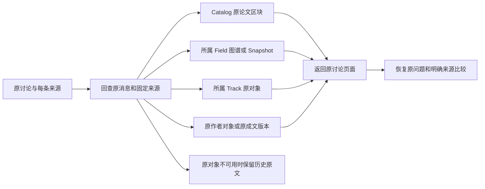

# 讨论来源定位与返回验收 · 2026-10-05

**本批完成代码和隔离接口核对。原 118 条要求／11 组仍完整保留；正式产品尚未整体通过验收。**

## 交互逐项核对

| 操作 | 当前实现和证据 | 尚待完成或实跑 |
| --- | --- | --- |
| 点 Studio／Catalog／FieldKG／Track 历史来源 | 每个主来源和额外来源都有“定位原对象”；先向后端回查真实消息、所属范围、原对象和原版本，再打开对应页面 | 浏览器点击、焦点、滚动、窄屏和完整跨模块流程 |
| 返回原讨论 | 保留原消息 ID、原所属范围和来源序号；额外来源属于另一个范围时，仍能查原调用并返回主讨论对象 | 真实多来源跨范围会话往返；旧独立 Studio 历史的统一接入 |
| 已输入问题后查看来源 | 定位不提交消息或批注；原问题和绑定原文保持。有新绑定时使用既有明确来源比较 | 真实离线、刷新、两个标签页及全部离开保护 |
| FieldKG／Track 原对象高亮 | 精确校验 Field／Track、Snapshot 或 Living；使用真实概念 term／关系键和稳定对象 ID，缺失对象不选邻居 | 完整语义 KG 与真实图面交互 |
| Catalog 原区块 | 找到精确论文及已存在的属性／QuickRead／Parse／Skeleton 区块；加载原详情后定位 | 独立 Parse 子单元没有对应可视区块时不假高亮；普通 PDF 阅读面继续 |
| Studio 原对象／旧成文 | 作者对象按稳定 ID 返回；旧成文读取实际原生成 version，不覆盖当前正式版本；保留只读原文、选区、批注和旧版／不可用状态 | 返回当前成文后清理旧深链接参数、真实移动／删除／重新生成流程 |
| 历史旧版观察 | 原作者内容变更返回 OLD_VERSION，删除返回 SOURCE_UNAVAILABLE；当前生成版本／作者 revision 变化时标旧版；原冻结内容不变 | 真实组件级版本切换和历史筛选 |
| 返回原页面 | 只接受配置中的 Catalog／Studio 根路径和来源链接，保留原页面查询状态；Studio 离开前等待原保存并核对冲突 | 原页面滚动／全部展开状态及共享草稿的真实往返 |

全局 Field／Topic／Track 列表继续作为独立导航入口，FieldKG 展示选定 Field 的图谱。Studio 原四区、文字选区、批注和明确采用建议的流程保留。

## 当前验证证据

- **152 项相关后端测试通过**，83.32 秒，1 条既有 Starlette/httpx 弃用警告。包含原 Studio 编辑／生成／建议、多轮讨论、历史原文，以及新增旧版观察和数据库启动契约。测试中的模型为明确替身。
- **35 项讨论状态检查、17 项研究工作面检查**通过；TypeScript、Oxlint、真实 Catalog 内嵌脚本语法和生产构建通过。没有新增依赖。这些受控检查不算真实浏览器操作。
- 运行实际同一份讨论控制器，连接现有真实 HTTP 服务，核对 **4 个原讨论来源**：定位、深链接回查、原调用详情、错误所属范围，以及内存中未发送问题保持。没有发送新的消息／批注；FieldKG／Track 及额外来源导航另有受控覆盖。
- 最新实际服务核对四个原研究／Studio 请求：返回内容与上一批原回执逐字结构相同，幂等重试 **0 新任务／0 新模型调用**。仍为 4 个讨论任务、8 条消息、2 条讨论批注和 6 条已有 Studio 调用。
- 原 **5 份稿件、7 份 ZIP、8 张科研表、4 条更早 Studio 调用**保留原摘要，已有软件验收稿件与两条共享讨论调用亦保持原输入和契约。
- 修正后的启动、接口读取和原请求重试期间，**全部 96 张表、schema 与数据库字节摘要均不变**。本批没有新增真实模型调用，没有改变科研决定、正式稿件或生产数据。
- 当前 Catalog 页面及两份讨论／研究工作面脚本字节等于源码；当前前端 **7 份 JS／CSS** 等于最终构建。记录 **65 份源码摘要、20 份证据摘要、7 份编译资源摘要**。

## 失败记录与修正

首次类型检查发现成文对象实际字段是 `content`，误用了 `markdown`；按现有类型修正，失败日志保留。概念对象使用实际 `term` 键，关系使用实际关系键；补精确高亮／Snapshot 检查后通过。

首次最终核对在重试前失败：上一批数据库文件摘要为 `205aca1887914761337a824244e9edf87c2e820a30fec8e842f632258f66b8f3`，这批重载后为 `83e4de6f6d682a06cd73b7239b130f2cbc0117b657c75bba4ee256f381d27f13`。原失败断言及 helper 完整保留；该次失败的完整工具输出在会话中，没有伪造成功 receipt 或完整文件日志。

在独立数据库副本复现，初始化同一版本仍改写 `schema_version.applied_at`，96 张表中仅该表记录变化。修正为版本实际变化时才记录应用时间，并增加 Catalog／Research 重复初始化与真实版本变化测试。修正后的受控服务重启严格验证 96 张表与字节保持；没有还原旧时间或重写原文件以凑旧摘要。

**不能宣称数据库与上一批字节相同**：旧摘要校验的失败仍计为失败。当前通过证明的是修正后的启动及导航／重试不再改动数据库，并单独保持已存的原讨论回执、稿件、包、科研表和模型调用证据。先前仅有摘要，不能还原所有物理差异。

另一次只读 baseline helper 因 Windows 默认编码读取含中文 JSON 而停止；未写 baseline，未重启或提交，随后显式使用 UTF-8 完成核对。权限变化后沙盒无法启动项目 Python，已通过工具审批执行具体核对脚本。

## 剩余范围

当前隔离服务：Catalog 54256／8885，Studio 55324（监听子进程 55468）／8874，生产前端 53416／3000。操作前已检查实际进程、父子关系、监听归属和无进行中任务；旧 receipt／日志保留。后续仍需重新检查归属。

G-01／G-02／G-03／G-10 和全部 11 组均未关闭。继续完成旧独立 Studio 历史统一、精确历史筛选和深链接恢复、完整 KG／范围文献、Collection／审核恢复／科研复核与重新绑定、完整模板、离线／上传、真实界面和整条 pipeline。

按用户“暂时无法操作，继续代码验收”执行。没有再次尝试未变化的 Chrome 连接或扩展设置；助手未更改文件网址权限，用户手动开启／恢复状态未知。mission 保持 verification／pending_review，无 gate 或科学审批。
