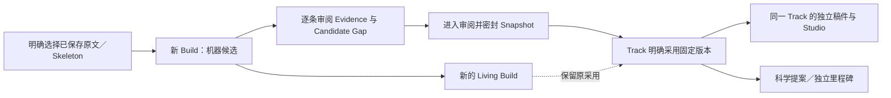

# FieldKG／Track 工作面：代码与隔离接口验收

日期：2026-10-05 · Asia/Kuala_Lumpur。原 118 条要求／11 组完整保留；G-10、G-01 与整体验收尚未关闭。

## 本批已落实

| 原要求 | 实际实现 | 验证边界 |
|---|---|---|
| KG-01 | 从全部 Field 总览进入选定 Field；读取限定 field_id，创建 Build 时才明确选用全目录的来源 | 越界引用只显示不可用；普通 Field 查询不并入其它领域内容 |
| KG-02 | 图、对象与关系列表使用实际 ID；Papers／原始 Concepts／Methods Intent／候选证据／候选 Gap／已接受 Evidence／Citation 可查 | Debates 与 Idea Mergers 的权威对象尚未实现；Findings／Counterevidence 的完整语义分类仍待完善 |
| KG-03 | 原文、页标记、序号、Section、条件、L1–4、PaperVersion、SkeletonVersion、摘要与审阅状态；节点／边回查来源 | 旧 file_version_id／parse_run_id 明确未知；来源是软件测试文本，没有伪造真实 PDF 或模型抽取；小屏与大库待浏览器验证 |
| KG-04 | 独立显示原九步 Build 状态、实际产物与缺项 | 本批复用已有 Skeleton；采集／下载／解析／Forge 运行未知时明确说明，不报九步均完成 |
| KG-05 | 候选接受／拒绝有理由和保存凭据；Gap 引用需可用且所属 Field 正确；密封前再核对证据与原文 | 接受 Candidate Gap 不生成批准的科学 Gap；没有把点击／讨论作为接受 |
| KG-06 | Snapshot 固定当时原文、L1–4、证据、候选 Gap、引用与 Citation，能查看版本、成员及采用记录 | 旧 Snapshot 没有完整来源副本时明确说明；成员清单不符拒绝采用 |
| KG-07 | Track 明确采用固定快照；多次采用保留原依据；新的 Living Build 不替换旧采用 | 单一快照路径已隔离 HTTP 实跑，双快照保留另有实际后端合约检查 |
| KG-08 | 实际 projection_outbox 状态单独展示 | 实时服务健康尚未探测，不由 outbox 或 Build 推断健康／科学批准／稿件保存 |
| KG-09／CH-03～CH-09 | 图／列表和来源详情选择有实际对象锚点 | Catalog／FieldKG Chat、文字选区与 annotation 尚未接通；此要求保持未完成 |
| TR-01／TR-02／TR-03／TR-07 | Scope／类型、采用、独立科研里程碑、节点／边／证据、Projects／计划／运行、独立稿件／投稿事件读回实际记录 | 不以 current_phase 合并 Build、科研与稿件六阶段；完整产物／科研恢复流程仍待验收 |
| TR-04／TR-05／TR-06 | 科学提案及批准记录只读展示；失效状态与稿件复核标记保留 | 原科学授权边界保留，未接科学审批／计划执行／重新绑定交互；首批后台修复已有既存证据 |
| G-03／G-10 | 四个入口、Field／Track 原生链接、保留总览上下文、明确确认、理由草稿、冲突比较、未知结果原请求 | Studio 内统一导航、范围文献、全部对象离线与浏览器继续 |

沿用原紧凑蓝色列表、系统字体与 Studio 组件。Web Interface Guidelines 用于标签、原生链接、键盘／焦点、状态提示、长文本和列表渲染检查；design-taste-frontend 的密集产品界面范围限制继续适用。较大列表加入 content-visibility，图仅展示前 90 个节点并明确提供完整列表；真实浏览器、窄屏与大库性能尚未验证。

## 实际流程与三条状态轴

Build 显示原九步，但此入口复用已有来源；采集／下载／解析的运行凭据和 Forge 实跑未记录时如实显示。上图是本批实际软件流程，不是完整采集、科学批准、实验、成文与发表验收。

## 本批验证结果

- **50 项相关后端通过，22.18 秒，2 项原有依赖警告**：18 项 FieldKG 工作面检查、16 项 metadata、11 项 Catalog、5 项 Track-first 合约。覆盖只读、Field 隔离、原文变化、原子回滚、并发、原请求重试、候选未审拒绝密封、冻结原文、成员清单篡改拒绝采用。
- **14 个受控交互场景**执行实际发布模块：节点／关系身份、固定来源、九步事实、旧快照原文、来源详情键盘关闭、异步换 Field、读取失败、来源选择器失败与过时返回、理由草稿、未知结果原请求、冲突比较、改决策不误提交旧决策、存储失败、独立 Track 状态。该计数为 14 个测试场景，不代表浏览器点击证据。
- 另补 1 项双快照采用合约通过，1.05 秒、1 项原有警告；第二版本不替换第一份采用。原总览 11 个受控场景与返回来源 11 项检查通过；Ruff、全前端类型检查、选定 Oxlint、内联脚本语法与差异检查通过。本批未改 writing-studio 源码；原正式构建源码摘要保持一致，未重复构建。
- 实际隔离 HTTP 完成 3 条证据候选审阅（2 接受、1 拒绝）、1 条候选 Gap 接受、READY／SEALED／ADOPT，以及新的 Living Build。未先审证据的 Gap 接受被拒；同创建／密封／采用请求均返回原结果。共 **12 条不可变操作凭据**，其中 3 条 metadata、9 条 FieldKG 操作。
- 原 **5 个稿件工作区和 7 个 ZIP** 前后摘要与上一批一致；0 次新增模型调用。新增的软件稿件保留真实 owner Track 与 ID，没有科学节点或批准记录。

首次后端计数为 50 项，附加双快照检查单列为 1 项；这些测试数不与以前的全套或其它批次相加；本批没有重跑完整 11 组端到端，也没有证明模型科学质量。

## 可查看的实际预览

- [选定 Field 的知识图谱](http://127.0.0.1:8885/?view=fieldkg&field=field_785167b274c54c2f921390317406d0a7)
- [固定 Snapshot](http://127.0.0.1:8885/?view=fieldkg&field=field_785167b274c54c2f921390317406d0a7&snapshot=fieldkg_snapshot_168ec05c7a2e4ad4a070b224c88e1189)
- [Track 详情与实际稿件](http://127.0.0.1:8885/?view=track&field=field_785167b274c54c2f921390317406d0a7&track=track_9a2b141f59c041d8b6621a750a66a40e)

均为原隔离目录中的软件验收资料。启动前确认旧三个进程及端口均已不存在，恢复同一目录，没有重新初始化原稿件。页面和发布脚本通过 HTTP 与当前源码字节一致检查；不是浏览器视觉验收。

## 失败与修正保留

初次 46 项后端通过后，仅导入排版失败；调整导入后本批最终 50 项通过。页面脚本首次解析发现嵌套模板表达式错误，已拆成可读分段并通过受控执行；随后一项 prefer-const 静态检查修正后通过，原失败日志保留。一次包装命令在错误工作目录找不到 UuMA 模块，没有执行测试；已改回 UuMA 工作目录。

启动核对发现旧 Studio 不存在，原启动尝试在检查阶段停止，没有修改服务；确认所有三个旧进程和预览端口不存在后才恢复原数据。共享会话被其它工作关闭／开启时重新读取当前 handoff 并 resume；其它科研验证和 Kanban 工作保持完整。

## 全目标继续范围

G-01／G-02 的跨模块 Chat 与选区／annotation／旧版本返回；G-03 的全部对象离线／多标签页与浏览器；G-04 的最终完整流程；G-05／G-09 的完整来源、图表公式与结构映射、真实研究回复质量；G-06 完整异常返修；G-07 手动文件上传；G-08 完整模板、显式替换、待安置区、Subsection、L2；G-10 完整语义图谱／Track、范围文献归属与 Chat；G-11 Collection 启动、人工审核恢复、科学复核与重新绑定继续。

TR-05／TR-06 和零版本阶段约束的首批后台修复已在 10 月 2 日有证据，本批未修改该实现；完整 UI 和重审恢复仍待验收。历史报告中的“仍需修复”不能据此当成当前代码仍未修复。

用户暂不能手动操作浏览器，继续代码验收的指令保持。助手未改变扩展文件网址权限，开启／恢复仍未确认。mission 保持 verification／pending_review，无科学／生产／gate／整体审批。

最终补验：来源选择器读取失败显示明确错误，过时返回不落入另一 Field。当前发布脚本重新以 HTTP 与源码比对；Snapshot 清单与 12 条原操作凭据只读复核一致，没有重复任何新增／审阅／密封／采用操作。初始报告与 manifest 留存。
