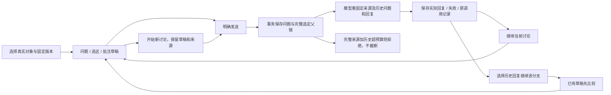

# Catalog／FieldKG／Track 多轮讨论：本批验收

2026-10-05 · 原 118 条要求／11 组保留。**本批通过；正式产品尚未整体通过验收。** Studio 共享讨论、完整建议采用及全部流程继续。

## 已实现的用户交互

| 要求 | 当前实现与证据 | 尚待完成 |
|---|---|---|
| CH-06 | 回复后下一问显示“继续这段讨论”；可点“开始新讨论”。每轮保存明确父消息、完整问题／回复链、各自固定来源／选区／批注和原调用契约。新对象有独立草稿；不自动携带别的对象会话。 | 与 Studio 四区的共享会话、跨模块往返与全部真实浏览器交互。 |
| CH-07 | 历史源已有新版本时明确显示旧版；删除保留原文。父消息的作者问题、助手回复、来源、所属范围、状态和父关系必须与原调用记录相符；损坏记录显示不可用。 | 内容移动后的页面定位、完整旧版原文阅读界面。 |
| CH-08 | 原对象续问草稿和父消息可恢复。换对象时原请求晚返回不能覆盖新对象／新问题。模型失败保留实际失败问题，可另发明确续问；原失败重试不会再调用模型。 | 断线／离线、真实多标签页、小屏与大库验收。 |
| CH-09 | 历史“继续这段讨论”明确选择分支，有草稿时先比较；显示本轮带入的历史问题／回复／固定原文和版本。历史每行可查看当时实际输入、响应、契约与错误。 | 历史对象返回对应页面的高亮、跨模块统一导航。 |
| CH-10 | 历史助手文字作为讨论意见。可引用当前或明确传入历史来源；历史含跨范围来源时，下一次调用仍需明确跨范围确认。没有自动改稿、科研批准或 Snapshot 采用。 | Studio 既有结构／来源／措辞建议及作者完整／部分采用的共享接通。 |

Catalog／FieldKG／Track 使用现有蓝色紧凑界面和底部讨论区。Studio 产品组件本批未改；其原点击、selection／annotation 和四区布局继续保留。design-taste-frontend 的先审计要求与 Web Interface Guidelines 的按钮、焦点、标签、状态通知仍用于本次审查。受控状态验证没有代替浏览器视觉验收。

## 多轮流程

## 本批证据

- **84 项相关后端通过**，29.89 秒、1 项既有依赖警告：原 67 项相关契约与新增 17 项多轮／历史完整性／兼容性契约。真实 SQLite 事务验证来源变化、删除、分支、失败、所属范围、运行中父消息、跨范围、总输入预算和损坏历史；模型明确使用测试替身。
- **26 项受控讨论状态检查**通过：原 18 项加 8 项续问／新讨论／对象切换／恢复／晚返回／历史分支／失败续问／历史调用查看。原工作面 14 项、总览 11 项、返回 11 项单列通过。不是浏览器实跑。
- Ruff、Oxlint、实际脚本及页面内脚本解析、相关差异检查通过。Studio 产品源码与已有构建未变化，本批没有重复构建。
- **真实模型续问 1 次通过**：连接上批实际回复，完整带入旧问题与旧回复。实际模型 `gemini-3.7-flash`、契约 `research-chat-v2-fixed-conversation`；实际 prompt 3422／completion 62／total 3484 tokens。回复准确复述上一轮用户问题，并解释来源版本未知信息应保留。完整原输入、输出、HTTP 响应与两代真实契约均保存。
- 未知父消息被拒绝且未建任务；相同续问请求返回原记录，没有重复模型调用。最后加载当前代码后，旧 v1 请求与新 v2 请求的重试都返回原结果。总计 2 个历史任务／4 条消息／1 条批注，最后核对 0 新任务／0 新模型调用，数据库字节不变。
- 原 5 份稿件、7 个 ZIP 和 9 张科研／候选／Snapshot／采用／Studio 模型表内容摘要均不变。当前页面与两份脚本字节与当前源码一致；共 59 份源码摘要、15 份本批证据摘要。

## 修复和保留的失败

1. 新测试最初有一处括号缺失、fixture 导入写法不合规范；已修复，原日志保留。
2. 旧运行观察测试把已保存成功回复的任务改回 RUNNING，形成与真实原回执矛盾的状态。新历史完整性检查拒绝它。测试改为保留原成功调用，另建一条实际未回答的任务并模拟运行中断；仍严格验证 0 新进程调用、原调用次数不变及不把存储状态当成活跃 worker。
3. 复查补了损坏 JSON、错误所属范围与消息状态的不可用处理；实际问题／回复必须匹配原调用。
4. 新增可选父消息字段可能改变旧请求的默认序列化。无父消息时沿用旧字段格式；旧真实请求的重试及作为新父链均已验证。没有改写原请求或原模型契约。

## 下一批与整体边界

原 118 条／11 组及 G-01／G-02／G-03／G-10 均未关闭。继续接通 Studio 到共享来源、会话和显式建议采用；随后继续完整语义 KG／范围文献、Collection、审核恢复／科研复核重新绑定、离线、上传、完整模板、真实浏览器和整条 pipeline 验收。科学授权边界及 mission verification／pending_review 未变。

按用户“暂时无法操作，继续代码验收”推进。助手没有更改扩展文件网址权限，手动开启／恢复状态仍未知；本批没有重新尝试未变化的 Chrome 设置或连接。
