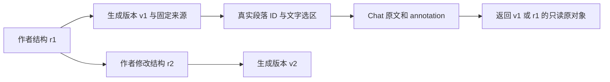

# Scholar 正式段落、选区、annotation 与固定引用续批

日期：2026-10-03，Asia/Kuala_Lumpur。118 个原需求 ID、11 组范围全部保留，**整体验收未通过**。

## 本批实现与证据

| 对应要求 | 当前实现 | 已有证明 | 尚待验收 |
|---|---|---|---|
| G-01 / ST-28 / CH-02、CH-05、CH-07 | 阅读对象固定生成版本与真实段落 ID；思想和成文选区传 UTF-16 精确范围；annotation 与原对象一起留存 | 实际 HTTP / 数据库检查；新增兄弟段落、重新生成、删除原对象后仍返回旧原文；越界、错误文本、拆开 emoji、错误对象／版本均在调用代理前拒绝 | 新 UI 的浏览器操作；Catalog／FieldKG 全部对象与选区；完整批注生命周期 |
| G-02 / CH-09 | 历史消息可打开原修订／原生成段落的只读原文，保留选区高亮和 annotation | 作者与代理消息保留相同原文绑定；原结构删除后仍返回历史快照，当前结构不变 | 建议分型、全部／部分采用／拒绝及采用来源记录，仍未完成 |
| G-03 / CH-06、CH-08 | 草稿记录对象、原版本、选区及 annotation；输入立即写本地；换对象保留草稿原对象，显式重新绑定；旧草稿兼容读取；回复完成不清掉期间新增输入 | 类型与静态检查通过；既有稿件副本恢复仍保留 | 新 Chat 草稿的刷新／离线／多标签／发送期间输入浏览器实跑，跨模块恢复 |
| G-05 / ST-16、ST-28 | 数字引用按首次使用编号；生成时固定 Evidence 和书目信息；点击打开该版本的来源；PDF 固定该版本原生成任务 | 真实 xelatex / bibtex 编译和 PDF 文本读取，引用 1／2 与书目一致；下划线 key 未被转义成另一 key；历史资料摘要校验和固定产物检查 | 正式 UI 点击及完整真实资料／输出流程；历史书目未保存的 Evidence 摘录和位置不能补造 |

新版本在既有 inputs_json 中保留完整生成结构和来源，在 quoted_json 中保留服务器核对过的引用；没有数据库结构迁移或新依赖。
旧版本优先读取原注册生成资料，校验文件范围、大小、摘要及其与版本正文／输入修订的一致性；书目信息从原 BibTeX 读取。
没有可证明结构映射的旧正文只拥有该不可变版本内的区块 ID，不猜当前编辑器对象。历史 PDF 原格式保留，界面如实提示。
生成失败／代理失败保留原文、作者消息与待处理记录，不批准科学决定。

## 检查结果

- 本批新增 11 项检查，连同原 Studio 保存、意见与生成等相关检查，最终 **31 passed**；1 项既有测试依赖警告。
- 类型检查、相关 Oxlint、Ruff、差异空白检查通过。相关静态检查原始结果在 checks.log。
- 最终正式构建五阶段完成、退出 0；完整原始日志在 production-build.log。较早构建与检查日志仍保留。
- 现有隔离服务只读 HTTP：两个旧生成版本均能匹配当时作者段落和原任务的五项产物；当前修订分别为 6／5，旧生成输入均为 1；当前结构和 OPEN 测试问题不变；编译后入口返回 200。
- 原界面四区、竖向标签、Stage 3 Done、意见上下文、导入和本地副本恢复功能保留。
- 本批没有重新运行所有研究模块的完整测试；此前 328 项结果保留原时点，不作为本批新增检查或 UI 证明。

这些测试中的代理文字为明确 TEST_FIXTURE，编译与版本保存使用真实服务。测试通过不证明科研语义质量。

## 浏览器与用户授权状态

用户明确授权临时文件访问并要求验收后恢复关闭；浏览器策略拒绝扩展设置网址，助手没有切换权限。
本轮未观察到 Chrome；应用内浏览器的同一空白页导航两次超时。未以绕路修改设置或用请求成功代替界面证明。
用户随后答复“暂时无法操作，继续代码验收”，因此文件上传浏览器实跑待恢复连接后继续；开启／恢复关闭均未确认。
本批新界面没有截图或交互实跑证明，窄屏仍未验收。G-01、G-02、G-03、G-05 均未整组关闭。

## 后续顺序

继续 G-02 建议分型、明确全部／部分采用／拒绝和来源；G-08 折叠／分组／空容器拖放／模板；G-09 多轮返修基线及输出；G-10 真实总览、Catalog Chat、FieldKG／Track／Pipeline；G-11 完整审核／科研复核闭环。
浏览器可用后实跑本批新操作及 G-03 恢复、G-07 文件流程，最后贯穿所有 11 组。已确认要求无需重新批准。
