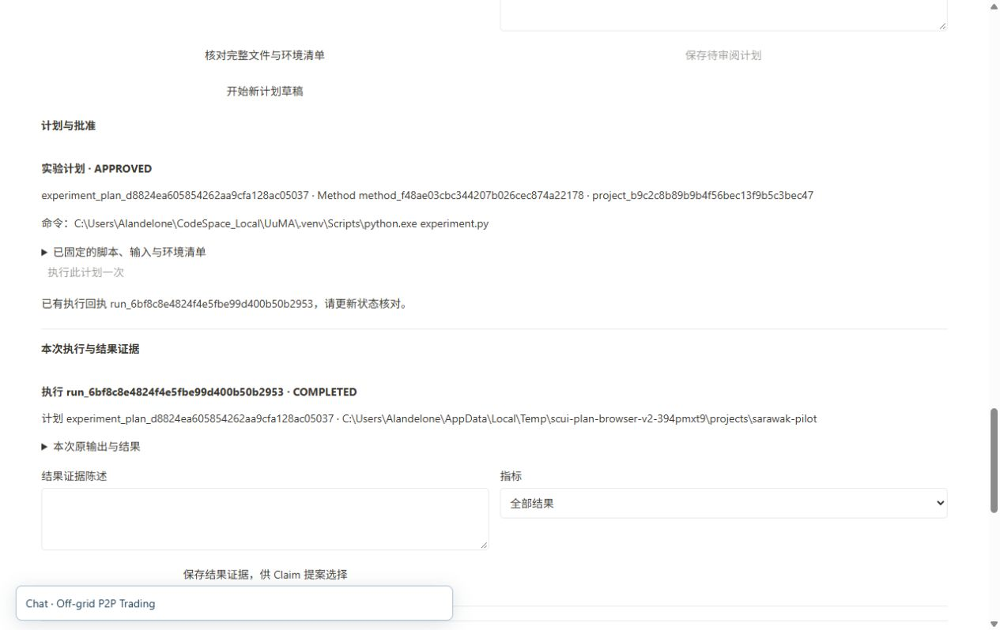

# 实验控制与原来源完成记录 · 最终续批 2026-10-08

**本批软件能力通过；原 118 条要求、全部 11 组整体验收仍未完成。**

已补齐 Project 元数据、实验计划的脚本／输入／环境审阅、真实批准记录读回、一次执行和原请求恢复、结果 Evidence 与独立待审阅 Claim。浏览器隔离软件夹具已走通，旧稿件和记录保持。

最终补验还实际重现并修复 Windows 环境选择问题：裸 python 虽按所选 PATH 显示为验证环境，实际子进程却落在 Anaconda。现将清单、保存计划与实际执行统一固定为已审阅的绝对路径；原实际进程路径断言及 Chrome 实跑均通过。控制服务的 Python／平台信息明确标为 observer，未探测到的所选解释器版本不推断，历史字段不改写。依据 [Python subprocess 文档](https://docs.python.org/3/library/subprocess.html)。

目录变化后，原脚本和失效输入仍可见，输入可明确移除而保留其余草稿。该恢复场景已在 Chrome 实跑。原 Studio 的 Done 返回旧成文且不关闭待改项、生成段落→原版本 Chat，以及问题／批注／面板刷新恢复亦已实跑，没有发送消息或修改稿件。

- **952 项最终完整后端测试通过，20 条依赖警告**；最终产品与测试摘要前后一致，全部控制器／语法／差异检查通过。
- **21 项实验专项、12 项实验工作台检查、11 个当前实验控制场景通过**。UuMA 完整 440 项／5 个子检查、7 项 session 专项通过。
- 当前安装包与 9 个 Catalog 资源及相关后端逐字节匹配；仅刷新已核实归属的闲置 Catalog，原 Studio／前端保留。
- **全部 108 表、schema、数据库字节、旧 5 稿件／7 ZIP／科研记录和 4 条原讨论回执保持**，原请求重试新增任务／模型为 0。
- 原同一重读任务成功，**12 个实际模型层返回**全部复用，发布了 **3 单元新 Skeleton**。旧同步失败保留，没有重跑已完成模型。

此次原来源是软件验证文档，任务成功不代表科研质量通过。新的 Build／真实七类语义质量、科学绑定至成文／返修／发布、模板／旧多来源／离线／多标签／上传，以及完整 11 组浏览器流程仍继续。软件授权夹具不是实际科研批准。Mission 保持 verification／pending_review。

此前 950+1 完整失败、预检查失败、引导观察程序异常与 Windows 错环境的重现均保留，不改写成 PASS。第一阶段记录见 [原封存报告](acceptance.md)。

