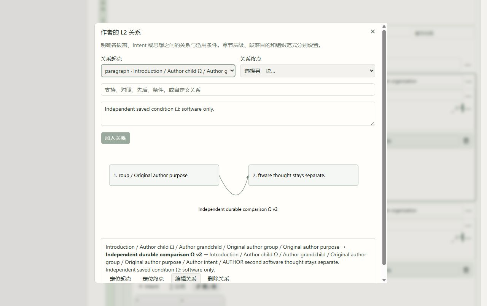

# 子章节与 L2 关系逐项修复及实跑 · 2026-10-08

**本批列明功能和实跑通过；原 118 条、G-01–G-11 保留，11 组整体验收仍未完成。** [前批模板报告](../formal-template-2026-10-08/acceptance.md) 及其 199 份文件重新逐份核验，保持原字节。本报告是其后新增的独立阶段。

作者可以明确指定父章节，新增、提升或重新嵌套子章节。后端验证按阅读顺序的父子关系、相同安置状态和五级标题上限，拒绝循环、外部父章节、非连续后代及过深结构。移动和删除以完整子树为单位，折叠隐藏后代但保留内容与展开状态；段落组保持独立。生成输入保留祖先路径，成文快照保留父编号与深度，Markdown／LaTeX／阅读标题使用相应层级，旧平面输出不变。

段落标签按需打开作者 L2 关系编辑器，以稳定 Paragraph／Intent／Thought 编号连接作者节点，关系含义和适用条件单独保存。可新增、编辑、删除和定位节点，关系图与完整文字列表同时显示；未提交草稿按所属稿件／段落保存，刷新恢复。后端拒绝外部或相同端点、重复或冲突编号、空关系及错误形状。移动保留关系；删除相关作者节点时一起移除关系，Undo 恢复。写作输入冻结两端作者全文和条件并标记 AUTHOR_ARGUMENT_RELATION，不产生科学批准。

嵌套章节的 INSERT 放在目标完整子树之后；REPLACE 将整个原子树转为待安置，记录原父编号，保留后代父子关系、原段落组、思想全文／ID、已选引用、公式和附件。新空模板继承原父章节。撤销恢复完整原文档；原请求重试只读回原采用记录和当前文档，不重新应用。来源仍是固定平面 Skeleton；没有按数字标题、L1–L4 或段落组猜测来源层级。本批没有数据库迁移。

| 实跑 | 实际结果 |
|---|---|
| 新增与整树移动 | Chrome 实际新增并命名 child／grandchild，把原 2 段落组移到 grandchild，提升 child 到主章节，再将整树嵌回 Introduction；原思想、选中引用、2 公式和同一 CSV 保持 |
| 折叠与刷新 | child 折叠后思想输入与 grandchild 入口均为 0；刷新仍折叠，展开完整恢复 |
| L2 草稿与编辑 | 未提交跨段落 Paragraph→Thought 关系草稿刷新恢复；保存、独立编辑、删除及撤销；编辑保持同一 edge ID，条件完整 |
| 整树删除与历史 | 逐项等待保存后 r42→43 DELETE_TREE，r43→44 UNDO，r44→45 REDO，r45→46 UNDO；完整文档与关系逐项精确比较 |
| 嵌套模板替换 | 原 r47 child 子树 REPLACE 到 r48：新 Alpha／Beta 属 Introduction，原 child／grandchild 一起待安置；生成实际拒绝空 Intent／思想及两个待安置章节，0 新生成／模型任务 |
| 撤销和原请求重试 | r48→r49 完整恢复 r47 文档，刷新关系图与节点定位仍可用，旧生成错误清除；同一请求服务 HTTP 重试返回原 r48 采用和当前 r49，整库字节相同。此重试不是额外浏览器操作 |
| 最终显示复验 | 长路径选择框不再撑宽窗口，DOM clientWidth=scrollWidth=753；关系连线和含义文字分开可读；正式构建刷新后同一关系和条件保持 |

软件夹具仍为 manuscript_c9bd5a665e5143eebb0ac01fbd36f74f，当前 r49 留作可复查的作者层级／关系示例。当前完整文档为 Introduction→Author child Ω→Author grandchild，原 2 段落组在 grandchild。独立核对 r27→r49 的 22 条实际持久记录及全表旧行保护；从 base39 起的关键编辑、删除、Undo／Redo逐项等待服务保存后验收。

一次移动入口点击实际触发 DELETE_PARAGRAPH_GROUP，随后正常 Undo 完整恢复，未记为移动通过；后继键盘进入选择器并真实 MOVE_BLOCKS 成功。早期连续编辑／删除／撤销合并保存：base36 的 Undo 恢复本地未单独保存的中间关系文本，并不等于 base35 的上一服务器文档。错误的观察断言失败保留，诊断记录保存这项差异；早期快速操作不记为逐项持久验收。后继 base39 EDIT、40 DELETE、41 UNDO 和42–45整树链分别保存并精确比较，没有削弱产品断言。

**最终完整回归：992 passed、20 条既有依赖警告，pytest 419.14 秒；完整检查 422.80 秒。** 新增20后端契约，含实际生成工作线程的章节路径、独立逻辑关系、两端冻结文字及条件记录。该工作线程测试用软件 gateway 和空编译夹具，不能冒充浏览器模型生成或真实 PDF。69 项聚焦后端、17 移动／分组、8 键盘坐标、7 新整树受控检查、TSC、原配置类型检查和两库差异检查通过。最终全量运行前后源码／测试摘要一致，11 份产品／测试变更与最终回归摘要完全相符。旧全量 v1 的992/20也保留，最终 v2 含截图后显示修复。

隔离正式构建 v1、最终 v2 均通过；最终五阶段构建 14.16 秒，从 C:\Users\Alandelone\AppData\Local\Temp\scui-hierarchy-build-ty6ek0rr\writing-studio 提供相同产物。当前前端根 83900、后端根 32792 的实际 listener 与完整进程祖先独立复核，都为127.0.0.1。仅重启已核验的本批预览 listener。一次旧 GBK 进程输出解码失败，以及一次把 bare node 命令误当必须含 node.exe 的身份检查失败，均在停止／写入前终止；修正为 UTF-8、限定所属进程树、实际 ExecutablePath 和精确创建时间／祖先／旧构建字节验证。原 3000 预览、wheel、dist 和无关进程保持。

原库108表、schema、物理字节、旧5稿件／7 ZIP／科学记录／4原讨论回执和同请求重试复验保持，SHA a2ff55ebd92c70c7d86c643c203c2eda8dea57ac4ae42cf302b33b0bf9805d1b。副本108表/schema核对，变化仅本软件稿件的7张声明作者表；旧行、全局模型及科学表保持，新增真实模型和生成任务均0。原返修稿服务器r9及2份未同步本地副本继续可见，未打开／采用／清除。

| 原组 | 当前证据与剩余范围 |
|---|---|
| G-01 固定对象／选区 | 前批固定版本与精确来源证据保持；全对象和最终纵向流程合验继续 |
| G-02 历史／建议采用 | 前批讨论、建议、采用与原回执保持；完整多来源和全部／部分采用浏览器链继续 |
| G-03 草稿／返回 | 新关系未提交草稿刷新恢复、层级折叠刷新恢复已实跑；旧 2 份本地副本保持；全部工作面和失效恢复合验继续 |
| G-04 Done | 前批实机证据保持；完整纵向流程复验继续 |
| G-05 数字引用 | 固定 PDF、引用与产物保持；新层级里的原引用决定完整保留；完整阅读／回查继续 |
| G-06 活动意见／稳定编号 | 前批关联／解除／删除／恢复原 ID 证据保持；本批树删除／恢复保留原思想与关联；意见全链继续 |
| G-07 导入 | 前批原文与大批预览证据保持；浏览器四格式文件上传仍未完成 |
| G-08 结构／模板 | 显式五级章节、整树移动／删除／折叠、L2 作者关系编辑与图、嵌套目标模板替换及完整撤销新增通过；真实来源嵌套模板、模板拖放、作者显式对应、复杂多边排布和完整生成合验继续 |
| G-09 返修／材料 | 原固定基线、文件入口、回复历史保持；前批实际浏览器 ZIP／PDF 失败仍未解决，本批没有重复或冒充通过 |
| G-10 FieldKG／Track | 原语义调用与空对象保留；学术来源七类内容质量、真实科学决定和完整工作面仍待验 |
| G-11 全流程 | 118 条和全部上述范围保留；Collection→科学审阅→实验→成文→返修→发布真实批准及失效恢复全链未完成 |

浏览器上传权限此前的问题仍未获答复，没有更改扩展／浏览器保护。前批生产副本 ZIP／PDF 的204／缺ACAO失败与相同精确服务URL的200保持各自证据，不将HTTP成功当成原生下载成功。真实科学批准、复杂来源内容质量和11组全流程继续；mission仍为verification、gate pending_review。独立 DSPy ALL、Honc 和控制守卫工作保持。

