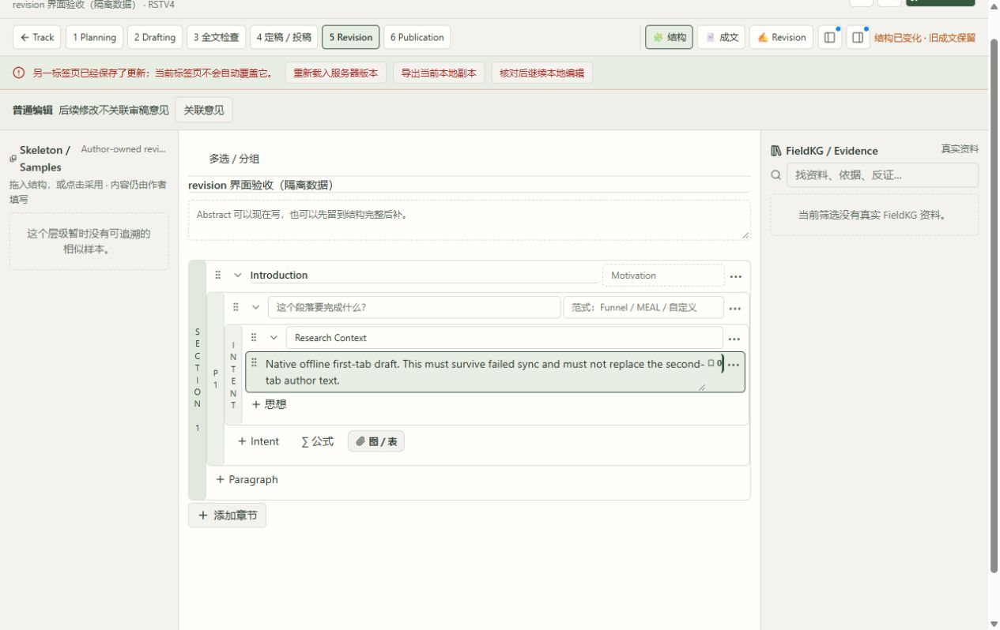
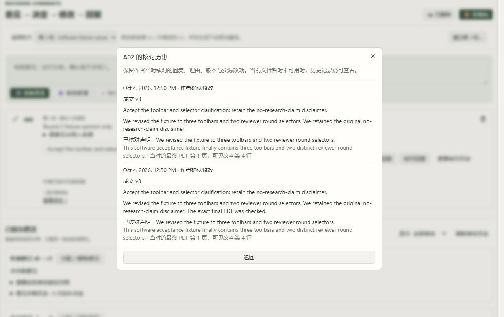

# 原来源 Build 与返修实机续验 · 2026-10-08

**本批新增实机证据；118 条要求、G-01–G-11 全部保留，11 组整体验收仍未完成。**

这次没有修改产品源码。完成原来源 Build 的真实模型恢复，以及审稿意见、离线／双标签、两轮基线和历史核对的浏览器操作。修正的是验收执行上下文；旧失败和缺失基线保持原状。

| 范围 | 本批实际结果 | 尚未关闭的范围 |
|---|---|---|
| G-01 固定对象／选区 | 延用前批固定来源证据，原讨论回执不变 | 跨全部对象、选区及最终完整流程 |
| G-02 历史／建议采用 | 原来源、修改前后对照与作者回复历史可读 | 完整多来源及全部／部分采用浏览器链 |
| G-03 草稿／返回 | 实际离线失败仍保留草稿；第二标签保存后显示冲突且不覆盖；原本地副本下载读回、刷新恢复通过 | 跨全部工作面、滚动与完整流程合验 |
| G-04 Done | 延用前批实机证据 | 最终整流程复验 |
| G-05 数字引用 | 原产物和固定版本保持 | 真实完整引用阅读／回查合验 |
| G-06 活动意见／稳定编号 | A01+A02 同时关联、移除一条、结束、刷新不复活；删除 A01 清上下文，后续修改不关联它；恢复原 ID／编号，A02 不漂移 | 列明的实机步骤通过，完整流程合验继续 |
| G-07 导入 | 两段含空行单条 A105；重复提示不自动合并；101 条全部预览，超量禁止，作者选 100 条后实际导入；未选第 101 条完整原文留在已保存来源；四种文件真实 HTTP 解析通过 | 浏览器文件上传被扩展文件权限阻止，未通过 |
| G-08 结构／模板 | 本批未修改或关闭本组 | 完整嵌套模板、插入／部分采用、明确替换／待安置、Subsection／L2 及拖放 |
| G-09 返修／材料 | 两轮分别固定 v1/r1、v2/r2；16 个固定文件入口；旧修改和两次回复核对历史，最终 PDF 第 1 页可见文本第 4 行读回 | 浏览器 ZIP／PDF 下载失败；完整材料流程仍未通过 |
| G-10 FieldKG／Track | 原新 Skeleton 实建 Build；沿同一语义模型句柄完成，逐一观察 3 单元并返回 0 对象；候选／Gap 均 0，原 12 层不重跑 | 实际科学来源的七类内容质量与完整工作面合验 |
| G-11 全流程 | 本批新增上述纵向恢复证据，原保护保持 | Collection→科学审阅→实验→成文→返修→发布全链、真实批准与失效恢复 |

新 Skeleton 的内容是标题、DOI、截断的软件夹具，分类 Formal／Formal／UNKNOWN。空语义结果符合这份来源；不能为填满流程发明科研发现或 Gap。实际语义调用的原句柄为 run_f69fcf0f8b224b99851df0fdb1ce4bc3，模型回执 SUCCESS；没有科学批准、密封或 Track 采用。本批有这一项新的语义调用，浏览器返修操作新增模型调用／生成任务为 0。

浏览器文件上传被 ChatGPT Chrome 扩展的 Allow access to file URLs 权限阻止，已请求用户临时开启，未获得开启答复。ZIP 与 PDF 点击均显示 Failed to fetch；实际浏览器收到无跨域头的 204，直接打开固定下载入口报 net::ERR_BLOCKED_BY_CLIENT。相同 ZIP 请求在服务端实跑返回 200、正确 Access-Control-Allow-Origin 和原 SHA。原因不能归咎于产品 CORS 或推断成某个设置；没有弱化浏览器保护或修改下载代码。这些浏览器下载不记作通过。

**最终复验：952 passed，20 条依赖警告，完整验收执行 400.28 秒。** 所有本批控制器／语法／差异检查通过，源码与测试运行前后摘要一致。原 108 表、schema、DB 字节、旧 5 稿件／7 ZIP／科学记录、4 条原讨论回执和原请求重试均保持；原重试新任务／模型为 0。物理 DB SHA 为 a2ff55ebd92c70c7d86c643c203c2eda8dea57ac4ae42cf302b33b0bf9805d1b。

写入只发生在 scui-revision-native-p48co4i6 副本：新增 101 意见、编辑 r6→r7、补偿 Undo r7→r8、第二标签 r8→r9；离线原操作未应用。所有旧历史不变。副本初次文件不可用的失败保留，仅重定位 30 个已核实、字节相同的副本产物路径；原库路径和字节未改。

失败与修正：Build v1 漏列 AUTOINCREMENT 配套序列表，其前摘要未保存，不重建历史证明；后继只读原 Build 并恢复原句柄，全表核对只有语义运行变化。返修 audit v1 漏列 A01 删除／恢复推进的唯一 reply state，后继精确核验新增 A01 revision2 和原行不变；v2 原文比较错误使用 read_text 转换 CRLF，v3 比较上传原字节解码，原文与拒绝请求全库字节保护保持。v4 用实际 base_revision/resulting_revision 严格核对三步编辑链，补足 v3 可选字段没有建立的关联断言。工具 checkbox uncheck 和下载观察超时均保留；真实 click／Space 与实际本地 JSON 分别核实。

执行约束已写入 rules/scholar-native-acceptance.md、findings 与 execution brief。Mission 保持 verification／pending_review；未触碰独立 DSPy ALL、Honc 或控制守卫任务。下一批优先处理 G-08 完整模板，再恢复文件浏览器验收与全部 11 组纵向流程；本报告不能替代科学内容和用户审阅。

