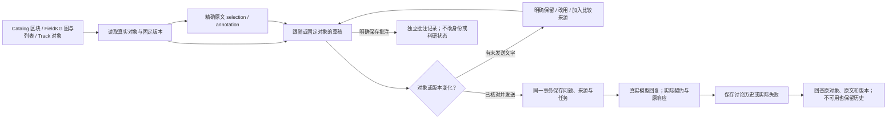

# Catalog／FieldKG／Track 固定来源讨论：本批验收

2026-10-05 · Asia/Kuala_Lumpur。原 118 条要求和 11 组完整保留；整体验收、G-01／G-02／G-03／G-10 均未关闭。

## 本批结果与边界

| 原要求 | 现有代码与实际证据 | 继续验收的范围 |
|---|---|---|
| CH-03 | Catalog 详情、Identity 属性、QuickRead 部分、Parse、Skeleton 及独立原文单元可绑定讨论；PDF 核对页保留 DOI／标题修正，另有“讨论原文／讨论批注”入口。实际 PDF 内容与文件摘要检查通过合约。 | 普通 Catalog PDF 阅读面尚未完整统一；论文、解析、QuickRead 的全部操作仍需实际浏览器验证。 |
| CH-04／KG-09 | FieldKG 图／列表的论文、原始概念、原文单元、节点、边、候选、Gap、Evidence 与 Snapshot 传真实 Field／对象／固定版本；Track 节点与边保留所属 Track。 | 当前实现支持这些实际对象；完整语义图谱、其他未来对象、来源往返视觉高亮仍待整体实跑。 |
| CH-05 | Chat 显示对象类型、来源标签、原文、文件／解析／Skeleton／Snapshot 版本、选区与批注，可移除选区；未知标未知。 | Studio 现有四区与精确引用保持原实现，本批没有修改其产品组件；跨模块展示仍未形成一个共享 Studio 会话。 |
| CH-06 | 跟随／固定对象；有文字的草稿遇到新对象时明确比较，保留原对象／改用新对象保留文字／加入额外固定来源。发送固定内容摘要，变化先拒绝；跨研究范围需要明确选择。 | 每条讨论是独立固定来源问答；多轮对话上下文、统一 Studio 会话与共享建议采用仍待接通。 |
| CH-07 | UTF-16 原文位置严格核对；空格、换行与 Unicode 保留；对象变版／删除后的原消息留固定内容，完整性损坏返回不可用。 | 历史可读回固定来源，旧版／不可用状态由真实比较返回；跨页面对象定位、移动／删除的真实界面流程继续。 |
| CH-08 | 底部展开／收起、当前对象筛选、更早历史、单独批注、对象与版本草稿；未知提交核对原 ID，模型失败有作者问题与调用记录。 | 本机存储失效保留窗口文字并如实说明；关页、断线、多标签页及大库小屏浏览器路径继续。 |
| CH-09 | 点历史分别回查每个固定来源；可用历史原文继续提问，不换成邻居对象。额外来源分别保存，失败不显示假回复。 | 当前回查展示原固定内容；完整跨模块返回与页面高亮仍未验收。 |
| CH-10 | 回复为普通讨论，批注独立保存；模型不能自动接受候选、密封／采用 Snapshot、批准科学决定或改稿；实际科研表不变。 | 结构／来源／措辞建议分型及完整／部分采用沿用已有 Studio 能力，本批未统一到研究 Chat。 |

页面沿用既有紧凑蓝色列表、字体与核对操作；应用了已读取的 design-taste-frontend 的先审计原则和 Web Interface Guidelines 的语义按钮、焦点、标签、状态通知、历史及明确失败处理。受控状态检查不是浏览器视觉验收。

## 实际链路

## 通过的证据

- **67 项相关后端通过**，23.44 秒、1 项既有依赖警告；包含 21 项新讨论契约、19 项 FieldKG、16 项研究结构、11 项 Catalog。测试均以真实 SQLite 事务、版本、来源和实际 PDF 提取验证；模型部分使用明确标注的替身。
- **18 项实际模块受控讨论状态检查**通过：对象切换／异步旧返回／固定／Unicode 选区／草稿／存储不可用／未知结果／失败／跨范围／历史失效／原请求重试。原工作面 14 项、总览 11 项、返回导航 11 项单列通过，不与以前整套计数相加。
- 当前 JS 与页面脚本解析、Ruff、Oxlint 和差异检查通过。writing-studio 产品源文件及前一批构建来源未变，本批没有重复构建或声称新增浏览器验收。
- **真实隔离 HTTP 与模型调用通过**：1 条固定 Snapshot 原文问题、1 条讨论批注；实际模型 `gemini-3.7-flash`，契约 `research-chat-v1-fixed-sources`，实际输入／输出 token 用量有原回执。保存完整问题、原选区、annotation、版本、请求、实际输出、原 HTTP 响应与契约。重复批注与问题返回原记录，不再调用模型；错误原文 422，旧摘要 409，拒绝后无新任务。
- 最后只读核对：1 个模型任务、2 条消息、1 条批注；数据库字节一致，当前页面／两份脚本与源码字节一致；0 新操作、0 新模型调用。旧 5 份稿件工作区、7 个投稿包 ZIP 与科研／候选／快照／采用／Studio 模型记录均保持原值。

以上证明软件链路与保存／重试约束，不证明真实科研语义质量或 11 组整体通过。

## 已修复并保留的失败

1. 当前 FastAPI 无 add_event_handler；改为 lifespan 的 finally 关闭讨论执行器。原失败日志保留。
2. 错误／旧来源的事务会连新增表一起撤回。测试改为核对数据库字节完全不变并确认无表、无任务、无调用，未削弱原约束。
3. 初始导入排版和 prefer-const 检查已修正，原日志保留。
4. 实际接口发现 StrictModel 默认裁掉选区末尾空格。QuoteInput 与原始对象 ID 关闭此裁剪，新增空格／换行／Unicode 原文严格保留契约。首次错误选区被拒绝，没有批注或模型任务；随后旧运行时仍拒绝的回执也保留。
5. 一次启动帮助文件版本替换误指不存在的旧帮助文件，发生在服务核对前，没有重启；修正后验证进程、后代和端口，仅重启原隔离 Catalog。最新 Catalog 进程 43852；Studio 和前端保持原实例。

## 可查看的实际环境

[打开固定 FieldKG 软件验收来源](http://127.0.0.1:8885/?view=fieldkg&field=field_785167b274c54c2f921390317406d0a7&snapshot=fieldkg_snapshot_168ec05c7a2e4ad4a070b224c88e1189)。这里是原隔离验收数据库，原稿件没有重建。Chat 来源选择与批注可由图、列表和原文打开。Chrome 手动操作仍延期；助手没有切换扩展文件网址权限，开启／关闭情况均未确认。

## 完整目标继续

保持原 118 条／11 组，下一步接通多轮讨论／Studio 共享来源与会话、完整建议采用及跨模块返回；继续 G-10 的完整语义 KG／范围文献，G-11 Collection／审核恢复／科研复核重新绑定，以及 G-03 离线、G-07 文件上传、G-08 完整模板结构和最终实际界面／全部流程验收。科学授权边界及 mission verification／pending_review 均未改变。
