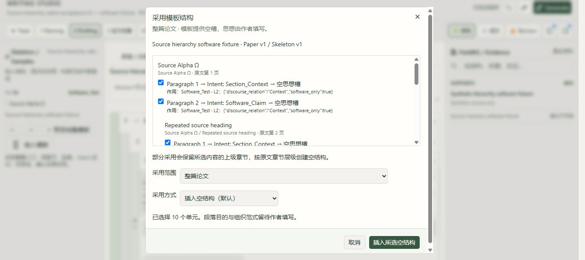

# 2026-10-09 来源明确层级与原稿保留续批验收

原 118 条要求、G-01 至 G-11 整体验收仍未完成。本批仅补齐并实跑 G-08 的明确来源层级软件链及弹窗可操作性，不批准科学内容、科研节点、生产发布或 gate。

## 修复和来源契约

- 保留 MinerU 内容列表给出的 `text_level` 及页码、bbox、内容索引。根据同一完成解析中的明确层级和块身份建立父子关系；不用标题编号、L1–L4 或同名标题猜关系。
- Catalog 12→13 仅新增 `skeleton_source_outlines`。在新隔离副本内迁移，原运行副本仍为原结构。旧 108 表原记录、原来源上下文与 golden 数据库 SHA 保持；迁移备份和历史保留。
- 新 Skeleton 身份包含来源层级。来源块、阅读顺序、页码或文字不匹配、层级跳跃、缺少父级、篡改 outline/parse 时拒绝发布或新采用。旧平面来源不追加字段、不改摘要或历史。
- 全模板预览显示章节路径和原文页码。部分采用保留所选单元的祖先空章节；相同标题的不同章节使用不同来源身份。章节、段落与 Intent 保留固定来源出处，不复制来源正文到作者思想。
- 在作者子章节处插入，只把新增根章节接到目标所属父级，保留模板内部父子关系。替换仍保留作者原内容到待安置，原内容未安置则阻止生成。
- 原生 1366×607 窗口曾裁切弹窗。最后仅调整弹窗最大高度、滚动与内部列表高度；类型检查、静态检查、隔离构建及修复后原生替换通过。

## 实跑与持久记录

新软件稿件 `manuscript_98c35f5b5557453583cb20df8d52810d`，原作者初始化 r1；新增 7 次实际保存，最终 r8 与 r1 完整文档相同。来源是明确标注的合成软件数据，不是合格学术来源或科学批准。

| 保存版本 | 实际操作和结果 |
|---|---|
| r2 | 仅采用第三层的一项单元，同时创建其完整三级祖先路径 |
| r3 | 刷新后撤销，完整恢复 r1 |
| r4 | 重做，完整恢复 r2 |
| r5 | 在既有子章节目标采用完整 5 章节／10 单元，新增根接到正确父级、内部三级关系保留 |
| r6 | 快速连续两次 UI 撤销合并为一次持久 UNDO，恢复 r1；中间 UI 画面不是独立保存版本 |
| r7 | 修复弹窗后明确确认整篇替换，原作者章节进入待安置；原生 Generate 检查拒绝空思想和待安置内容，未创建任务或模型调用 |
| r8 | 刷新后撤销整篇替换，完整恢复 r1 |

每个保存版本的前后文档、逆向记录、固定来源及采用记录已独立核对。原作者 2 思想、2 选中引用、2 公式、同一 CSV 的 2 关联、原段落组和完整 L2 边／条件保持。CSV 字节和 SHA、原运行副本全部 108 表、旧来源以及 golden DB 字节均保持。新增真实模型调用、生成任务、科学批准均为 0。

## 检查结果和保留失败

针对性 65 项通过；版本契约修正后的最窄检查 24 项通过。完整回归 1,015 项通过、20 条原有警告，23 项流程检查全通过，运行中源码摘要不变。最新完整日志 SHA256 `82e30366c32968fd5c5025f60ec5e43c96aa2744a3aeb07adab2b34aaa7ddb2d`，pytest 424.72 秒；全流程 427.75 秒。

完整回归后唯一产品差异是模板弹窗的两个显示类，原文差异已严格核对；最后类型／静态／diff 检查与构建通过，后台及测试代码保持该完整回归时的字节。最终 build v2 5.132 秒。

失败全部保留：首轮页码读取转换错误（9 失败／56 通过）；新测试误用不存在的物理模型调用表（1 失败／64 通过）；旧 schema12 数值断言（1 失败／1014 通过），先记录执行契约再适配声明版本，字节与历史断言保持；两次裁切弹窗的原生替换未产生操作，不记通过，修复后 r7 才记成功；PowerShell 元数据 GBK 解码失败发生在进程维护之前，显式 UTF-8 后复用成功构建、严格所有权校验；文件清单子命令完成，但会话日志写入冲突，保留错误并改为等运行句柄终止后再启动下一个日志命令。没有修改会话引擎或弱化断言。

## 原 11 组仍待完整验收

| 组 | 当前界限／后续实跑 |
|---|---|
| G-01 | 固定对象各层的完整纵向链与全部交互继续 |
| G-02 | 多来源、完整与部分建议全场景继续 |
| G-03 | 多工作台、离线、草稿、原本地副本及失效恢复继续 |
| G-04 | Done 完整链和所有对象继续 |
| G-05 | 实际学术引用、完整阅读上下文及固定来源继续 |
| G-06 | 完整评论关联链与稳定对象身份继续 |
| G-07 | 四格式原生文件输入尚未通过；既有权限问题和错误 TXT 路径记录保留 |
| G-08 | 明确来源层级软件链已通过；实际合格学术来源层级、原作者内容到任意 Intent 空槽的明确对应、复杂多边论证和完整分层生成仍待验收 |
| G-09 | ZIP/PDF 原生下载按用户要求暂停；其余 Revision 完整链继续 |
| G-10 | 真实七类科学内容、来源质量和真实用户批准继续；软件夹具不代替科学验收 |
| G-11 | Collection→审核→Experiment→生成→Revision→Publication 与失效恢复的完整 118 条逐项验收仍未完成 |

用户说“it's pop out , dont test this download thing first”并手动关闭弹窗。下载保持暂停，不打开下载页／文件弹窗，不改变浏览器或扩展权限。原 12 个 DONE 来源调用不重复；原本地副本、DSPy/Honc/control-guard 工作保持。

最终来源预览留在 Chrome 3 的 tab 1479454355，整篇 INSERT 默认、10 单元待核对，未提交；原稿 r8 保持。原两页 tab1479454207/1479454178 及未提交草稿保留。当前新预览 3005/8878 与原预览 3004/8877 分离。

