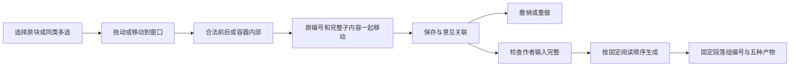

# Scholar 结构编辑：本批代码和隔离流程验收

日期：2026-10-04 · Asia/Kuala_Lumpur。原 **118 条要求、11 组全部保留；整体验收未通过。**

## 本批实现

| 行为 | 已实现与证据 | 仍需验收 |
|---|---|---|
| 连续结构折叠 | 章节、段落组、段落、Intent 可折叠；只隐藏内容，保存全文；视图偏好和网址记录折叠状态；定位思想时展开所属容器 | 浏览器点击、刷新、历史跳转、窄屏 |
| 拖动与明确位置 | 同类前后、正确容器内部和空容器目标；实际目标文字提示；稳定编号寻址；保留全部子内容 | 浏览器手势和滚动、键盘真实事件 |
| 点击／键盘替代入口 | 每块菜单可打开具名移动窗口；选择前／后／里面与合法目标；各层六点把手转交键盘操作，Delete 只在把手删除块 | 实际焦点、窗口关闭返回、辅助技术 |
| 多选与段落组 | 同类多选移动；同章节未分组段落集中为组；空组可接收段落；解除分组保留原内容；删除组及段落是明确独立操作 | 实际多选、误操作恢复与完整模板替换 |
| 标签设置 | 点击原竖向标签同时选定 Chat 对象、展开设置；保留自定义 Intent／范式；可选文字正立、旋转、横排 | 中文长标签、狭窄区域和真实视觉效果 |
| 保存与追溯 | 后台验证成员归属、唯一编号和完整阅读顺序；错误请求完整拒绝；原文操作、意见关联、Undo／Redo 和固定历史版本保留 | 多标签／离线的完整结构操作 |
| Chat 与生成 | 组对应准确原对象；结构建议向组或章节加入空段落时保持组及阅读顺序；移动后生成按实际顺序，固定生成版本保留组编号 | 全模块 Chat、完整语义质量、全部来源与输出 |

沿用既有四区编辑器、组件库和原交互。新增组只引用原段落编号，不复制作者内容。组本身不是额外论文标题。
遇到空段落组或作者用途未定，允许保存草稿，但 Generate 指出具体组并拒绝，不能悄悄忽略。
移动记录现在比较父容器和子项顺序；仅文字未变也会记录所属对象改变。

## 检查与实际流程

- 新增 20 项后台契约；连同既有 Studio／意见／固定上下文／建议／实际 PDF 检查，**78 passed**；1 项既有测试依赖警告。
- **17 项**受控移动／分组／关联检查，**8 项**实际键盘坐标函数检查；包含空容器、跨容器、批量原顺序、非法目标、折叠隐藏和保留图表公式。它们没有操作浏览器。测试已加入前端项目，可运行 `npm run test:structure`。
- 相关 Ruff、类型检查、Oxlint、差异检查通过；正式构建五阶段完成、退出 0。入口 HTTP 200。
- 隔离稿件：保存组 r1 → 移到空章节 r2 → 撤销 r3 → 重做 r4 → 实际模型生成／实际编译 → 解组 r5 → 撤销解组 r6。原思想、图表、公式与编号保留；此前三份验收稿的完整工作区摘要未变。
- 原组 Chat 实际回复约 6.61 秒，讨论不改作者输入；解组后原 Chat 仍读取 r1 原内容。当前稿件最终 r6，r4 生成稿保留，正确显示需重新生成。
- 固定生成段落按真实章节／段落顺序；组成员带原组编号。Markdown、JSON、TeX、Bib、PDF 五种产物均实际通过 HTTP 交付，内容与注册文件相同；PDF 具有有效文件头。
- 初次测试脚本错误地把创建决定的 HTTP 状态写成 200；实际契约为 201，已按契约修正。初次实跑脚本的 `job_kind` 被拒绝 422；按正式 `kind` 字段从同一稿件续跑，没有重复讨论、上传或编辑。这两处是验收脚本问题。

真实模型采用未替换的既有网关，软件 fixture 没有科研主张。当前产品没有为普通讨论和生成段落保存模型契约；不能据此指出实际模型名称，也不代表科学语义通过。这项追溯缺口继续留在验收范围内。

## 完整范围仍未关闭

G-08 还缺完整嵌套模板插入、来源／版本与局部采用、替换后的内容匹配与待安置区、Subsection 与 L2 关系。现有段落组基础不能代替这些要求。
G-01／G-02 的 Catalog／FieldKG Chat，G-03 跨页完整草稿，G-09 多轮返修、基线、关联和输出，G-10 总览／Catalog／FieldKG／Track／Pipeline，G-11 完整采集审核与科研复核恢复，继续按原范围处理。

用户已答复“暂时无法操作，继续代码验收”。本批未操作 Chrome 扩展权限；手动开启和验收后关闭均未确认。新折叠、移动、设置、文件上传及窄屏没有浏览器实跑证据。
只重启核实归属的隔离 Studio 与前端；共享模型服务及科研优化任务未重启，冻结科研模块和正式研究数据未改动。没有依赖或数据库表／版本变化，没有科学采用或阶段门批准。
