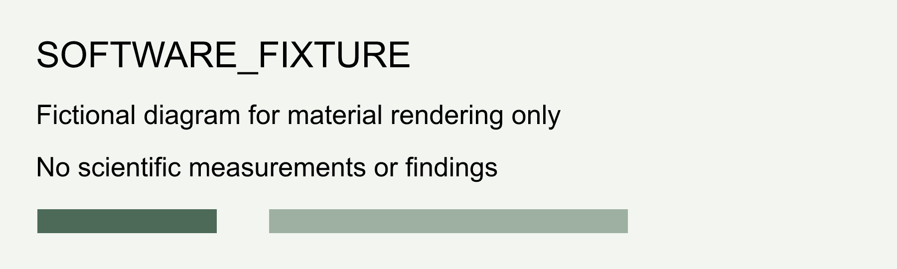

# Fixed citation source - software acceptance

## Other software source

G09 software acceptance slot 1: this author note fills a template slot only; no scientific claim or external source is asserted.

**software-only-table.csv**
| SOFTWARE_FIXTURE | fictional_value | qualification |
| --- | --- | --- |
| alpha_demo | 1 | Software rendering test only; no scientific measurement |
| beta_demo | 2 | Software rendering test only; no scientific measurement |

[Original material: software-only-table.csv](material-asset_ea004de6f5da423ba6ab98710d9a9458-source.csv)

[Original material: software-only-figure.svg](material-asset_65e4b91ba806497e9afd0c7c514c7d1b-source.svg)

### Introduction

Beta software original paragraph. Keep this second paragraph's original source and conditions; no scientific claim is asserted. [@evidence_b5348fa59b3948ae9540b75a33ca9bd9] [@evidence_3a2639ee8b5e432aafd7e3743c825f33]

SOFTWARE_FIXTURE: Check original sources only and preserve their original conditions without asserting any scientific claim; retain both original source-only and source-condition boundaries in this shared sentence and in their separate sentences. [@evidence_b5348fa59b3948ae9540b75a33ca9bd9] [@evidence_6b169de2b78d452f919391b00916f2c8] Check original sources only; no scientific claim is asserted. SOFTWARE_FIXTURE C-MANY author clarification: preserve this source-only restriction in the shared sentence and in the separate source-check sentence. [@evidence_b5348fa59b3948ae9540b75a33ca9bd9] [@evidence_6b169de2b78d452f919391b00916f2c8] G09 software boundary: preserve the original sources and their conditions; no scientific claim is asserted. SOFTWARE_FIXTURE C-MANY author clarification: retain this original boundary in the shared sentence and in the separate source-condition sentence.

G09 software acceptance slot 2: this author note fills a template slot only; no scientific claim or external source is asserted.

### Software source section 3

G09 software acceptance slot 3: this author note fills a template slot only; no scientific claim or external source is asserted.

### Software source section 1

G09 software acceptance slot 9: this paragraph preserves the original empty section in the generated workflow; no scientific claim is asserted.

### Software source section 2

G09 software acceptance slot 5: this author note fills a template slot only; no scientific claim or external source is asserted.

### Software source section 3

G09 software acceptance slot 6: this author note fills a template slot only; no scientific claim or external source is asserted.

### New section

G09 software acceptance slot 7: this author note fills a template slot only; no scientific claim or external source is asserted.

G09 software acceptance slot 8: the original empty paragraph is retained and filled for this workflow test; no scientific claim is asserted.
