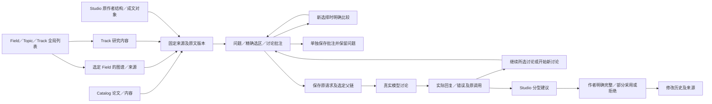

# Studio 共享讨论续批验收 · 2026-10-05

**本批已完成代码接入和隔离真实接口验收；原 118 条要求／11 组差距仍在范围内，正式产品尚未整体通过验收。**

## 这次落实的交互

| 位置／操作 | 当前实现与证据 | 仍需验收的边界 |
| --- | --- | --- |
| Studio 结构或成文点击对象／拖选文字 | 使用 Catalog／FieldKG／Track 同一份讨论控制器；固定实际稿件、作者 revision、成文 version、稳定对象 ID、原文与 UTF-16 选区；保留原四区布局 | 实际浏览器中的点击、拖选、高亮、窄屏与键盘仍待实跑 |
| 已有问题、批注、引用或固定对象后再选 | 显示来源比较，可保留原对象、明确改用新对象或添加比较来源；旧对象草稿保留 | 跨模块页面返回、原对象高亮、共享会话导航继续 |
| 批注与问答 | 独立保存讨论批注保留未发送问题及当前父链；问题与批注都有精确原引用和版本；原提交不确定时核对相同请求 | 普通 PDF 阅读面、实际上传与完整离线场景继续 |
| 多轮／历史分支 | 显示将带入的原问题、原回复和每个固定来源；可继续实际回复或明确开始新讨论；旧版／来源不可用如实标记 | 旧独立 Studio Chat 消息保留可读，未自动转换成新的共享父链；完整旧会话迁移继续 |
| 原调用记录／旧原文回查 | 共享消息在研究讨论与 Studio 原讨论区使用同一消息 ID；真实 writing_chat 输入、输出、模型契约和错误留存；列表、原文回查、建议预览与采用都核对原记录 | 原调用详情目前仍有可展开原始记录；进一步友好显示继续 |
| 分型建议采用 | 保留既有 StudioSuggestionReview 与目标／原版本校验；完整采用、部分采用、拒绝、重复操作仍走既有明确决定接口 | 本批真实模型仅讨论，不修改稿件；建议采用的真实界面端到端仍待实跑 |
| 恢复旧草稿 | 无绑定旧问题不会被默认当前稿件吞掉；来源不可用时保留原对象、文字、批注和选区并禁止发送，等待明确核对；存储权限不可用时保留窗口内文字 | 真实断线、两标签、关页重开与冲突继续 |

### 统一讨论流程

全局 Field／Topic／Track 列表继续作为独立导航入口；FieldKG 展示选定 Field 的图谱。本图说明本批讨论接入关系，不代表 Collection、完整科学知识图谱或全 pipeline 已通过。

## 代码与接口证据

- 主集成验证 **140 项相关后端测试通过**，72.42 秒、1 条既有 Starlette/httpx 弃用警告；包含新增 **18 项**共享 Studio 契约，以及原作者结构、生成原文、建议采用、旧研究 Chat 和多轮历史契约。模型使用明确测试替身。
- 最后补原文回查完整性后，**29 项**共享 Studio／原文相关测试再次通过，18.55 秒、同一既有警告。这些测试与 140 项有重叠，不能相加为独立覆盖数。
- 最终前端 **28 项**受控讨论状态检查通过：含保存批注保留问题／父链、生成对象精确版本续问。TypeScript、Oxlint、当前生产构建和差异检查通过；没有新增依赖。
- 真 SQLite 事务验证原文、历史版本、生成文件完整性、精确选区、所属稿件、固定来源、原调用、建议的完整／部分采用、回放幂等、原子回滚及失败保留；只读来源解析不创建 StudioService，不初始化稿件或重置其他 RUNNING 作业。
- 两个服务均接同一语义 `/api/research/discussion` 协议；保留既有 Catalog 和 Studio 接口。无新数据库表或迁移；保存新的 Studio 投影及真实模型调用记录。新可选 Studio target 字段不写入旧非 Studio 请求，旧请求与旧来源摘要保持兼容。
- **真实模型两轮通过**，实际模型 `gemini-3.7-flash`、契约 `writing-chat-v3-fixed-conversation`。第一轮实际 prompt 1404／completion 30；第二轮 prompt 2431／completion 41。第二轮完整带入第一轮原问题、回复、标题选区、批注和结构 r0，并准确复述上一轮用户意图。实际 HTTP 响应、输入、输出及契约均保存。
- 原研究 Chat v1／v2 和两轮新 Studio 请求，在加载最终代码后再次使用原请求核对；**0 新任务／0 新模型调用，数据库字节不变**。共 4 个讨论任务／8 条消息／2 条讨论批注；原 Studio 模型记录 4 条完整保留，仅增加新软件验收稿件所属的 2 条真实 writing_chat 调用，总计 6 条。
- 原 **5 份稿件、7 个 ZIP、8 张科研／候选／Snapshot／采用表**保持原摘要；原 Studio 模型表的全部已有行也保持原摘要。软件验收稿件结构仍为 r0，未自动采用建议或改变科研状态。
- 当前 Catalog 页面／脚本字节等于源码；当前前端正式服务提供的 7 份 JS／CSS 资源字节等于最后构建。记录 **64 份源码摘要／16 份证据摘要／7 份当前编译资源摘要**。HTTP 与资源检查不算浏览器交互验收。

## 修复过程与限制

1. 首轮共享投影测试使用了公共消息的 `reply_to` 来读既有 Studio 表；该表真实字段为 `parent_message_id`。按真实 schema 修正后主集成 140 项通过。首轮 9 项失败／9 项通过的工具输出保留在会话中，没有单独完整文件日志，未宣称文件日志存在。
2. 首轮检查的工作目录错误，触发后端 import 分类差异；检查改在 RSTV4 目录执行并修正 import，原失败日志保留。没有降低断言或绕过检查。
3. 前端首轮发现缺依赖、冗余 spread、复选框标签缺关联和状态标签语义问题；逐项修复，最后检查及构建通过。原失败日志保留。
4. 首个真实验收 helper 错把 Studio 模型表列写为 `model_call_id`；真实字段是 `call_id`。修正前仅只读核对，没有提交模型或批注。首个部分 receipt／helper 保留。复制 helper 时旧证据文件名被误改，启动即停止、没有提交；改回真实旧文件名后完整实跑通过。
5. 最后复查增加直接原文回查的投影核对，并保留不可用的旧草稿对象。最新 29 项后端及 28 项状态检查、编译构建、最终运行核对均通过。

## 当前环境与下一批

原隔离根目录 `C:\Users\Alandelone\AppData\Local\Temp\scholar-ui-fixes-2026-10-03-8pn_4t3h`；当前拥有的 Catalog 32448／Studio 43852（监听子进程 49748）／生产前端 49196。仅在确认进程身份、父子关系、监听归属及没有 QUEUED／RUNNING 工作后更新这些隔离服务；服务旧 receipt 和日志保留。

仍继续：共享会话与历史跨模块定位／返回高亮、完整语义 KG 与范围文献、Collection、审核恢复与科研复核重新绑定、离线与上传、完整模板、真实浏览器及整条 pipeline。原 G-01／G-02／G-03／G-10 与全部 11 组未整体关闭，mission 保持 verification／pending_review。

按用户“暂时无法操作，继续代码验收”执行。助手没有更改 Chrome 扩展文件网址权限；用户手动开启／恢复状态未知，没有再次尝试未变化的连接或设置。没有生产数据、科学决定或阶段 gate 审批。
