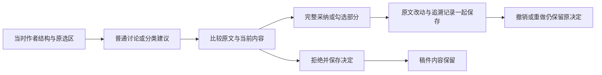

# Scholar 建议审核：本批代码与隔离接口验收

日期：2026-10-03 · Asia/Kuala_Lumpur。原 **118 条要求、11 组**全部保留。**整体验收尚未通过。**

## 本批完成的行为

| 要求 | 当前实现与证据 | 仍需验收 |
|---|---|---|
| G-02 / CH-10 普通讨论、结构、来源、措辞分清 | 普通回复保持讨论；其余返回明确类别、实际目标与独立改动；删除任意回复直接加入当前 Intent 的旧按钮 | 新界面逐项点击与完整真实讨论；Catalog／FieldKG 尚未接入 |
| 完整／部分采纳／拒绝 | 显示原文、当前内容、拟采用内容；独立勾选；拒绝只记决定；同项不可重复应用，未采用部分可继续比较 | 浏览器完整操作、刷新／断线恢复与窄屏 |
| 原对象和版本 | 建议绑定当时真实作者结构；生成稿讨论使用当时输入修订；当前选择不会把建议转给另一 Intent | 所有模块及历史旧数据的完整往返 |
| 改过／删除／失效 | 改过的目标必须明确确认；目标删除、选区位移、来源不存在或不属于本稿范围时拒绝；不找邻居或自动重找文字 | 实际浏览器异常与来源页往返 |
| 保留作者内容与引用 | 结构插入只加空槽；措辞只替换原始 UTF-16 范围；来源只加入未选中候选；原思想、引用选择、图表、公式、稳定编号保留 | 完整模板更换、待安置区、科研语义质量 |
| 保存、重试、撤销与追溯 | 原文修改、操作、意见关联和决定同次提交；记录原建议／原对象／模型契约／采用项；同决定重试不重复；Undo／Redo 保留历史 | 实际多标签、断线和界面撤销／恢复 |

新审核窗口使用具名勾选框、窗口标题、状态提示与键盘可访问的组件，沿用正式 Studio 四区与竖向标签。
原对象更新确认属于作者采用决定，不能自动批准科学节点、Snapshot 或关闭审核问题。

## 实际检查结果

- 新增 **27 项**后台契约检查，连同既有 Studio／意见／固定版本／真实编译检查，**58 passed**；1 项既有 Starlette 测试依赖警告。
- **9 项受控回复状态检查**：包括等待时新增输入、服务器已有后续修订、相同决定重试、拒绝和 JSON 字段排序；分类不修改本地作者内容。它们没有操作浏览器。
- 类型、相关 Oxlint、Ruff、差异空白检查通过；正式构建五阶段完成、退出 0。早期格式／可访问性失败日志保留，问题已修复。后台测试原日志包含后续的一项格式检查失败；最终 checks.log 为通过结果。
- **真实模型讨论**：通过隔离服务调用现有本地网关，无文字替身，实际模型返回 `gemini-3.7-flash`、`writing-chat-v2-author-decisions`；一次调用约 8.97 秒，返回两项结构改动。
- **真实 HTTP 决定流程**：新隔离稿件 r1 → 部分采纳 r2 → 同决定重试仍 r2 → 拒绝仍 r2 → 采纳剩余项 r3。决定原对象始终为 r1；原思想、引用与编号保留。讨论本身不改稿。
- 该模型调用只验证明确软件 fixture 的结构建议和决定流程。来源／措辞规则另有受控后台检查；没有据此宣布模型整体表达或科学质量通过。
- 两份此前隔离验收稿及其现有状态保持原值；前端入口 HTTP 200。HTTP 成功和构建不证明界面点击已实跑。本批没有重新运行所有研究模块的完整回归，旧 328 项结果仍属于此前时点。

## 数据与运行范围

仅在原隔离 Catalog 中新增一份建议验收稿和相关 Chat／决定／作者操作；没有写入正式研究数据。
新增 `studio_suggestion_decisions` 表，启动时以 `CREATE TABLE IF NOT EXISTS` 加入旧库；保留现有表、记录和 Catalog 版本号，无新依赖。
采用与普通保存现在先锁定写入，再读实际作者修订，防止两次保存互相覆盖。并发检查确认同决定仅应用一次，不同旧版本写入有一个被拒绝。
只重启已核实归属的 Studio 和前端；保留共享模型服务、科研任务及原输入。

## 尚未通过的验收

用户已答复“暂时无法操作，继续代码验收”。本批没有恢复 Chrome 或切换扩展权限；临时授权继续有效，手动开启和验收后恢复关闭均未确认。
新审核窗口、最新选区／批注／草稿、文件上传和窄屏均缺浏览器实跑。G-02 与整体 11 组不关闭。
继续处理 G-08 折叠／分组／空容器与完整模板、G-09 多轮返修基线／关联／输出、G-10 总览／Catalog Chat／FieldKG／Track／Pipeline、G-11 完整采集审核与科研复核恢复；最终贯穿原 118 条要求。

已经确认的要求继续作为基准，无需逐项重新批准。实际界面和完整业务流程完成后再交付最终验收。
