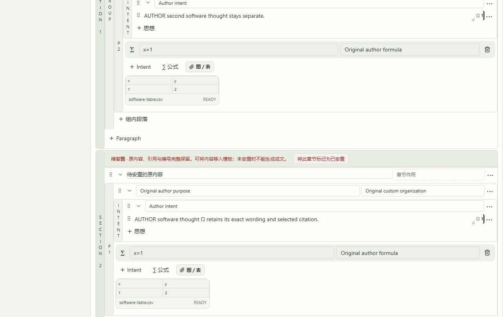

# 模板结构逐项修复与实跑 · 2026-10-08

**本批模板采用功能及列明实跑通过；原 118 条要求、G-01–G-11 全保留，11 组整体验收仍未完成。**

此前 [原来源 Build 与返修实机报告](../formal-native-revision-2026-10-08/acceptance.md) 是前一阶段的独立证据，保持原文。本报告记录其后新增产品修改、原生浏览器和正式构建复验，不能把前报告“未改产品”的阶段说明解释成当前阶段。

旧页面采用样本只改标签，且用任意第一个 Layer3 字符串作为 Intent，可能选中 rationale。本批改为读取固定 Skeleton/Paper 版本、完整预览有来源的结构、勾选部分单元，再通过一个原子操作保存空结构和模板实例。只读取明确的 layer3.intent；UNKNOWN 留空。默认 INSERT，REPLACE 必须明确确认；旧内容与稳定编号完整进入可见待安置区域。未安置内容、空 Intent 或空思想都会阻止生成。来源撤回、范围不符、摘要改变、版本冲突与改变原操作请求均拒绝且保持整库字节。

页面从固定作者版本明确选择整篇、章节、段落或 Intent，排除待安置目标；范围改变会清掉替换确认。原请求在发送前存入所属稿件，断线／刷新只核对同一操作，确定拒绝后先归档原请求与错误才重新预览。重试原采用时读取当前服务器文档；即使已撤销，也不会把模板重新应用。旧元数据接口兼容保留，新记录显式标记 UNVERIFIED_LEGACY_RECORD，不冒充已核实采用，也不重写旧记录。没有数据库迁移。

L2 逻辑关系放在段落标签的按需展开设置中，与 purpose/paradigm 分开；模板原 L2 分析单独只读保留。生成错误固定到实际提交的结构版本，编辑、Undo、Redo、刷新或模板采用清除过时定位与对应提示，迟到结果明确说明旧版本。

| 实跑范围 | 实际结果 |
|---|---|
| 完整来源预览／部分采用 | 2 个来源章节、3 单元完整预览；单单元采用不复制来源正文，不以 rationale 作 Intent；UNKNOWN 空槽保持 |
| 四层级 × 两方式 | Chrome 原生实际操作整篇／章节／组内段落／Intent 的 INSERT 与明确 REPLACE 共 8 种；各自 Undo，r9→r25 的 16 步实际版本与补偿修改逐一核验 |
| 原内容保护 | 每个采用与补偿版本逐条保留原思想全文／ID／已选 citation；公式与图表多重集合保持；每次补偿完整恢复初始文档和段落组 |
| L2 独立设置 | 实际 r4→r5 编辑逻辑关系，purpose/paradigm 空槽保持，来源 L2 不变；Undo 两步到 r7 |
| 离线与刷新 | HMR 后旧 r1 请求实际断线、刷新恢复、被服务器 r7 拒绝并归档；从 r7 重新预览的同一请求断线后刷新恢复，仅应用一次到 r8，Undo 到 r9 |
| 生成保护 | 早期 r4 实际拒绝空思想、未定 Intent 和待安置内容；最终代码严格等待 r10 空思想错误返回，Undo 后旧提示和定位消失；新增生成／模型任务均 0 |
| 正式构建实跑 | 隔离五阶段构建退出 0，实际产物在 3004 服务；组内段落选择单单元，明确 REPLACE r25→r26，Undo r26→r27，刷新完整恢复初始文档 |
| 撤销后原请求重试 | 对实际 r25→r26 原请求做服务 HTTP 重试，返回原采用记录与当前 r27，不重放；整库字节完全相同。此项是 HTTP 读回，不伪称额外浏览器操作 |
| 原返修副本 | 正式构建刷新原稿，服务器 r9 与 2 份未同步本地副本仍可见，没有打开、采用或清除这两份草稿 |

软件夹具稿件为 manuscript_c9bd5a665e5143eebb0ac01fbd36f74f，来源 skeleton_ed31db92a461c9df4ca56415cb0b70b1。本批夹具构造、PaperPool 导入和初始作者 r0→r1 由隔离服务建立；它们不是浏览器创建证明，不是学术来源、科学批准或模型输出。模板阶段新增实际模型调用为 0；前一阶段原 Build 语义模型完成的那 1 次调用继续由前报告保存，未重跑原 12 个层调用。

**最终完整回归：972 passed、20 条既有依赖警告，pytest 424.99 秒；完整检查执行 428.39 秒。** 新增 20 个模板保护用例覆盖四范围、插入／替换、并发只采用一次、失败原子回滚、来源／版本／跨稿件防护和每种采用撤销后重试。TypeScript、全部原配置类型检查、Ruff、17 个移动／分组和 8 个键盘坐标受控检查及完整控制器检查通过。运行前后所有被检查产品源码／测试摘要相同。全量 v1 与最终 v2 都是各自阶段的 972/20 记录，均保留；v2 包含最终范围选择功能。

隔离构建有两次保留失败：v1 副本缺相邻共享讨论文件；v2 补齐相同文件后在 RSC 阶段进程退出 0xC0000409，当时可用虚拟内存 855208 KiB。未把退出码单独当作内存因果证明；修正执行上下文，仅验证并暂停本批 dev 3004 实际 listener 78244，将 Node 堆与 Rust 工作线程设为有界后，v3 构建通过。没有关闭无关进程、修改保护／检查规则或覆盖原 dist。前端最初根 75360、Studio 63780 的旧回执作为历史保留，不能当作当前存活证明。

当前运行独立核实为 Studio 根 82248→实际 listener 83352／8877，以及正式构建根 35552→实际 listener 77500／3004；都绑定 127.0.0.1。前端从独立 scui-template-build-hb6xzpgj/writing-studio/dist 提供与构建摘要相同的文件，后台通过 current RSTV4/src 导入当前模板代码。原 3000 正式预览、已安装旧 wheel 和它们的旧产物没有更新；不能声称原预览已部署新模板。

原库最终重新验证全部 108 表、schema、物理字节、旧 5 稿件、7 ZIP、科学记录、4 条原讨论回执及原请求重试均保持；数据库 SHA a2ff55ebd92c70c7d86c643c203c2eda8dea57ac4ae42cf302b33b0bf9805d1b。副本本批变化仅为本夹具稿件及列明的 7 张作者编辑／模板／候选缓存表；所有旧记录逐行保持，模型表和科研批准记录不变。新夹具的 Field/Track/来源及初始文档另由建立前后全表前缀核验，并保留建立前整库备份。

新版副本实际再点 ZIP 和 PDF 都失败：浏览器各收到 204、缺 Access-Control-Allow-Origin，分别记录 MissingAllowOriginHeader；页面 Failed to fetch，下载事件没有完成。同一精确地址以 Origin 3004 在服务 HTTP 返回 200、正确跨域头；ZIP 20724 字节／SHA c8690ba64bb08dbe3935cc2751ae52e15a983842d718c137938609a1bd5a94c4，PDF 8144 字节／SHA 8a2b53a55ddab052ec0625475cefbb1c21b1f0229cf70057956bbaecd6e0d754，PDF 与 ZIP 成员完全相同，ZIP 与原记录相同。这些是最新一份 12:50 PM 固定包，区别于前报告另一份包的摘要。不能据服务成功宣称浏览器通过，也不能凭差异断定某个扩展／设置的具体原因；没有绕过浏览器保护或改写下载代码。

浏览器文件上传的扩展文件 URL 权限仍等待此前问题的用户答复，本批没有变更设置或将 HTTP 解析冒充浏览器上传。全页截图曾超时，后继只读页面与正常可见范围截图成功；native waitFor(hidden) 曾以 no_matches 超时，后继实际读回保存结果；一次关闭动画中的 Undo 点击没有效果，独立 r18 原样保留，再从新鲜页面点击完成 r18→r19。旧泛 alert 的生成观察竞争不记通过，后继严格等待 r10 的特定失败并核对补偿。session 的一次 progress 写入 OSError22 发生在构建执行前，下一次受管理命令正常完成。所有失败与修正原记录保存，未降低断言。

| 原组 | 当前证据与剩余范围 |
|---|---|
| G-01 固定对象／选区 | 延续前批固定版本与精确来源证据；全对象与最终完整流程继续 |
| G-02 历史／建议采用 | 旧讨论／建议／采用证据与原回执保持；完整多来源、全部／部分采用浏览器链继续 |
| G-03 草稿／返回 | 前批真实离线／双标签保护，本批模板原请求断线恢复及 2 份旧本地副本保持；全部工作面的完整合验继续 |
| G-04 Done | 延续前批实机证据；最终纵向流程复验继续 |
| G-05 数字引用 | 原固定 PDF、引用与产物保持；真实完整阅读／回查合验继续 |
| G-06 活动意见／稳定编号 | 前批关联／解除／删除／恢复原 ID 证据保持；本批未重复这些编辑，最终合验继续 |
| G-07 导入 | 前批含空行单条、重复提示、101 全预览与选 100 保存原文证据保持；浏览器四格式文件上传未完成 |
| G-08 结构／模板 | 本批空结构完整预览、部分采用、四层级插入／替换、待安置保留、原请求恢复及独立 L2 文字设置实跑通过；显式 Subsection、真实嵌套来源模板、L2 关系图／多节点高级关系、作者显式内容对应和完整模板拖放仍未完成 |
| G-09 返修／材料 | 两轮固定基线、16 文件入口与回复历史保持；新版实际 ZIP／PDF 仍失败，完整交付流程未通过 |
| G-10 FieldKG／Track | 前一阶段原三单元语义调用完成且空对象正确保留；学术来源七类内容质量、真实科学决定和完整工作面仍待验 |
| G-11 全流程 | 原 118 条和上述全部范围保留；Collection→科学审阅→实验→成文→返修→发布真实批准与失效恢复全链未完成 |

平面旧 Skeleton 只证明连续章节标题及段落单元，本批没有凭空推断 Subsection 或段落组来源边界，也没有把 Paragraph Group 当作 Subsection。四层级采用与 L2 文本入口不能替代这些剩余要求。Mission 保持 verification、gate pending_review；独立 DSPy ALL、Honc 和控制守卫的工作与历史完整保持。

