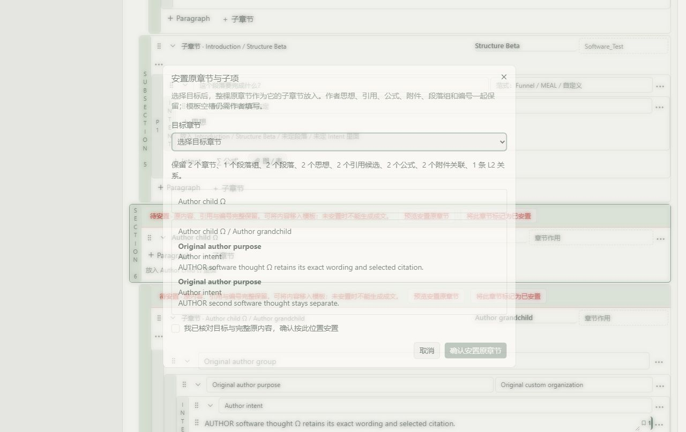
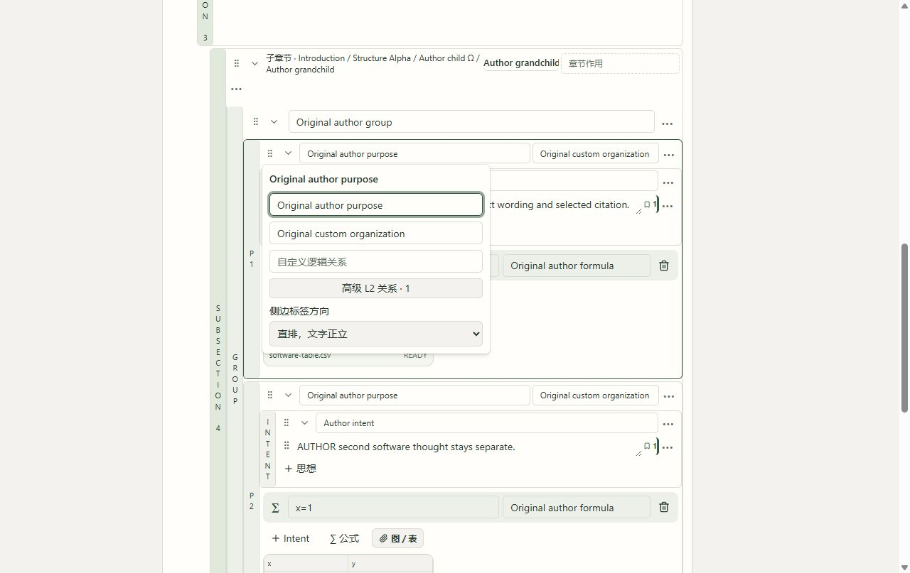

# 模板拖入、原稿安置与刷新撤销实跑 · 2026-10-09

**本批列明功能通过；原118条和G-01–G-11全部保留，11组整体验收仍未完成。下载实测已按用户要求暂停。** [前批层级与关系证据](../formal-hierarchy-2026-10-08/acceptance.md)及模板报告逐份重新核验，未重写原证据。本批使用原软件夹具，不冒充真实学术来源或科学批准。

左侧固定来源模板可以拖到整篇入口，或已安置章节、段落、Intent后方。拖放先打开完整结构与部分选择的采用预览，默认插入空槽，作者确认后才写入。鼠标实际拖到子章节并采用；键盘Enter抓取、ArrowRight移动到作者Intent、Enter打开准确目标的预览，取消不采用。早期ArrowDown两次没有改变到预期目标，保留为未通过；后继ArrowRight的可见目标与预览路径独立记录，不冒称全部方向或落点已实跑。

替换后的待安置原章节可以先审阅完整原子树，再明确选择已安置目标章节。目标改变会撤销确认；取消不写入。确认后将完整原树作为目标子章节移动，保留原思想全文／ID、段落组、已选引用、2公式、同一CSV及L2关系与条件。模板空思想槽仍需作者填写；本功能是整树安置，不能冒称任意段落或Intent槽逐个对应。

Undo／Redo完整快照按稿件、API和同一标签保存到sessionStorage，包含保存修订和完整当前文档；恢复前精确核对，拒绝外部稿件、变更修订、正文差异和错误形状。最多保留各100份；不匹配原记录保留，后继明确新编辑时先归档。不可用存储有独立提示。本标签刷新可以恢复历史，关闭标签及所有工作面历史合验仍未完成。无历史按钮禁用；聊天和对话框保留自身文字撤销行为。

| 实际操作链 | 独立结果 |
|---|---|
| r49→50 INSERT，r50→51 UNDO | 鼠标拖放预览并确认；完整撤销回r49 |
| r51→52 REPLACE，r52→53 原树安置 | 原child／grandchild一起待安置；取消及目标改动无写入；明确放入Structure Alpha后保存一个完整操作 |
| r53→54 UNDO，r54→55 REDO | r54精确等于r52，r55精确等于r53，包括全文及关系 |
| r55初次刷新后Undo | 实际没有操作，r55保持；失败诊断保留。修复历史存储后重新实跑，不把旧失败算通过 |
| r55→56 REPLACE，r56→57 原树安置 | 再次替换，并明确放入另一个Structure Beta；两个同名Alpha的完整路径分开 |
| 刷新r57→58 UNDO；刷新r58→59 REDO | 每次刷新后实际按钮可用并分别保存；r58精确等于r56，r59精确等于r57 |
| r59→60→61 两次逐项Undo | 精确恢复r56，再恢复r55，原树回Introduction／Structure Alpha |
| Chat Ctrl+Y／Ctrl+Z | 重做栈可用时聊天快捷键没有重做原稿；撤销只改变未发送测试草稿，随后草稿清空，0新讨论／模型任务 |
| r61→62 Enter；空Thought Delete | Enter添加一个同级空思想，PENDING且0引用；Delete仍保留3个思想输入，不删块 |
| r62→63 Shift+Enter | 同一新思想仅增加换行，ID保持，思想数仍3；原思想全文与引用不变 |
| r63→64→65 两次原稿Ctrl+Z | 分别撤销换行与新增思想；r64精确等于r62，r65精确等于r61 |

共16条新增真实持久操作，最终软件稿manuscript_c9bd5a665e5143eebb0ac01fbd36f74f为r65。完整恢复的树为Introduction→Structure Alpha→Author child Ω→Author grandchild，原2段落组在grandchild；Structure Beta为Alpha的同级子章节。原2思想、引用决定、2公式、CSV以及同一L2边和完整条件保持。最终刷新选中已撤销测试思想时明确提示原对象不可用并回本稿，随后实际打开原段落关系，没有改到外部对象。旧返修稿服务器r9与2份未同步本地副本继续可见，未打开／采用／清除。

实际Generate预检在已安置原树后拒绝3个空模板Thought和未定Intent，不再报原树UNPLACED，0新增生成及模型。服务HTTP重试原r55采用请求，在r61返回原r56操作和当前r61完整文档，全库字节不变；该回执不是额外浏览器重试。原完整内容为软件资料，来源模板仍只有平面section字符串；没有根据数字标题、L1–L4或Paragraph Group猜测来源父子关系。

**最新完整回归992 passed／20条依赖警告，pytest 441.67秒，完整检查445.64秒。** 23项控制器、静态和后端全量检查均0，运行前后源码摘要一致。前端17移动／分组、8键盘坐标、7层级、7原树安置、6历史保存以及7固定文件交付受控契约均通过；最终类型检查、原配置类型感知lint和差异检查通过。69项聚焦后端v4已通过，早期lint标签／语义元素失败及修复记录保留。

全量后唯一产品差异是studio-api.ts拒绝204及空Blob的保护，防止把空响应报为已发起下载；该精确差异单独封存，最终类型／lint／构建通过，没有声称最后保护已经浏览器实下载。最终隔离五阶段构建5.22秒，正式source／原dist不变。一次构建Rust分配失败保留，后继仅本批低内存构建设置Node512MiB／单线程通过，未结束无关进程。

固定文件同源入口只接受指定稿件投稿包及artifact读取，使用配置的loopback服务，拒绝任意API路径、外部地址、路径穿越、外部Origin、写入和重定向。转交原字节／文件名／类型，不转交cookie，保留410不可用错误。实际原跨端口ZIP下载浏览器收到空204／无允许头；同一服务HTTP200含正确允许头、ZIP20724字节和PDF8144字节。同源浏览器仍收到空204，曾显示交给下载但未得到保存回执，保留为失败；原生PDF文件链接下载也失败。工具禁止打开浏览器下载状态页后没有绕过。用户回复“it's pop out , dont test this download thing first”，并说明手动关闭；此后停止所有实际下载尝试，关闭本批下载测试标签，没有修改浏览器设置。

TXT选择器本次也实跑，但扩展本地文件权限阻断setFiles，未上传文件；MD／DOCX／PDF没有冒称实跑。用户此前上传权限问题没有获授权，未修改Allow access to file URLs。文件选择器阻断发生在本地文件读取前，所给TXT路径未送到服务。浏览器文件工作流与真实批准继续保留缺口。

原库108表、schema、物理字节、旧5稿件、7ZIP、4讨论回执及精确重试保持，SHA a2ff55ebd92c70c7d86c643c203c2eda8dea57ac4ae42cf302b33b0bf9805d1b。副本108表／schema／原行核对，变化仅本稿声明作者／模板／缓存表；本批0新增真实生成及模型、0数据库迁移。当前前端根46628、后端根32792的127.0.0.1 listener、实际创建时间／命令／祖先和编译字节再次核对。原3000／8874／8885预览和无关DSPy ALL／Honc／控制守卫工作保持。

观察器一度把UNPLACED错写为UNPLACED_ORIGINAL，诊断保存实际字段并以正确合同重验；采用重试观察器错猜adoption返回键，后继核对实际idempotent_replay和原operation版本。一次新单元命令在错误工作目录失败，后继修正测试文件相对目录并正常受控执行；一次键盘预览等待猜错标题，随后读取实际“采用模板结构”完成目标核验。全部错误保留，没有削弱产品断言或把失败记作成功。

| 原组 | 本批证据与剩余范围 |
|---|---|
| G-01 固定对象／选区 | 原证据保留；撤销掉选中测试思想后刷新明确提示对象不可用并回本稿，没有定位到其他对象；完整纵向流程继续 |
| G-02 历史／建议采用 | 原讨论和回执保留；多来源、全部／部分建议采用全链继续 |
| G-03 草稿／返回 | 同标签刷新 Undo／Redo 新实跑通过；未同步旧2份本地副本保持，全部工作面及失效恢复继续 |
| G-04 Done | 前批实机证据保持；完整纵向流程复验继续 |
| G-05 数字引用 | 本批原引用决定、公式和附件原字节保留；完整成文阅读／回查继续 |
| G-06 活动意见／稳定编号 | 原意见关联／解除／恢复证据保持；本批原作者对象和L2稳定编号保持，完整意见全链继续 |
| G-07 导入 | 本次TXT选择器被扩展本地文件权限阻断，未上传；四格式浏览器验收仍未完成，未修改权限 |
| G-08 结构／模板 | 完整模板鼠标与键盘拖入预览、整树原稿明确安置、跨刷新撤销／重做、Enter／Shift+Enter／Delete新增实跑通过；真实来源层级、任意Intent槽对应、复杂多边及完整层级生成仍待验 |
| G-09 返修／材料 | 同源固定文件入口和基础契约已完成；ZIP／PDF原生保存未通过，用户要求先暂停下载实测，未再触发 |
| G-10 FieldKG／Track | 原语义和科学记录保留；真实学术七类内容质量、真实用户批准和完整工作面仍待验 |
| G-11 全流程 | 原118条／11组保留；Collection→科学审阅→实验→成文→返修→发布及失效恢复整链仍未完成 |

mission保持verification、gate pending_review；本报告不代表科学、知识、生产或阶段批准。

