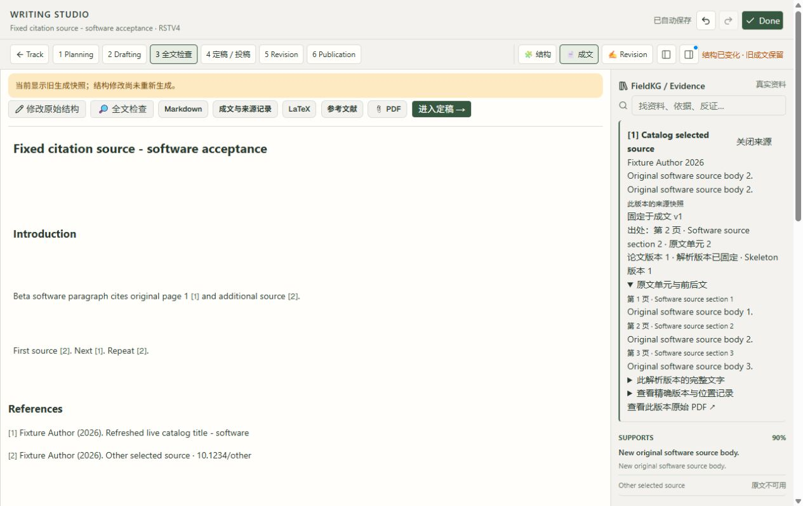

# 类型化建议、部分采纳与历史来源 — 2026-10-12

G02 原定义的 Studio 浏览器软件验收通过，CH-10 的结构建议／来源候选／措辞建议及部分采纳／完整采纳／拒绝均实际执行。**原始 118 项、11 组范围保留；11 组整体验收仍未完成。**

| 实际路径 | 实际结果 |
| --- | --- |
| 结构建议两项，仅勾选段落目的 | r11 → r12，只改 Alpha 的 purpose；未采纳的新增 Intent 不存在。原思想、引用、对象和版本保留。 |
| 来源候选一项，完整采纳 | r12 → r13，只给 Beta 加入未选中的来源候选，citation_mode 为 PENDING；原来两个 selected=true 引用和全部原文字不变。 |
| 措辞建议 Check → Review，UTF-16 0..5，拒绝 | 保存 REJECT／0 项；文档、修订、操作和修改记录与拒绝前逐字一致，没有操作 ID。 |

每个回复出现后都先只读核对“未自动改稿”。各作者决定的 source 与原回复完全一致，均固定于原 v3／r10；接受决定分别记录作决定时的 r11、r12，而非把旧来源重写成当前版本。三条记录与原实际调用、原文、原建议、选中的 change ID、实际操作、完整前后文相连。关闭页面重新打开及刷新后，旧消息仍可显式定位原 v3／原段落／原选区，决定记录仍可查看；已采纳项不能再次勾选。

来源测试明确以 Beta v3 为主来源，另加入 Alpha v1 为比较来源。两个定位入口分别返回原 v3／r10 第二段、原 v1／r1 第一段。建议使用的是比较来源保存的第 2 页原 Evidence、旧题名及原文，不使用当前目录已更新的题名。来源仍为候选，不是科学批准。

实际回查暴露新缺陷：回复的来源按钮只读主 v3，而需要的来源保存在比较 v1，于是误报未保存来源。保留原失败屏幕与文字。只修前端 studio-workspace.tsx，使用现有的严格历史接口检查本消息的主来源和比较来源，按固定模型输入的同样顺序优先主来源，并用匹配原生成版本的所属稿件打开原来源。旧独立会话仍使用既有接口。没有生成来源、猜测原文、放宽后端验证或替换当前成文。

修复后实际按钮打开 v1 第 2 页、原题名、原单元和第 1／3 页前后文；主 v4 阅读仍保留。又复验原 G01 两段旧定位／mark 和主 v3 来源按钮。载入提示仍没有内部引用 ID。

验证：最终前端类型检查、类型感知静态检查、7 项固定文件交付检查、差异检查及隔离生产构建通过；原源目录和原 dist 不被构建改写。后端源码没有新增改动，保留已通过的 1067 测试／20 既有警告基线；本批前端变更在该完整后端测试之后，新增浏览器路径已实跑。新前端只替换本任务已核实身份的 3008 进程，8881 后台和数据库保持。

全部 109 表只读核查，审计前后数据库物理字节不变；旧记录保留，20 个原生成产物大小和 SHA256 仍一致。共 4 个成功生成版本，当前 author r13／active v4／last_generated r11，明确显示结构已变化而旧成文保留。本批没有生成新成文或推进阶段。现有 14 个模型调用为 6 VALIDATED／7 RETURNED／1 REJECTED；本批 3 个讨论调用均为明确的软件测试 gateway，原实际 Gemini 拒绝记录仍原样保留。软件界面验收不证明科学有效性或专家批准。

审计工具首次将 sqlite_sequence 当作不可变应用记录，因合法追加两条消息（9 → 11）失败；原失败工具和完整上下文保留。后续精确要求唯一消息计数器与真实记录数同步，其他历史应用记录不变，没有放宽产品断言或重跑模型。封存首轮读取的是无变化的可访问性差异；改为原来同时保存的完整 DOM 快照，仍要求完全相同的失败文字，原封存工具与失败上下文保留。拒绝后的比较窗口仍打开，定位器因此未找到背景文章；根据实际窗口状态记录了拒绝结果，没有重复提交。

原 G01 的 118 个封存文件及更早来源报告继续保留。此处的文件数量与原始需求数量是不同概念。G03 仍待验：重新打开时保存的旧对象状态与当前成文显示之间已留观察记录，不能用手动定位成功代替完整恢复验收。随后继续 G04–G11，最后执行完整 11 组流程；mission 仍 verification／pending_review，未批准任何阶段、知识或科学结果。
