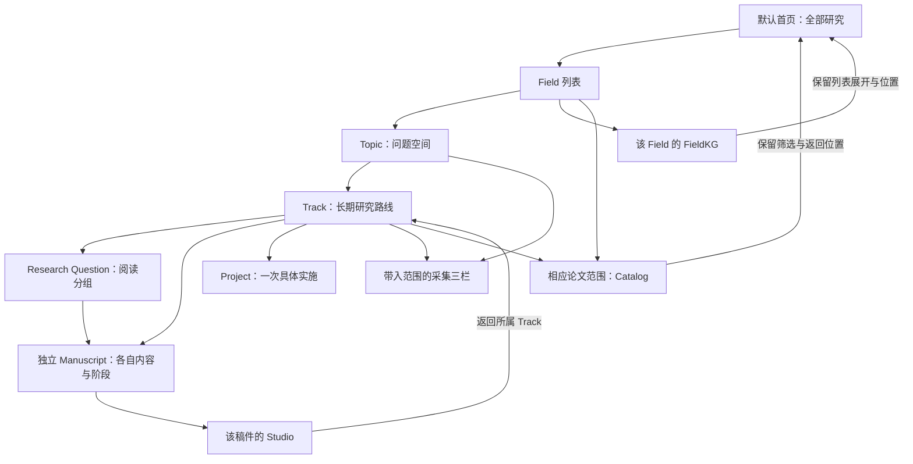
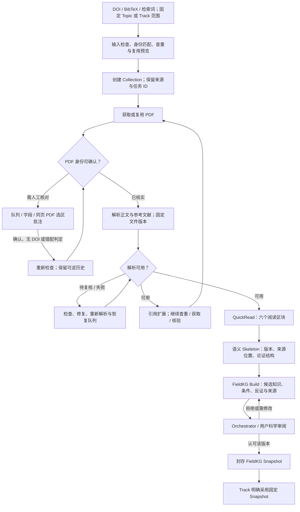
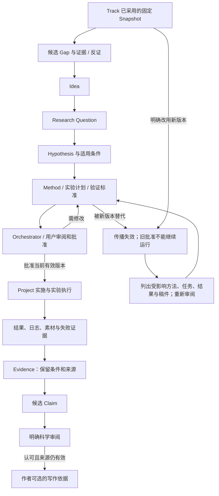
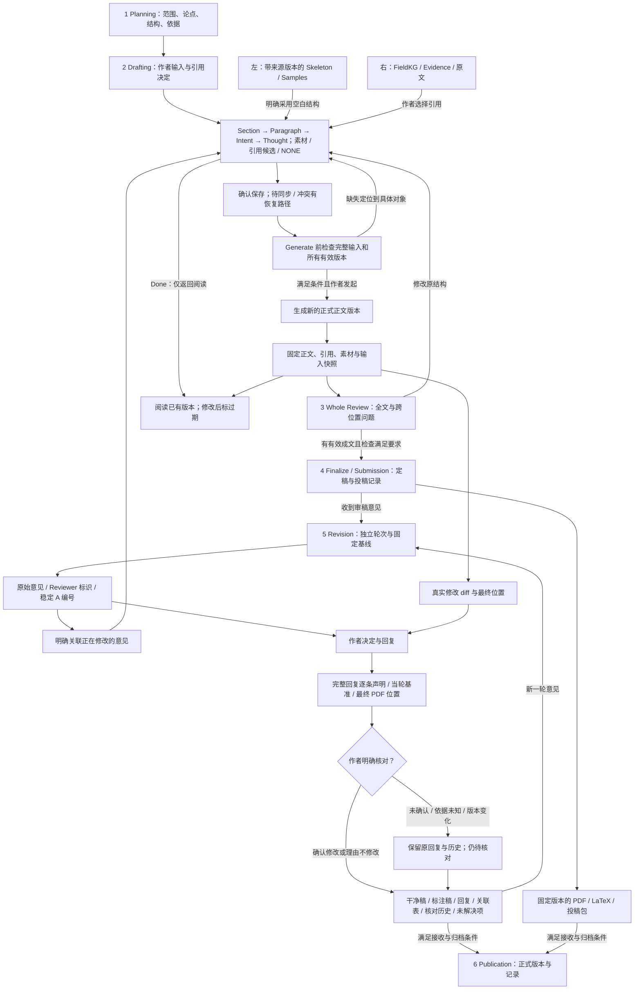
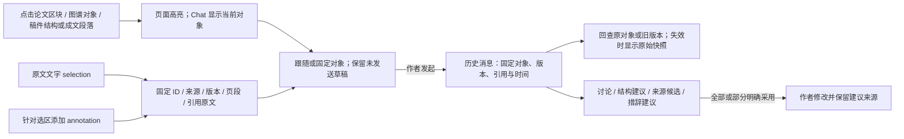

# Scholar / RSTV4：完整流程与界面验收地图

## 2026-10-07 Catalog 选入与范围筛选续批

已有论文搜索／分页／选入及真实 ID／原始输入保留已接通，按本次范围筛选后复用文件。范围／论文变化与过期租约拒绝旧筛选发布；新排名和旧章节绑定保护完成。
848 完整测试、41 相关契约和隔离 10 次 HTTP 请求通过；声明 schema 8→9、新增空筛选输入表，原资料与回执保持。
原 118 条／11 组、浏览器与完整科学 pipeline 仍未整体通过。
[本批证据](C:/Users/Alandelone/CodeSpace_Local/UuMA/docs/reviews/scholar-rstv4-2026-09-30/formal-catalog-selection-2026-10-07/acceptance.md)。

## 2026-10-06 稿件科学依据复核续批

完整新绑定提案／真实用户批准边界／原新绑定历史已接通；旧成文保留并标过期，待审与运行中变更拒绝生成晋升。
833 全库测试与隔离软件 25 次 HTTP 请求通过；原资料经声明的 7→8 迁移保持，真实科学批准、浏览器与全 11 组仍未完成。
[本批证据](C:/Users/Alandelone/CodeSpace_Local/UuMA/docs/reviews/scholar-rstv4-2026-09-30/formal-scientific-binding-2026-10-06/acceptance.md)。

## 2026-10-06 文件撤回与来源重审续批

当前文件可明确重新审核；原版本保留、关联任务停住并更新凭据、研究节点／稿件标为待重审。
文件重新批准不会恢复旧科研依据，也不会跳过原解析质量待办。823 全库／45 相关测试与实际控制器 9 次 HTTP 请求通过。
原 97 表／schema／DB 字节、5 稿件／7 ZIP／8 科研表／原调用保持。原 118 条／11 组仍未整体通过。
[本批详细证据](C:/Users/Alandelone/CodeSpace_Local/UuMA/docs/reviews/scholar-rstv4-2026-09-30/formal-source-withdrawal-2026-10-06/acceptance.md)。

## 2026-10-06 身份／解析审核恢复续批

已接明确身份复核、源文件／原任务保护、原 PDF 参考文献补选与解析复检、不可覆盖候选和独立输出版本。
819 全库后端、83 相关及 8 审核交互检查通过；实际控制器连 HTTP，真实 MinerU 发布 3 正文块／6 引用／1 解析版本。
原 96 表旧行／5 稿件／7 ZIP／8 科研表／原调用保持，v7 空审核动作表与版本迁移明确记录。
原 118 条／11 组仍未整体通过，审批撤回／科研重审／通用纠错／完整 pipeline／浏览器继续。
[本批详细证据](C:/Users/Alandelone/CodeSpace_Local/UuMA/docs/reviews/scholar-rstv4-2026-09-30/formal-review-recovery-2026-10-06/acceptance.md)。

## 2026-10-06 Collection 开始与状态续批

真实 Topic／Track 采集、只读 Catalog／PDF 预览、原子创建、并发与完整回执重试、任务详情、暂停／继续和单步重试已接通。
最新 815 全库后端、9 Collection／11 总览／17 工作面检查通过；实际软件 HTTP 与 BibTeX worker 入 Catalog 已跑，检索仍只入队。
原 96 表旧行、5 稿件／7 ZIP／8 科研表／原调用保持；v6 的两个可空字段迁移明确记录，旧字节不冒充相等。
原 118 条／11 组仍未整体通过，审核恢复／完整 pipeline／浏览器继续。[本批详细证据](C:/Users/Alandelone/CodeSpace_Local/UuMA/docs/reviews/scholar-rstv4-2026-09-30/formal-collection-workflow-2026-10-06/acceptance.md)。

## 2026-10-05 Studio 历史与精确筛选续批

旧 Studio 讨论可定位实际原对象／版本并明确选用原来源；当前对象按类型／修订／成文版本筛选，更早记录加入同稿件稳定 cursor。关闭旧来源清历史深链接，保留当前页面偏好与返回地址。155 后端、39 讨论、6 历史辅助、17 工作面及生产构建通过；实际接口核对 6 稿件／10 消息（含 6 原独立消息）。原 4 请求重试 0 新调用，全部 96 表／DB 字节与上一导航批次相同。

原 118 条／11 组未整体通过；完整多来源／旧父链、恢复／KG／Collection／模板／上传／浏览器／全流程继续。[本批证据](C:/Users/Alandelone/CodeSpace_Local/UuMA/docs/reviews/scholar-rstv4-2026-09-30/formal-studio-history-2026-10-05/acceptance.md)。

## 2026-10-05 讨论来源定位与返回续批

历史主／额外来源接精确页面定位、原调用回查与返回原讨论；Studio 旧成文只读打开原版本，原问题不因定位而提交或覆盖。152 项相关后端、35 项讨论状态、17 项研究工作面及生产构建通过；实际控制器接真实 HTTP 核对原 4 个来源。原 4 请求重试 0 新调用，原稿件／包／科研表／调用证据保持。

发现并修复同版本启动改写 schema 应用时间：上一批文件摘要不相同的失败保留；修正后全部 96 表与数据库字节不变。原 118 条／11 组尚未整体通过，浏览器和完整 pipeline 继续。[本批证据](C:/Users/Alandelone/CodeSpace_Local/UuMA/docs/reviews/scholar-rstv4-2026-09-30/formal-discussion-navigation-2026-10-05/acceptance.md)。

## 2026-10-05 Studio 共享讨论续批

Studio 原四区接入与 Catalog／FieldKG／Track 相同的固定来源讨论机制，保留原对象选区、讨论批注、生成版本和明确建议采用。主集成 140 项后端通过，最后原文核对 29 项复验通过（重叠计数）；最终 28 项状态检查、编译和生产构建通过。新软件验收稿件真实两轮讨论通过，最终原研究 v1／v2 与两轮 Studio 的原请求重试 0 新调用。原 5 份稿件、7 ZIP、8 科研表及旧模型调用行保持；仅增加 2 条本稿件所属的真实 writing_chat 记录。

原 118 条／11 组及正式产品整体验收仍未完成。旧独立 Studio 会话未自动迁移，共享导航／回查定位、完整 KG／Collection、离线／上传、模板、浏览器和全流程继续。[本批证据](C:/Users/Alandelone/CodeSpace_Local/UuMA/docs/reviews/scholar-rstv4-2026-09-30/formal-studio-shared-discussion-2026-10-05/acceptance.md)。

## 2026-10-05 多轮讨论与历史原调用续批

Catalog／FieldKG／Track 已接明确父链续问、历史分支、新讨论、来源及原调用记录；84 项后端、26 项受控讨论、工作面 14／总览 11／返回 11 与静态检查通过。实际续问 1 次完整带入上批问题与回复；旧／新请求重试 0 新调用。原 5 份稿件、7 个 ZIP、科研状态不变。
Studio 共享会话和完整建议采用、跨模块定位、浏览器与全流程仍待完成；原 118 条／11 组及整体验收保持未完成。详情：[本批证据](C:/Users/Alandelone/CodeSpace_Local/UuMA/docs/reviews/scholar-rstv4-2026-09-30/formal-research-conversation-2026-10-05/acceptance.md)。

## 2026-10-05 Catalog／FieldKG／Track 固定来源 Chat 续批

新对象／原文／版本／选区／讨论批注和历史来源已接通研究界面代码；67 项相关后端、18 项受控讨论、原工作面 14／总览 11／返回 11、静态检查通过。隔离实际模型 1 次、批注与固定来源历史／原请求重试通过；原 5 份稿件、7 个 ZIP 和科研状态不变。
浏览器尚未新增验收，多轮会话／Studio 共享 Chat／完整建议采用及跨模块定位继续。原 118 条、11 组与整体验收保持未完成。详情：[本批证据与边界](C:/Users/Alandelone/CodeSpace_Local/UuMA/docs/reviews/scholar-rstv4-2026-09-30/formal-research-chat-2026-10-05/acceptance.md)。

## 2026-10-05 FieldKG／Track 工作面与固定快照采用通过本批代码验收

50 项相关后端与附加 1 项双快照采用检查、14 个受控工作面交互、原总览／返回各 11 项、静态检查通过。
隔离 HTTP 从已保存来源完成候选审阅、Snapshot 密封、Track 明确采用、新的 Living Build与稿件往返；12 条保存凭据、原五工作区／七包不变、0 次新模型调用。
图与来源列表使用真实 ID／原文／版本，九步 Build 事实与科研里程碑、稿件阶段分别展示。原 118 条／11 组和 G-10 均未关闭。
Catalog／FieldKG Chat、语义图谱完整类型、范围文献、科学重审恢复、浏览器与窄屏继续。详情：[本批 FieldKG／Track 证据与剩余范围](C:/Users/Alandelone/CodeSpace_Local/UuMA/docs/reviews/scholar-rstv4-2026-09-30/formal-fieldkg-workspace-2026-10-05/acceptance.md)。

## 2026-10-04 全局 Field／Topic／Track 编辑与返回位置通过本批代码验收

32 项相关后端（含原 Catalog 与 Track-first／FieldKG 合约）、11 组受控总览交互、11 项返回来源／上下文检查、静态与正式构建通过。
隔离实跑新增两个 Field、一个明确共享 Topic、两条 Track 和三篇独立稿件；重复新增不复制、冲突不覆盖，原五工作区与七下载包保持一致，0 次新模型调用。
原蓝色五层列表保留，新增／修改接入真实保存；刷新／跨视图／Studio 返回保留稳定 ID、展开、焦点与位置。浏览器与窄屏视觉尚未复核。
本批不关闭 G-10：完整 FieldKG／Track／Pipeline 工作面、范围文献与归属理由、Catalog Chat、科学范围变更仍须接通和实跑。原 118 条、11 组及整体继续。
详情：[本批总览证据与剩余范围](C:/Users/Alandelone/CodeSpace_Local/UuMA/docs/reviews/scholar-rstv4-2026-09-30/formal-research-overview-2026-10-04/acceptance.md)。

## 2026-10-04 返修回复逐条核对与历史保存通过本批验收

171 项核心相关回归通过；独立只读历史接口新增后，3 项针对性检查通过。最终静态、5 组受控回复交互和正式构建通过。
两轮保留稿件实跑：回复声明对应最终 PDF，第 1 页可见文本第 4 行；原样句子不算已修改。两条核对记录与新包导出一致，旧六包及原稿件保持一致，0 次新模型调用。
RE-11／RE-13／RE-14 已补明确作者确认、精确选区、版本／关联过期、理由拒绝、本地草稿、冲突与原提交重试。原 118 条、11 组及整体未关闭；素材／来源／浏览器及全部 Field／Topic／Track 总览继续。
详情：[本批回复核对证据与剩余范围](C:/Users/Alandelone/CodeSpace_Local/UuMA/docs/reviews/scholar-rstv4-2026-09-30/formal-response-review-2026-10-04/acceptance.md)。

更新：2026-10-02 · Asia/Kuala_Lumpur  
用途：开发说明与验收。箭头表示要求中的流转与依赖；不表示当前实现已经全部通过。

本图与 [118 条 UI 要求](C:/Users/Alandelone/CodeSpace_Local/UuMA/docs/reviews/scholar-rstv4-2026-09-30/ui-requirements-preservation.md)、[统一工作台建议](C:/Users/Alandelone/CodeSpace_Local/UuMA/docs/reviews/scholar-rstv4-2026-09-30/unified-workspace-proposal.md)一起使用。状态证据仍以本轮现场观察和[前次代码验收](C:/Users/Alandelone/CodeSpace_Local/UuMA/docs/reviews/scholar-rstv4-2026-09-30/acceptance.md)为准。

## 1. 先看到什么，再进入哪里

FieldKG 聚焦选中的 Field。全部 Field / Topic / Track 的列表属于默认首页；Track 的科研路线、Project 与稿件从 Track 详情查看。稿件属于 Track，RQ 关联是分组关系，不能把同稿复制成不同写作记录。

## 2. 资料到科研依据的完整链

引用扩展不是固定三层自动截止；应按最新获取决定、去重、任务预算、停止条件与权限运行。身份核验、解析核验与科学审阅是各自独立的状态，任何一个“完成”都不能替代另两个。

当前缺口：界面“开始采集”仍禁用；PDF / Parse 核对后的完整恢复链待验；FieldKG 完整页面待接入；Skeleton 的科学质量另需真实来源与参考样本验收。

## 3. Track 的实施与批准依赖

新 Claim 保持候选状态。Knowledge 的权威记录、查询投影与科研执行记录按既有契约分工；界面不直接写底层知识库或绕过审阅。

前次已复现的未闭环问题：间接依赖／稿件失效传播不足；Method 被替代后，旧批准的实验仍可执行。不能用导航集成或示例状态把它们算作已修复。

## 4. Studio 六阶段、作者输入与成品

Stage 4 包含定稿与投稿，不能再加一套相互冲突的投稿阶段轴。Done 不等于 Generate、检查完成或阶段推进。没有成功正文版本，不能进入要求正文的后续阶段；前次已复现零版本仍可推进到 Publication 的问题，仍待修复。

## 5. 每个工作区到 Chat 的共同链

科学批准、Snapshot 采用和 PDF 身份核验继续走各自的明确动作。点击对象只选择上下文，不自动发送、改稿或批准。

## 6. 按阶段交付什么证据

| 范围 | 要求清单 | 可验收的证据 | 当前结论 |
|---|---|---|---|
| 首页与归属 | OV-01–OV-11、TR-01–TR-07 | 真实层级 / 多稿独立内容与阶段 / 回原 Track 与位置 | 总览部分现场核实；完整 Track 工作面有缺口 |
| Catalog / PDF | CA-01–CA-09、RV-01–RV-10 | 全局筛选排序、列偏好、PDF 同页原文定位、审批与撤回历史 | 表格 / 详情 / PDF 页面已见；完整恢复和 Chat 待接 |
| 采集与加工 | AC-01–AC-09 | Collection ID、查重复用、任务与失败恢复、来源链 | 启动入口禁用；真实完整执行待验 |
| FieldKG | KG-01–KG-09 | 来源 / 条件 / 反证、审阅、封存、Track 显式采用 | 后端契约与部分能力已见；完整工作面待接 |
| 作者结构与阅读 | ST-01–ST-29 | 四区、点击、拖动、折叠、引用、保存恢复、生成版本 | 正式 UI 部分核实；G-01–G-05、G-08–G-09 待补 |
| 六阶段与成品 | WF-01–WF-10 | 有效版本、阶段门、真实编译与包内一致性 | 完整模型 / 编译 / 成品链未在本轮实跑 |
| Revision | RE-01–RE-14 | 固定基线、稳定编号、意见导入、实际 diff、回复关联、恢复 | 正式 UI 编号漂移与活动上下文缺口已复现 |
| 统一 Chat | CH-01–CH-10 | 原对象 / 选区 / 标注 / 版本 / 历史返回 / 明确采用 | Studio 对象跟随核实；跨模块完整链新增待实现 |

开发交付需填写：对应要求 ID → 正式组件 / 服务 → 操作步骤 → 数据 / 版本 → 保存及返回证据 → 截图 → 剩余缺口。交互预览仅供检查整合方式，不能替代上述正式验收。

## 2026-10-08 实验计划与受控执行续批

已接通 Project 元数据、完整实验计划清单、批准读回、唯一一次执行与恢复、结果 Evidence→待审阅 Claim。951 完整软件测试、49 相关／10 控制场景及 Chrome 隔离软件实跑通过，原 108 表／全部旧资料和回执保持。真实科研批准、内容质量及完整 11 组仍继续；原 950+1 失败保留。
[本批验收报告](C:/Users/Alandelone/CodeSpace_Local/UuMA/docs/reviews/scholar-rstv4-2026-09-30/formal-experiment-controls-2026-10-08/acceptance.md)。

## 2026-10-08 原来源 Build 与返修实机续验

真实原语义句柄完成三单元观察并返回空对象；来源是 Formal／Formal／UNKNOWN 软件文档，不发明科研 Gap，不做科学批准。意见多关联／结束／删除后不关联／恢复编号、含空行单条、重复提示、101 条完整预览及原文保存、真实离线／双标签不覆盖／本地副本刷新恢复、两轮固定基线与回复历史实机通过。四种文件 HTTP 解析通过；浏览器文件权限未开启，ZIP／PDF 下载被客户端阻止，均不记通过。952 完整后端／20 warnings、全部控制器与源文件稳定，原108表／schema／DB字节／旧资料和回执保持。G-08 完整模板与全部11组继续；mission verification／pending_review。
[本批实机证据与11组剩余范围](C:/Users/Alandelone/CodeSpace_Local/UuMA/docs/reviews/scholar-rstv4-2026-09-30/formal-native-revision-2026-10-08/acceptance.md)。

## 2026-10-08 模板结构修复与实跑

ST-13/ST-14 当前新增：固定来源的完整平面章节／段落／Intent 空结构预览、部分采用、四层级默认插入／明确替换与原内容待安置，8 种浏览器实跑及各自补偿撤销，正式构建追加单单元替换／撤销／刷新到 r27。ST-11 当前新增：独立 L2 文字关系及只读原分析；高级关系图仍未完成。实际断线原请求恢复、旧版本拒绝、撤销后原请求不重放与全库字节保护通过；原 2 份本地副本保持。972 全量／20 warnings、最终类型／控制检查及隔离正式构建通过，源码稳定，原108表／schema／DB字节／旧稿件产物和回执保持。平面来源不证明 Subsection，不能据此关闭 G-08；浏览器文件上传仍待权限答复，正式副本 ZIP／PDF 也实跑失败。真实科学批准及全部11组纵向验收继续，mission verification／pending_review。
[本批证据、源码与11组剩余范围](C:/Users/Alandelone/CodeSpace_Local/UuMA/docs/reviews/scholar-rstv4-2026-09-30/formal-template-2026-10-08/acceptance.md)。

## 2026-10-08 子章节与高级 L2 关系修复／实跑

ST-05/06/07/11/13/14/20 当前新增：显式五级父子章节、整树移动／删除／折叠、Paragraph/Intent/Thought 作者关系含义／条件编辑与关系图，嵌套目标模板替换、完整待安置子树与Undo。Chrome逐项保存后独立核对r27→r49的22持久记录，快速动作合并及本地Undo与服务器历史差异不记为逐项通过；后继独立操作完整文档精确比较。最终992/20全量、69聚焦、前端类型／控制检查和隔离五阶段构建通过，源码稳定；108表/schema/原库物理字节与旧产物／回执保持，0新真实模型或生成任务。真实来源嵌套模板、模板拖放、显式作者对应和复杂多边／完整生成合验继续，G-08及全部11组仍未关闭；浏览器上传／ZIP/PDF和真实科学批准仍待完成，mission verification/pending_review。
[本批完整证据与11组剩余范围](C:/Users/Alandelone/CodeSpace_Local/UuMA/docs/reviews/scholar-rstv4-2026-09-30/formal-hierarchy-2026-10-08/acceptance.md)。

## 2026-10-09 模板拖入、原稿安置、刷新撤销与思想键盘实跑

ST-07/08/13/14/20/21本批新增：鼠标拖模板到子章节采用，键盘Enter→ArrowRight→Enter打开准确Intent范围预览；完整原树先审阅后明确安置，变更目标清确认，取消不写入；同标签跨刷新Undo/Redo逐次持久保存。Enter新增空思想、Delete不删空块、Shift+Enter同思想换行，两次Ctrl+Z精确恢复。r49→r65共16新增持久操作，原全文/ID/引用/组/公式/附件/L2条件保持。最新全量992/20、最终前端静态及正式隔离构建通过；全量后仅空下载响应保护精确差异，未冒称该保护原生下载已验。原108表/schema/字节/旧稿件产物和回执保持，0新真实模型/生成、0迁移。真实来源层级、任意Intent槽对应和复杂多边/生成仍待验；TXT选择器被扩展权限阻断，四格式未验，用户明确先暂停下载实测，下载不记通过。原118条/11组保留，mission verification/pending_review。
[本批完整证据与11组剩余范围](C:/Users/Alandelone/CodeSpace_Local/UuMA/docs/reviews/scholar-rstv4-2026-09-30/formal-template-mapping-2026-10-09/acceptance.md)。

2026-10-09 封存复核补记：本次TXT选择器先报扩展权限阻断，提供的opinion.txt路径同时不存在；真实TXT夹具为opinions-101.txt。因此本次不证明真实文件传输或解析，四格式仍未完成。原报告和所有275份证据保持，新说明见[最新本批报告](C:/Users/Alandelone/CodeSpace_Local/UuMA/docs/reviews/scholar-rstv4-2026-09-30/formal-template-mapping-2026-10-09/acceptance-v2.md)与manifest-v2.json。用户要求先暂停下载实测，未再尝试下载或打开选择器；原118条/11组及pending_review保持。

## 2026-10-09 明确来源层级与原生替换续批

明确解析层级／来源位置／部分祖先结构／嵌套目标内部层级已修复，并在新隔离副本实跑 7 次持久操作至 r8，撤销后原作者文档、引用、组、公式、CSV、L2 完整保持。原 108 表／来源摘要／golden 字节保持，schema13 仅在新副本新增一张来源 outline 表。1015 完整测试、23 流程检查通过；修复弹窗后原生整篇替换、待安置生成阻止及刷新撤销通过。真实科学来源与任意 Intent 空槽对应等仍待验收；下载按用户要求暂停。原118／全部11不关闭，verification/pending_review 保持。
[本批证据](C:/Users/Alandelone/CodeSpace_Local/UuMA/docs/reviews/scholar-rstv4-2026-09-30/formal-source-hierarchy-2026-10-09/acceptance.md) · SHA256 `e22e3f95599d06cb797680bd4fce88e612e8feba462afe2464c95a12300837e2`。
