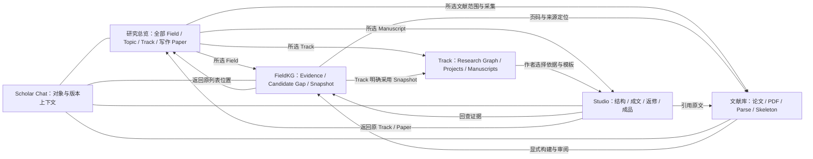

# Scholar 统一工作台建议

更新：2026-10-02（延续 9 月 30 日验收，10 月 1 日完成详细复核）  
状态：统一方向已获同意；118 条保留要求、具体实现差距与完整流程已重整，讨论预览已扩展。正式产品页面、路由和后端保持本轮复核时的状态；mission gate 仍为 pending_review。

## 本轮修订：以既有精修 UI 为整合基准

上一版预览省略了已经逐步确认的交互细节，不能据此替换正式页面。本轮重新核对文档、正式实现和独立测试库的浏览器界面，结果见[完整 UI 要求与保留验收清单](C:/Users/Alandelone/CodeSpace_Local/UuMA/docs/reviews/scholar-rstv4-2026-09-30/ui-requirements-preservation.md)。清单包含 118 条要求的设计理由、逐项行为、来源版本、当前证据、具体差距和复验方法。[完整流程与界面验收地图](C:/Users/Alandelone/CodeSpace_Local/UuMA/docs/reviews/scholar-rstv4-2026-09-30/full-pipeline-and-ui-acceptance.md)进一步展开采集、FieldKG、Track 实施、Studio 六阶段和 Chat 的全部依赖与返回路径。

整合应完整带入：

- **研究总览**：全部 Field 的可展开列表、大小与蓝色层级、Topic／Track 采集入口、稿件独立阶段、返回位置。
- **Catalog**：已确认的轻量表格、AND／OR 嵌套 Filter、多条 Sort、Columns 显隐／顺序／宽度与偏好、分页、详情抽屉和可审核状态跳转。
- **原文核对**：左队列、中字段、右连续 PDF；同页原文选区、DOI／标题浮动批注、自动保存、高亮、无 DOI／错配判定及可逆历史。
- **Studio V6**：左样本、中嵌套作者结构、右证据、底部 Chat；竖标签、六点拖动、引用书签、面板开关、自动保存／离线与冲突、Undo／Redo；成文阅读与原结构修改；Revision 意见预览、关联修改、删除／恢复和真实回复材料。
- **统一 Chat**：保持点击对象与 selection／annotation 的关联，再扩展到 Catalog 和 FieldKG；稳定对象／版本、引用原文和历史返回作为共同契约。

本轮也发现正式实现与文档有差距，例如成文段落讨论没有稳定 ID、视图偏好刷新不恢复、Stage 3 修改结构时缺少约定的 Done、Revision 可读编号随删除变化。这些必须按清单补齐；不能因为旧文档写“已落地”就直接算验收通过。FieldKG／Track 完整工作面、采集启动与审核恢复仍需接通。

## 推荐方向

一个 Scholar 工作台，**研究总览为默认首页，另有文献库 Catalog、知识图谱 FieldKG、论文工作台 Studio 三个工作区**。顶部可见四个导航入口：研究总览／文献库／知识图谱／论文工作台。把成文、全文检查、返修、版本及成品放在 Studio 内。

本次修正来自用户指出遗漏的 Field／Topic／Track 列表，并复核「END检查 Paper Catalog 导入流程 (2)」中的已接受界面。上一版把研究总览降为 Catalog 二级视图，弱化了全局研究入口；此处替换该建议。

三者是随时可切换的工作区。用户可以边补文献、边检查图谱、边改稿；它们各自保留运行和审阅状态。科研批准、Snapshot 采用和成功成文仍遵守各自条件。

设计判断：保留已接受的研究总览、轻量目录表格与嵌套写作编辑器，增加一致的应用导航、研究上下文、来源回查和 Chat 入口。布局变化保持克制，少量状态反馈，按工作区调节信息密度。

## 三个工作区包含什么

| 一级入口 | 二级视图 | 用户主要动作 |
|---|---|---|
| 文献库 Catalog | 论文目录、采集任务、待审核；论文详情内有 PDF、References、QuickRead、Skeleton | 发现／采集、查重、核对原文、阅读、与 Scholar 讨论 |
| 知识图谱 FieldKG | 所选 Field 的图谱与证据列表、Build 与 Snapshot、候选 Gap | 回查来源、理解关系、审阅候选、封存可复现版本；Track 明确采用快照 |
| 论文工作台 Studio | 结构编辑、成文／全文检查、Revision、版本与成品；现有六阶段保留 | 作者写思想、选引用与素材、生成正式版本、审稿、返修、导出和归档 |

Research Track 的科研路线、实验、Projects 和 Manuscripts 从研究总览的 Track 行进入详情。Track 采用 FieldKG Snapshot，保存自己的科研决定和批准状态；相关结果可在 Studio 被引用。FieldKG 的普通查看以一个 Field 为范围，跨 Field 查询必须明确发起。

## 研究总览默认首页

保留原讨论中的可展开列表，无大标题、无列标题：

```text
Field A                                  [FieldKG] [文献 —] [一个状态]
  Topic A                                           [—] [＋采集]
    Track A                                         [—] [＋采集]
      Research Question
        Paper A · 独立写作阶段 → 对应 Studio
      Paper B · 独立写作阶段   → 对应 Studio
Field B                                  [FieldKG] [文献 —] [一个状态]
Field C                                  [FieldKG] [文献 —] [一个状态]
```

- 先看到全部 Field，逐层展开 Topic／Track／Research Question／Paper。Field 到 Paper 同一蓝色系由深到浅，行高延续约 76／67／59／52／46px。
- Field 行的 FieldKG 进入该 Field 的知识空间；不把全局 Field 列表放进某个 FieldKG。
- Track 行进入其 Research Graph、Projects、采用的 Snapshot 和 Manuscripts。Topic 是可重复研究的问题空间；Track 是长期科学路线；Project 是一次具体实施。
- 写作 Paper 直接属于 Track，可关联零个或多个 Research Question。问题下显示 Paper 是阅读分组；没有关联问题的稿件直接显示在 Track 下。同一 Track 的多篇稿件保留独立阶段和内容。
- 中间文献数量以唯一 `paper_id` 计数；无已确认归属时显示「—」。点击数量应进入对应文献范围；父层按集合并集计数，跨 Track 关联不复制论文。该关联尚未完整落地，预览不伪造数量。
- Topic／Track 的「＋采集」从所选行带入研究归属，打开 DOI、BibTeX、检索词三栏；Field／Research Question 不直接发起采集。
- 从 FieldKG／Studio 返回时恢复原列表展开状态、原 Track／Paper 位置及上下文。

依据：[研究总览与采集验收文档](C:/Users/Alandelone/CodeSpace_Local/RSTV4/docs/research-overview-v1.md)、[研究领域模型](C:/Users/Alandelone/CodeSpace_Local/RSTV4/docs/research-domain-model.md)。早期 Thread 与当前 Track 指同一层，界面统一为 Track。

### 采集如何运行

1. 从 Topic／Track 点「＋采集」，输入归属已经固定。
2. 接通后的正式行为：验证 DOI／BibTeX／检索词、查重与 PDF 复用，创建 Collection 并返回其 ID；缺失 PDF 进入获取、核验、解析、参考文献扩展、QuickRead／Skeleton 等队列。
3. 提交后回到发起的 Topic／Track。点右侧状态可看 Collection、各任务数量、最近活动与同一 Track 的采集记录；不需要一直停留在输入页。
4. 当前原界面「开始采集」仍禁用，未创建任务。本次整合预览同样只演示输入与往返。已有任务状态及更新时间能够说明记录中的进度，实时运行健康还需独立心跳证据；不能用「RUNNING」或示例状态推断 worker 正在运行。

## 统一导航建议

**推荐总览首页＋顶部工作区。** Studio 已有左样本、中编辑、右证据三列；顶部导航能保留编辑宽度。上方放 Scholar、研究总览、三个工作区、研究范围／上下文和 Chat。各页的 Filter、采集、Build、Generate 留在对应内容区。

上下文示意：Field / Topic / Track / 当前论文、节点或稿件。Catalog 可以浏览全部论文；FieldKG 在 Field 范围查看知识；Studio 的稿件属于 Track。切换工作区可携带已有范围，目标页面不支持的层级仍保留为关联信息，不能静默换研究范围。

备选：紧凑左侧导航，同样包含研究总览和三个工作区。适合以后增加模块，但 Studio 需要可收起侧栏；当前推荐顶部方案。

研究总览直接作为默认首页。沿用已精修的层级列表与右侧单个摘要状态。

## Chat 的统一方式

## 2026-10-07 Catalog 选入与范围筛选续批

已有论文搜索／分页／选入及真实 ID／原始输入保留已接通，按本次范围筛选后复用文件。范围／论文变化与过期租约拒绝旧筛选发布；新排名和旧章节绑定保护完成。
848 完整测试、41 相关契约和隔离 10 次 HTTP 请求通过；声明 schema 8→9、新增空筛选输入表，原资料与回执保持。
原 118 条／11 组、浏览器与完整科学 pipeline 仍未整体通过。
[本批证据](C:/Users/Alandelone/CodeSpace_Local/UuMA/docs/reviews/scholar-rstv4-2026-09-30/formal-catalog-selection-2026-10-07/acceptance.md)。


## 2026-10-06 稿件科学依据复核续批

完整新绑定提案／真实用户批准边界／原新绑定历史已接通；旧成文保留并标过期，待审与运行中变更拒绝生成晋升。
833 全库测试与隔离软件 25 次 HTTP 请求通过；原资料经声明的 7→8 迁移保持，真实科学批准、浏览器与全 11 组仍未完成。
[本批证据](C:/Users/Alandelone/CodeSpace_Local/UuMA/docs/reviews/scholar-rstv4-2026-09-30/formal-scientific-binding-2026-10-06/acceptance.md)。


## 2026-10-06 文件撤回与来源重审续批

当前文件可明确重新审核；原版本保留、关联任务停住并更新凭据、研究节点／稿件标为待重审。
文件重新批准不会恢复旧科研依据，也不会跳过原解析质量待办。823 全库／45 相关测试与实际控制器 9 次 HTTP 请求通过。
原 97 表／schema／DB 字节、5 稿件／7 ZIP／8 科研表／原调用保持。原 118 条／11 组仍未整体通过。
[本批详细证据](C:/Users/Alandelone/CodeSpace_Local/UuMA/docs/reviews/scholar-rstv4-2026-09-30/formal-source-withdrawal-2026-10-06/acceptance.md)。


## 2026-10-06 身份／解析审核恢复续批

已接明确身份复核、源文件／原任务保护、原 PDF 参考文献补选与解析复检、不可覆盖候选和独立输出版本。
819 全库后端、83 相关及 8 审核交互检查通过；实际控制器连 HTTP，真实 MinerU 发布 3 正文块／6 引用／1 解析版本。
原 96 表旧行／5 稿件／7 ZIP／8 科研表／原调用保持，v7 空审核动作表与版本迁移明确记录。
原 118 条／11 组仍未整体通过，审批撤回／科研重审／通用纠错／完整 pipeline／浏览器继续。
[本批详细证据](C:/Users/Alandelone/CodeSpace_Local/UuMA/docs/reviews/scholar-rstv4-2026-09-30/formal-review-recovery-2026-10-06/acceptance.md)。


## 2026-10-06 Collection 开始与状态续批

真实 Topic／Track 采集、只读 Catalog／PDF 预览、原子创建、并发与完整回执重试、任务详情、暂停／继续和单步重试已接通。
最新 815 全库后端、9 Collection／11 总览／17 工作面检查通过；实际软件 HTTP 与 BibTeX worker 入 Catalog 已跑，检索仍只入队。
原 96 表旧行、5 稿件／7 ZIP／8 科研表／原调用保持；v6 的两个可空字段迁移明确记录，旧字节不冒充相等。
原 118 条／11 组仍未整体通过，审核恢复／完整 pipeline／浏览器继续。[本批详细证据](C:/Users/Alandelone/CodeSpace_Local/UuMA/docs/reviews/scholar-rstv4-2026-09-30/formal-collection-workflow-2026-10-06/acceptance.md)。


## 2026-10-05 Studio 历史与精确筛选续批

旧 Studio 讨论可定位实际原对象／版本并明确选用原来源；当前对象按类型／修订／成文版本筛选，更早记录加入同稿件稳定 cursor。关闭旧来源清历史深链接，保留当前页面偏好与返回地址。155 后端、39 讨论、6 历史辅助、17 工作面及生产构建通过；实际接口核对 6 稿件／10 消息（含 6 原独立消息）。原 4 请求重试 0 新调用，全部 96 表／DB 字节与上一导航批次相同。

原 118 条／11 组未整体通过；完整多来源／旧父链、恢复／KG／Collection／模板／上传／浏览器／全流程继续。[本批证据](C:/Users/Alandelone/CodeSpace_Local/UuMA/docs/reviews/scholar-rstv4-2026-09-30/formal-studio-history-2026-10-05/acceptance.md)。


## 2026-10-05 讨论来源定位与返回续批

历史主／额外来源接精确页面定位、原调用回查与返回原讨论；Studio 旧成文只读打开原版本，原问题不因定位而提交或覆盖。152 项相关后端、35 项讨论状态、17 项研究工作面及生产构建通过；实际控制器接真实 HTTP 核对原 4 个来源。原 4 请求重试 0 新调用，原稿件／包／科研表／调用证据保持。

发现并修复同版本启动改写 schema 应用时间：上一批文件摘要不相同的失败保留；修正后全部 96 表与数据库字节不变。原 118 条／11 组尚未整体通过，浏览器和完整 pipeline 继续。[本批证据](C:/Users/Alandelone/CodeSpace_Local/UuMA/docs/reviews/scholar-rstv4-2026-09-30/formal-discussion-navigation-2026-10-05/acceptance.md)。


## 2026-10-05 Studio 共享讨论续批

Studio 原四区接入与 Catalog／FieldKG／Track 相同的固定来源讨论机制，保留原对象选区、讨论批注、生成版本和明确建议采用。主集成 140 项后端通过，最后原文核对 29 项复验通过（重叠计数）；最终 28 项状态检查、编译和生产构建通过。新软件验收稿件真实两轮讨论通过，最终原研究 v1／v2 与两轮 Studio 的原请求重试 0 新调用。原 5 份稿件、7 ZIP、8 科研表及旧模型调用行保持；仅增加 2 条本稿件所属的真实 writing_chat 记录。

原 118 条／11 组及正式产品整体验收仍未完成。旧独立 Studio 会话未自动迁移，共享导航／回查定位、完整 KG／Collection、离线／上传、模板、浏览器和全流程继续。[本批证据](C:/Users/Alandelone/CodeSpace_Local/UuMA/docs/reviews/scholar-rstv4-2026-09-30/formal-studio-shared-discussion-2026-10-05/acceptance.md)。


2026-10-05 当前进度：Catalog／FieldKG／Track 固定来源讨论与多轮续问已接入，并通过本批代码／真实接口验收；保留旧问题、原文、选区、批注和实际调用。Studio 原有交互保持，接入共享会话及完整跨模块定位继续；尚未整体通过验收。[当前证据](C:/Users/Alandelone/CodeSpace_Local/UuMA/docs/reviews/scholar-rstv4-2026-09-30/formal-research-conversation-2026-10-05/acceptance.md)。

**用户已明确要求：Studio 原有点击对象、selection／annotation 进入 Chat 的体验必须保持；Catalog 与 FieldKG 也支持同样的选中、高亮和讨论方式。** 完整要求见保留清单 CH-01–CH-10。

1. 每页同一个可见 Chat 入口。Catalog 和 FieldKG 可用右侧讨论抽屉；Studio 延续底部讨论区，保留左样本、右证据的空间和现有历史筛选。
2. Studio 点击 Section／Paragraph／Intent／Thought 时，编辑器与 Chat 同步显示选中对象。文字 selection 进入 Chat 时显示引用片段；添加 annotation 时显示其内容锚点。讨论发送由作者发起。
3. Catalog 点击论文／详情区块，或选 PDF、Parse、QuickRead、Skeleton 原文片段，可将对象／选区放入 Chat；保留既有打开详情、状态跳核对及“标为 DOI／标题”的原文操作。
4. FieldKG 点击节点、边、Evidence、候选 Gap、Snapshot 或其来源区块，图／列表与 Chat 同步高亮；可添加 selection 或 annotation，并返回原证据。
5. 输入区显示对象类型、名称、层级路径、稳定 ID 对应的可读标签、固定版本及引用原文。PDF 使用文件版本＋页码／词范围；图谱使用 Field＋节点／边／Snapshot；稿件使用 Manuscript＋对象／文本范围＋修订或生成版本。作者可移除引用片段。
6. 支持“跟随当前选择”与“固定本次对象”。换对象后输入的作用范围必须可见；切换页面保留会话、草稿和返回位置，不能静默把旧草稿挂到另一篇论文。
7. 每条发送后的消息固定对象、版本、引用和时间；旧消息不会随新选择改写。内容移动仍可定位；修改后标明旧版；删除后保留历史来源，不能挂到邻近内容。点击历史消息可回查原对象或旧版本。
8. 普通讨论、结构建议、来源候选与措辞修改分清；全部／部分采用与拒绝仍由作者显式操作。科研批准、Snapshot 采用和审核闭环按其语义服务执行。

2026-09-30 提案时的实现事实（历史基线）：Studio 结构区选中对象更新 Chat 已核实；完整文字选区／annotation、成文版本锚点与历史返回仍有缺口。Catalog 尚无正式 Chat，FieldKG 完整工作面尚未接入。这些是本次整合要补齐的行为，上一版导航预览未实现完整契约。

## 跨页面联系



从证据跳到原文、从稿件引用跳到证据，使用稳定 ID 并保留返回位置。多个打开对象可在浏览器新标签打开。以后统一同一站点入口，旧 Catalog 和 Studio 深链接需要兼容；具体地址待用户批准方案后确定。

## 视觉与交互原则

- 延续已有低饱和蓝色研究层级与轻量分隔。统一基础字体、控件、圆角、选中和错误状态；写作页的结构侧标签仍保留语义区别。
- 每页保持一个清楚的主动作：Catalog 开始采集、FieldKG 创建 Build／审阅、Studio Generate。浏览与审阅动作分别命名。
- 待审核、等待全文、解析失败、需要科学复核、当前采集范围完成分别显示，避免一个“完成”覆盖不同状态。
- 图谱同时提供证据列表；选择节点展示来源和审阅状态。列表是长文本、键盘和小屏使用的可靠路径。
- 侧栏可收起，窄屏改为按需打开；控件有可见标签和键盘焦点；长标题不挤坏布局；状态更新可被读屏工具感知。
- 切换前确保稿件内容已确认保存；等待同步和版本冲突须明确提示并提供保留／恢复路径。
- 示例和空库明确标注；不要用虚构统计或假运行状态填充画面。

## 实施顺序（按详细清单接入与验收）

| 顺序 | 范围 | 验收 |
|---|---|---|
| 1 | 用完整 UI 清单固定现有组件；公共导航、上下文、旧链接兼容、返回与草稿保护 | OV／CA／RV／ST 各项有对应组件；首屏全部 Field；原交互、筛选、选区、保存与展开位置保持 |
| 2 | Studio selection／annotation／Chat 完整链，再扩展 Catalog／FieldKG | CH 各项：对象与版本固定、原文引用、选中高亮、草稿与历史保留、旧对象回查、显式采用 |
| 3 | Studio／Revision 细节差距与后端闭环 | G-01–G-09；另验真实 Collection 启动、审核复检恢复、科研依赖失效、旧方法拒绝执行、稿件版本阶段门 |
| 4 | FieldKG、Track、Pipeline 完整视图及 Studio 成品 | KG／TR／AC／WF／RE 各项，真实来源、科学状态、产物与实际修改可回查，不以示例入口代替验收 |

统一外壳不会自动解决既有代码和质量问题。PaperSkeleton 科学质量仍单独验收，见 [前次验收报告](C:/Users/Alandelone/CodeSpace_Local/UuMA/docs/reviews/scholar-rstv4-2026-09-30/acceptance.md)。

## 本次添加的设计技能

- `web-design-guidelines`：来自 [Vercel 官方技能](https://github.com/vercel-labs/agent-skills/tree/main/skills/web-design-guidelines)，安装于 `C:/Users/Alandelone/.codex/skills/web-design-guidelines`。已读取实时 [Web Interface Guidelines](https://github.com/vercel-labs/web-interface-guidelines/blob/main/command.md)，用于导航、标签、焦点、深链接、草稿保护与状态设计。
- `design-taste-frontend`：来自 [作者仓库](https://github.com/Leonxlnx/taste-skill/tree/main/skills/taste-skill)，安装于 `C:/Users/Alandelone/.codex/skills/design-taste-frontend`。当前默认版本为 v2 experimental。作者将密集产品工作台／数据表列为范围之外；本方案没有将营销页的 Hero、动画或视觉实验规则套到科研界面。

## 已同意的方向与下一步基准

沿用用户已同意的方向：**研究总览默认首页＋顶部三个工作区；FieldKG 围绕所选 Field；Track 详情从总览进入；成品归 Studio；统一上下文与 Chat**。用户进一步要求先 double-check 所有既有 UI 与详细交互；本轮清单已完成这一步，并列出待补功能与待实跑项目。

10 月 2 日讨论预览已扩展为可检查的交互方案，覆盖下述核心操作。嵌套复杂筛选、多条排序、完整真实 PDF／骨架、模板替换／部分采用、附件与公式、完整旧结构、正式保存和真实输出等，继续以 118 条保留清单为完整基准，不能由预览代替。统一方向获同意不代表产品全流程已经验收通过。

## 2026-10-02：详细整合预览

保留总览首页、蓝色层级和顶部导航，并扩展这些交互：

- Catalog：22 个示例字段可显隐、调整顺序与数值列宽；Title / PDF 状态的 AND / OR 本地筛选；单字段排序、详情、来源摘录与三栏审核布局。正式合同仍要求嵌套类型筛选、多条排序、服务端全局查询及完整 PDF 原文批注。
- Studio：Samples、嵌套 Section / Paragraph / Intent / Thought、Sources、底部 Chat；选择联动、折叠、六点拖动及键盘移动、引用书签／NONE、空白模板插入、标签／Purpose／Paradigm、Enter 新思想、Undo／Redo、两栏开关、Done 返回阅读、固定示例成文与数字引用。
- Revision：固定示例轮次／基线，稳定 A 编号、单条意见／拆分预览／勾选确认、重复与超量提示、归档／恢复、正在修改的意见、结束上下文、关联当前对象。真实 diff、第二轮基线和回应包仍需正式服务。
- Chat：对象跟随／固定，selection 与 annotation 引用卡片，本地历史／当前对象筛选，固定 ID／版本／页码／原文，历史返回。旧结构只返回同 ID 的当前对象并提示旧版，完整历史结构阅读明确标为尚未接通；不会假装已有完整版本库。
- 保存范围：在预览里保留草稿、列设置、展开、稿件和讨论；快照上限 16 KiB，超量明确提示当前页仍保留而无法持久化。该机制不代表正式产品的服务端保存、离线恢复、双标签冲突或离开保护已实现。

本轮浏览器已确认：Catalog 的 Sky 筛选为 1 / 3、来源引用进入 Chat；Thought 跟随、NONE、空思想检查、annotation 原文和标注保留；Enter / Undo / Redo；归档 A01 后 A02 保持编号，恢复和修改上下文；Done 返回阅读并收两栏；FieldKG 节点与摘录进入 Chat；刷新恢复已选稿件／对象和本地引用。320 像素窗口的 Studio、Catalog、总览没有文档横向溢出，宽表仅在表内横向滚动。

Generate、身份审批、采集、正式导出与科学批准没有通过预览执行。上面的操作证据属于讨论预览；正式实现的 G-01–G-11 状态保持不变。


## 讨论预览核对

2026-10-01 补齐研究总览后，已在浏览器核对：

- 默认总览可见三个示例 Field；折叠 Field 隐藏其下所有层级，再展开恢复内容。
- Rural Electrification 行的 FieldKG 进入该 Field 范围，图谱标题及 Chat 上下文一致。
- 同一 Track 下两篇 Paper 分别进入对应标题和独立阶段的 Studio；Paper A 的作者思想在切换到 Paper B 再返回后保留。
- Track 详情包含采用的 Snapshot、科研路线、Project 和各自阶段的 Manuscripts；不混入 FieldKG 本地导航。
- Track 的「＋采集」带入 Field／Track 归属，打开 DOI／BibTeX／检索词三栏；返回恢复列表。开始按钮保持禁用。
- 总览在 1024 和 320 像素浏览器窗口下没有向右溢出；检查后恢复正常窗口。


同日首次工作区预览还核对了：

- Catalog → FieldKG → Studio 切换时，未发送的聊天输入保留。
- 固定 FieldKG 节点后进入 Studio，讨论对象保持固定；作者思想在离开再返回时保留。
- Studio 的「成文与版本」包含生成版本及 PDF、LaTeX、投稿包、回应包入口。
- 两种导航可切换比较；备用左侧导航可收起，并保留入口的可访问名称。
- 顶部方案在 1024 像素窗口下保留 Studio 三列；320 像素窗口下，Catalog 与 Studio 内容未向右溢出。

这些核对仅适用于本次讨论预览。正式产品的保存、版本约束、来源定位和科研执行仍须按前次验收报告逐项实现与验收。


